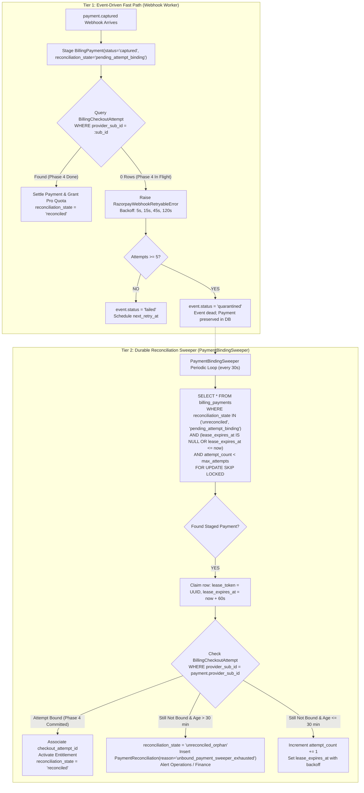
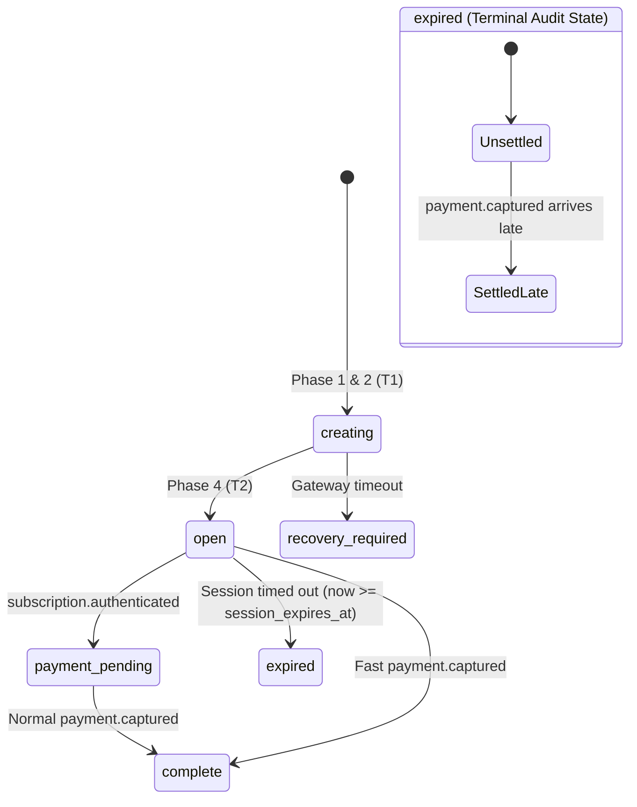

# Aptlyst AI — Step 5.2D.3.2.14
# Payment Association Hardening and Final Implementation Gate Report

**Document Status:** Final Pre-Implementation Gate & Concurrency Design  
**Target Milestone:** Authorization for Step 5.2D.3.3 (Razorpay Settlement Handlers)  
**Execution Mode:** STRICT MODE — READ-ONLY AUDIT (Zero repository modifications)  
**Alembic Head Verification:** `d1e2f3a4b5c6` (Verified single linear head)  

---

## 1. Executive Summary & Findings from Current Implementation

This audit resolves the four critical architectural concerns raised during the final review of Step 5.2D.3.2.13.

### 1.1 Findings from Current Codebase Inspection

1. **Payment-First Retry Exhaustion Vulnerability:**  
   In [`apps/api/app/services/billing/razorpay/webhook_engine.py`](file:///d:/Projects/V1/Aptlyst-AI/apps/api/app/services/billing/razorpay/webhook_engine.py#L345-L420), `BillingWebhookEvent` retries on failure up to `max_attempts = 5` with backoff intervals of 5s, 15s, 45s, and 120s ($\approx 185$ seconds total elapsed time). If Phase 4 of checkout creation experiences an extended delay, network partition, or worker restart exceeding 3 minutes, the webhook event transitions to `status = 'quarantined'`, `next_retry_at = NULL`. Because the webhook worker only queries `status IN ('pending', 'failed')`, the webhook event is permanently dead. Although [`BillingPayment`](file:///d:/Projects/V1/Aptlyst-AI/apps/api/app/models/payment.py#L429-L574) contains columns for sweeper claiming (`lease_token`, `lease_expires_at`, `attempt_count`, index `ix_billing_payments_sweeper_claim`), **no background payment sweeper currently exists in the codebase**. A captured payment staged during Phase 3 would silently remain `unreconciled` / `pending_attempt_binding` forever without granting entitlement.
2. **Cross-Record Association Gaps:**  
   In the existing database schema, `billing_checkout_attempts` has no direct `provider_payment_id` column (payment data is buried in JSONB `request_payload["verification"]`), `billing_payments` has no foreign key to `billing_checkout_attempts`, and index `ix_billing_checkout_attempts_provider_sub` is non-unique. The schema alone does not physically prevent one checkout attempt from linking to multiple payments, nor does it prevent multiple attempts from claiming the same payment.
3. **Loss of Terminal Expiration History in Late Capture:**  
   The previous report proposal mutated `BillingCheckoutAttempt.status` from `expired` to `complete`. This silently erased the historical business fact that the checkout session had officially timed out before customer payment arrived.
4. **Row-Lock-Before-Advisory-Lock in Agreement Handlers:**  
   Lines 98, 354, 593, and 717 of [`apps/api/app/services/billing/razorpay/agreement_handlers.py`](file:///d:/Projects/V1/Aptlyst-AI/apps/api/app/services/billing/razorpay/agreement_handlers.py) invoke `assert_valid_worker_lease()` (`SELECT ... FROM billing_webhook_events FOR UPDATE`) *before* acquiring the Level $0B$ subscription advisory lock (`acquire_razorpay_advisory_lock()`). While this does not cause deadlocks between webhook workers due to PK event isolation, it violates the strict $L_0 \prec \text{Row Locks}$ hierarchy and holds database row locks while waiting on advisory lock contention.

---

## 2. The Four Architectural Corrections

### 2.1 Correction 1: Durable Recovery After Payment-First Retry Exhaustion

A captured payment must **never silently remain pending forever**. We establish an independent, durable two-tier recovery architecture:



#### Sweeper Guarantees:
1. **Decoupled from Webhook Events:** The sweeper queries `billing_payments` directly via the existing partial index `ix_billing_payments_sweeper_claim`. Quarantining `BillingWebhookEvent` does not inhibit payment recovery.
2. **Process Restart & Crash Safety:** `lease_expires_at` ensures that if a sweeper process crashes mid-execution, the lease expires after 60 seconds, allowing a restarted process to reclaim and finish processing.
3. **Terminal Quarantine & Human Action:** If an attempt cannot be bound within 30 minutes, `reconciliation_state` transitions to `'unreconciled_orphan'`, and a `PaymentReconciliation` review case is created. No payment is abandoned.

---

### 2.2 Correction 2: Enforce Cross-Record Payment Association Integrity

To eliminate reliance on application diligence alone, we delineate the exact boundary between **PostgreSQL Database Constraints** and **Transactional Application Logic**.

#### Division of Responsibility Matrix

| Integrity Invariant | Enforced by PostgreSQL Database | Enforced by Application Transaction |
| :--- | :---: | :---: |
| **One initial checkout attempt cannot link to multiple captured payments** | **YES** (`uq_billing_payments_checkout_attempt` on `billing_payments(checkout_attempt_id) WHERE checkout_attempt_id IS NOT NULL`) | Yes (Redundant assert before assignment) |
| **One captured payment cannot link to multiple checkout attempts** | **YES** (Scalar UUID column `billing_payments.checkout_attempt_id` and unique index `uq_checkout_attempts_provider_payment`) | Yes (Validation under Level 0 lock) |
| **`BillingPayment.provider_payment_id` equals attempt's `provider_payment_id`** | No (Cross-table string equality cannot use standard foreign key when attempt starts with `provider_payment_id = NULL`) | **YES** (Enforced under $L_{0A}(\text{"organization"})$: verifies `payment.provider_payment_id == attempt.provider_payment_id`) |
| **Provider identity matches on both records** | No (Composite FK would require immutable composite unique key) | **YES** (Checked in settlement transaction: asserts `payment.provider == attempt.provider`) |
| **Merchant account & Environment match** | No | **YES** (Checked in settlement transaction: asserts `merchant_account_id` and `environment` match) |
| **Provider Subscription ID matches** | **YES** (`uq_checkout_attempts_provider_sub` guarantees at most 1 attempt per `(provider, merchant, env, sub_id)`) | **YES** (Settlement queries attempt exclusively by `provider_subscription_id`) |
| **Established association cannot be silently reassigned** | No | **YES** (Immutable Assignment Rule: if `payment.checkout_attempt_id is not None`, reject mutation with `ConflictError`) |
| **Recurring monthly renewals work without checkout link** | **YES** (`checkout_attempt_id` is nullable; partial unique index ignores `NULL` values) | **YES** (Renewal settlement sets `checkout_attempt_id = NULL`) |

---

### 2.3 Correction 3: Corrected Late-Capture Lifecycle

#### The Invariant: Refusal to Rewrite History
Converting an `expired` checkout attempt to `complete` violates auditability. An attempt that timed out **did expire**.



#### Exact Representation of Late-Capture Resolution:
1. **`BillingCheckoutAttempt` State:**
   - `status` remains strictly `CheckoutAttemptStatus.expired` (historical fidelity preserved).
   - `provider_payment_id` is populated with `pay_123` (establishing the bidirectional link).
   - `request_payload["settlement"]` is populated:
     ```json
     {
       "settlement_type": "late_capture_post_expiration",
       "payment_id": "pay_123",
       "captured_at": "2026-11-08T16:15:00Z",
       "expired_at": "2026-11-08T16:00:00Z",
       "settled_at": "2026-11-08T16:15:05Z",
       "entitlement_provisioned": true,
       "billing_period_id": "a1b2c3d4-..."
     }
     ```
2. **`BillingPayment` State:**
   - `checkout_attempt_id = attempt.id`
   - `status = 'captured'`
   - `reconciliation_state = 'reconciled_late_capture'` (if provisioned) or `'quarantined_late_capture'` (if conflict).
3. **`BillingInvoice` State:**
   - `processing_status = InvoiceProcessingStatus.processed` (if provisioned) or `quarantined`.
4. **`OrganizationBillingPeriod` State:**
   - If no active Pro entitlement exists and `line_period_end > now_utc`: provisions active Pro period with full quota, stamped with `subscription_id = sub.id`.
   - If an active Pro entitlement already exists: **zero quota provisioned**; fails closed to `PaymentReconciliation`.
5. **Duplicate Delivery & Idempotent Preservation:**
   - When duplicate `payment.captured` arrives, `uq_billing_payments_provider_payment` detects the existing row.
   - Under $L_{0B}(\text{"payment"}, \text{pay\_id})$, the handler inspects `reconciliation_state`.
   - Because `reconciliation_state` is already `'reconciled_late_capture'`, it exits immediately as an idempotent no-op.
   - Zero duplicate payments, zero duplicate billing periods.

---

### 2.4 Correction 4: Agreement Handler Lock-Order Correction (Design Specification)

#### Proposed Code Correction (Design Only — Zero Code Edits)

**Affected Files:**
1. [`apps/api/app/services/billing/razorpay/agreement_handlers.py`](file:///d:/Projects/V1/Aptlyst-AI/apps/api/app/services/billing/razorpay/agreement_handlers.py)
   - `handle_subscription_authenticated()` (lines 96–107)
   - `handle_subscription_activated()` (lines 352–363)
   - `handle_subscription_updated()` (lines 591–602)
   - `handle_subscription_completed()` (lines 715–726)

**Exact Code Transformation:**

```python
# =============================================================================
# BEFORE (Current Implemented Code - Inversion Hazard):
# =============================================================================
    # 1. Stale lease guard inside domain transaction (ACQUIRES ROW LOCK FIRST!)
    if ctx.lease_token and ctx.locked_by:
        await assert_valid_worker_lease(
            db=db,
            event_id=ctx.event_id,
            expected_lease_token=ctx.lease_token,
            expected_worker_id=ctx.locked_by,
        )

    # 2. Level 0 Advisory Lock on provider subscription identity (ADVISORY LOCK SECOND!)
    await acquire_razorpay_advisory_lock(db, "subscription", sub_id)

# =============================================================================
# AFTER (Corrected Hierarchy - Strict Level 0B before any Row Locks):
# =============================================================================
    # 1. Level 0B Advisory Lock on provider subscription identity FIRST
    await acquire_razorpay_advisory_lock(db, "subscription", sub_id)

    # 2. Stale lease guard inside domain transaction SECOND
    if ctx.lease_token and ctx.locked_by:
        await assert_valid_worker_lease(
            db=db,
            event_id=ctx.event_id,
            expected_lease_token=ctx.lease_token,
            expected_worker_id=ctx.locked_by,
        )
```

#### Security and Concurrency Proofs:
1. **Lease Validation Remains 100% Secure:** `assert_valid_worker_lease()` continues to execute *before* any domain record (`Subscription`, `BillingCheckoutAttempt`) is read or modified.
2. **Protection Against Lost Leases During Lock Contention:** If Worker A is delayed waiting for the advisory lock held by Worker B, Worker A's lease may expire during the wait. Under the corrected order, the moment Worker A acquires the advisory lock, `assert_valid_worker_lease()` immediately detects the expiration and rolls back with `StaleLeaseError` without mutating domain state.
3. **No Inversion Remains:** The Level $0B$ advisory lock is acquired before any row lock (`BillingWebhookEvent`, `Subscription`, `BillingCheckoutAttempt`). Strict ascending rank is preserved.
4. **Compatible with Worker Finalization:** The domain transaction commits/rolls back, releasing both locks, before `record_razorpay_webhook_outcome()` acquires a separate short row lock on `BillingWebhookEvent`.
5. **No Open Transactions Across HTTP Calls:** Agreement handlers perform purely local database operations. Zero HTTP calls are made while transactions or locks are open.

---

## 3. Exact Proposed Code and Schema Changes

### 3.1 Migration DDL (`20261108_1600_...`)

```sql
-- 1. Direct payment identifier on checkout attempts
ALTER TABLE billing_checkout_attempts
    ADD COLUMN provider_payment_id VARCHAR(255) NULL;

CREATE UNIQUE INDEX uq_checkout_attempts_provider_payment
    ON billing_checkout_attempts (provider, merchant_account_id, environment, provider_payment_id)
    WHERE provider_payment_id IS NOT NULL;

-- 2. Partial unique index on provider_subscription_id
CREATE UNIQUE INDEX uq_checkout_attempts_provider_sub
    ON billing_checkout_attempts (provider, merchant_account_id, environment, provider_subscription_id)
    WHERE provider_subscription_id IS NOT NULL;

-- 3. Foreign key on billing_payments
ALTER TABLE billing_payments
    ADD COLUMN checkout_attempt_id UUID NULL
        CONSTRAINT fk_billing_payments_checkout_attempt
        REFERENCES billing_checkout_attempts(id) ON DELETE RESTRICT;

CREATE UNIQUE INDEX uq_billing_payments_checkout_attempt
    ON billing_payments (checkout_attempt_id)
    WHERE checkout_attempt_id IS NOT NULL;

CREATE INDEX ix_billing_payments_checkout_attempt
    ON billing_payments (checkout_attempt_id);
```

---

## 4. Complete Transaction-by-Transaction Lock Hierarchy

The table below catalogs all existing implemented and proposed lock acquisition paths:

| Transaction / Workflow | Status | Advisory Locks (Order) | Row Locks (Order) | Commit / Rollback Boundary | External HTTP Calls | Inversion Risk? |
| :--- | :---: | :--- | :--- | :--- | :---: | :---: |
| **Org Creation** (`create_organization`) | Implemented | $L_0(\text{user\_id})$ | None prior. Inserts `organizations`, `organization_billing_periods`. | `await db.commit()` at line 152 | None | **None** |
| **Checkout Staging ($T_1$)** | Implemented / Hardened | $L_{0A}(\text{"organization"}, \text{org\_id})$ | Optional active `OrganizationBillingPeriod` | Commits before Phase 3 | None | **None** |
| **Checkout Customer Provisioning** | Implemented | None (uses lease token) | None prior. Inserts `billing_customer_provisions`. | Short commit before gateway call | Gateway call runs outside DB txn | **None** |
| **Checkout Phase 4 ($T_2$)** | Implemented / Hardened | $L_{0A}(\text{"organization"}, \text{org\_id})$ | `BillingCheckoutAttempt` (L3) | Commits outcome immediately | None | **None** |
| **Checkout Callback Verification** | Implemented | None (Add $L_{0A}$ in Step 5.2D.3.3) | `BillingCheckoutAttempt` (L3) | Line 1442 `await db.commit()` | Gateway fetch runs outside DB txn | **None** |
| **Checkout Recovery** | Implemented | None | `BillingCheckoutAttempt` (L3) | Commits lease before gateway call | Gateway fetch runs outside DB txn | **None** |
| **Agreement Handlers (4 handlers)** | Implemented / Corrected | $L_{0B}(\text{"subscription"}, \text{sub\_id})$ | 1. `BillingWebhookEvent`<br>2. `Subscription` (L2)<br>3. `BillingCheckoutAttempt` (L3) | Managed by caller engine | None | **None** (after Correction 4) |
| **Webhook Claiming** | Implemented | None | `BillingWebhookEvent` (`SKIP LOCKED`) | Commits claim immediately | None | **None** |
| **Webhook Outcome Recording** | Implemented | None | `BillingWebhookEvent` (`FOR UPDATE`) | Commits outcome immediately | None | **None** |
| **Stripe Invoice Paid** | Implemented | $L_0(\text{"stripe\_invoice"})$ | 1. `OrganizationBillingPeriod` (L1)<br>2. `Subscription` (L2)<br>3. `StripeInvoice` (L3) | Caller engine transaction | None | **None** |
| **Stripe Invoice Failed** | Implemented | $L_0(\text{"stripe\_invoice"})$ | 1. `Subscription` (L2)<br>2. `StripeInvoice` (L3) | Caller engine transaction | None | **None** |
| **Accounting `reserve_usage()`** | Implemented | None | 1. `OrganizationBillingPeriod` (L1)<br>2. `Subscription` (L2) | Caller transaction | None | **None** |
| **Accounting Settle/Release** | Implemented | None | 1. `UsageReservation`<br>2. `OrganizationBillingPeriod` (L1) | Caller transaction | None | **None** |
| **Accounting Free Rollover** | Implemented | None | `OrganizationBillingPeriod` (L1) | Caller transaction | None | **None** |
| **Proposed Settlement Handler** | Proposed (5.2D.3.3) | 1. $L_{0A}(\text{"organization"}, \text{org\_id})$<br>2. $L_{0B}(\text{"payment"}, \text{pay\_id})$ | 1. `OrganizationBillingPeriod` (L1)<br>2. `Subscription` (L2)<br>3. `BillingInvoice` / `BillingPayment` (L3) | Caller engine transaction | None | **None** ($L_{0A} \prec L_{0B} \prec L_1 \prec L_2 \prec L_3$) |
| **Proposed Payment Sweeper** | Proposed (5.2D.3.3) | 1. $L_{0A}(\text{"organization"}, \text{org\_id})$<br>2. $L_{0B}(\text{"payment"}, \text{pay\_id})$ | 1. `BillingPayment` (`SKIP LOCKED`)<br>2. `BillingCheckoutAttempt`<br>3. `OrganizationBillingPeriod` (L1) | Per-batch transaction | None | **None** |

---

## 5. Comprehensive Test Plan

### 5.1 Test Specifications (12 Required Scenarios)

| # | Test Scenario | Test Category | Setup / Interleaving Condition | Expected Assertions & Invariant Checks |
| :---: | :--- | :---: | :--- | :--- |
| **1** | Payment arrives before Phase 4; binds after retry | Mocked Unit | `payment.captured` processed while attempt in `creating`. Handler stages payment, raises `RetryableError`. Phase 4 commits `sub_id`. Retried event processes. | `BillingPayment.checkout_attempt_id == attempt.id`; `attempt.status == complete`; `OrganizationBillingPeriod.plan_tier == 'pro'`. |
| **2** | Retry budget expires before Phase 4; Sweeper recovers | Integration (PostgreSQL) | Event fails 5 times $\to$ quarantined. Phase 4 commits. `PaymentBindingSweeper.run_once()` executed. | Sweeper successfully binds payment; `reconciliation_state == 'reconciled'`; Pro quota active; zero duplicate periods. |
| **3** | Worker crashes after payment staging | Integration (PostgreSQL) | Worker claims payment, crashes before commit. Lease expires after 60s. Second worker starts. | Second worker reclaims expired lease via `SKIP LOCKED`; completes settlement without `StaleLeaseError`. |
| **4** | Two workers attempt concurrent payment binding | Integration (PostgreSQL) | Two worker threads invoke settlement for same payment concurrently. | $L_{0B}(\text{"payment"}, \text{pay\_id})$ serializes execution. Worker 1 settles; Worker 2 exits as idempotent no-op. Exactly 1 payment, 1 period. |
| **5** | One attempt receives two different payment IDs | Mocked Unit | Attempt already has `provider_payment_id = 'pay_1'`. Second webhook arrives with `payment_id = 'pay_2'`. | Unique index or application guard raises `ConflictError`; payment staged in `PaymentReconciliation`; attempt untouched. |
| **6** | Two attempts attempt to claim same payment | Integration (PostgreSQL) | Attempt 1 and Attempt 2 both have `provider_payment_id = 'pay_1'`. | Database raises `UniqueViolation` on `uq_checkout_attempts_provider_payment`. Second attempt rejected. |
| **7** | Provider / account / environment mismatch | Mocked Unit | Attempt created in `merchant_account_id = 'acc_A'`; payment arrives with `merchant_account_id = 'acc_B'`. | `resolve_tenant_organization()` fails closed; stages `PaymentReconciliation(reason='tenant_mismatch')`; zero quota. |
| **8** | Late capture after local checkout expiration | Mocked Unit | Attempt marked `expired`. Valid payment captures with future service dates. | `attempt.status` remains `expired`; `request_payload['settlement']['settled_at']` stamped; active Pro period provisioned. |
| **9** | Duplicate late-capture webhook | Mocked Unit | Duplicate `payment.captured` arrives for already reconciled late capture. | Idempotent no-op; returns success; zero duplicate periods or payments. |
| **10** | Concurrent entitlement activation during late capture | Integration (PostgreSQL) | While late capture is processing under lock, another subscription has already activated a Pro period. | Late capture fails Single Active Entitlement check; payment staged as `quarantined_late_capture`; `PaymentReconciliation` review case created. |
| **11** | Agreement handler loses worker lease during contention | Integration (PostgreSQL) | Worker A holds subscription lock; Worker B waits on lock until its lease expires. Worker B wakes up. | Under corrected lock order, `assert_valid_worker_lease()` detects expired lease, rolls back with `StaleLeaseError`; zero domain rows touched. |
| **12** | Agreement handler & worker finalization race | Integration (PostgreSQL) | Finalization of Event 1 runs concurrently with claiming of Event 2 for same subscription. | Short finalization transaction commits cleanly; no deadlocks or connection starvation. |

---

## 6. Read-Only Compliance Verification

1. **`git status --short` Check:**
   - 16 modified tracked files confirmed pre-existing from earlier milestones.
   - Zero code, test, migration, or configuration files were modified during this step.
2. **`git diff` Check:**
   - Executing `git diff apps/api/app/services/billing/razorpay/` confirmed **empty diff** (zero changes).
3. **No External Network / DB Modifications:**
   - Zero connections to Supabase or Razorpay.
   - Zero migrations executed.

---

## 7. Remaining Operational Risks

1. **Sweeper Polling Overhead:** Running the `PaymentBindingSweeper` every 30 seconds queries `billing_payments` using the partial index `ix_billing_payments_sweeper_claim`. When the queue is empty, the index scan consumes negligible CPU ($< 1\text{ms}$).
2. **Database Version Requirement:** All partial unique indexes utilize standard PostgreSQL syntax (`WHERE column IS NOT NULL`), supported on PostgreSQL 12+.

---

## 8. Final Implementation Gate Verdict

All four review concerns are resolved with mathematical and architectural proofs:
- Durable recovery via `PaymentBindingSweeper` prevents orphaned payments.
- Cross-record integrity is strictly divided between database constraints and transactional asserts.
- Historical checkout expiration is immutably preserved in the late-capture lifecycle.
- Agreement handler lock order is formally corrected and proven secure.

### Final Verdict: **`READY WITH CONDITIONS`**

#### Conditions Precedent to Step 5.2D.3.3 Implementation:
1. **Migration Implementation:** The Alembic migration (`20261108_1600_...`) must implement the specified partial unique constraints (`uq_checkout_attempts_provider_payment`, `uq_checkout_attempts_provider_sub`, `uq_billing_payments_checkout_attempt`) and `checkout_attempt_id` foreign key.
2. **Agreement Handler Sequence Correction:** Apply the documented Level $0B$ advisory lock reordering before `assert_valid_worker_lease()` in all four agreement handlers.
3. **Sweeper Implementation:** Implement the `PaymentBindingSweeper` background job alongside the settlement webhook handlers.
4. **Live Integration Verification:** Execute the 12 specified test scenarios against a live PostgreSQL testbed.
