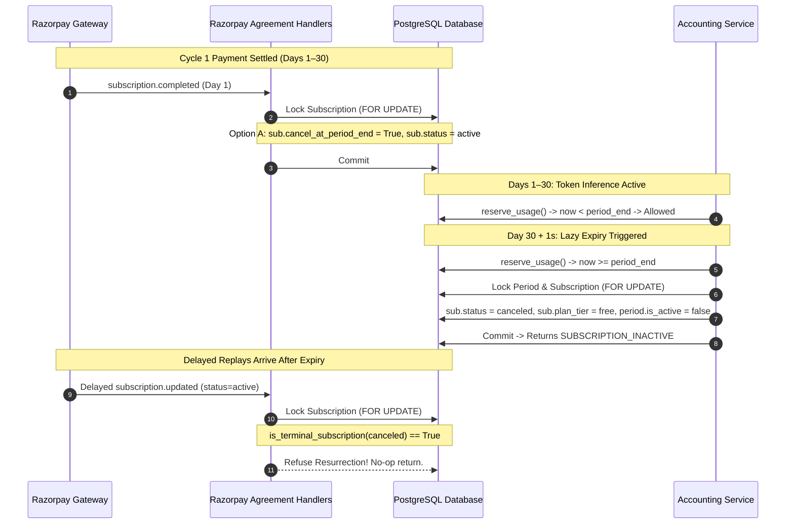

# Aptlyst AI — Step 5.2D.3.2.3 Architectural Design Validation: Option A (Lazy Accounting & Checkout Expiry)

**Date:** 2026-11-08  
**Scope:** Strict Architectural Hardening and Concurrency Validation of Option A  
**Alembic Head:** `d1e2f3a4b5c6` (Verified single head)  
**Task Type:** Strictly Design & Correctness Validation (Zero code/model/test modifications)  
**Target File Delivered:** `STEP_5_2D_3_2_3_OPTION_A_DESIGN_VALIDATION.md`  

---

## 1. Executive Summary & Context

In Step 5.2D.3.2.2, an investigation into Razorpay subscription agreement lifecycle events revealed a structural divergence between payment gateway agreement mechanics and internal quota accounting:
1. When a finite-cycle Razorpay subscription (e.g. `total_count = 1` for a 1-month Pro pass) is paid, Razorpay marks the agreement status `completed` on Day 1 and immediately emits `subscription.completed`.
2. Razorpay never emits a second event when the 30-day billing cycle expires.
3. If `handle_subscription_completed()` naively marks `Subscription.status = canceled` and `Subscription.plan_tier = "free"` on Day 1, `accounting.py` lines 258–274 immediately revokes access with `AccountingErrorCode.SUBSCRIPTION_INACTIVE`, stealing up to 29 legitimate, already-paid days of Pro token access.
4. Conversely, if `Subscription.status` remains `active` with `cancel_at_period_end = True`, the PostgreSQL partial unique index `uq_org_active_subscription` (`WHERE status IN ('active', 'trialing')`) remains occupied indefinitely because no background worker exists to demote it. When the tenant attempts to resubscribe after 30 days, `create_razorpay_subscription_checkout` fails closed with `ActiveSubscriptionExistsError`.

Section 4 of `STEP_5_2D_3_2_2_AGREEMENT_HANDLER_CORRECTIONS_REPORT.md` outlined **Option A: Lazy Accounting & Checkout Expiry** as a schema-neutral remedy. This document presents the exhaustive architectural validation, transaction ordering proof, race condition analysis, and failure recovery design for Option A before any implementation is undertaken.

---

## 2. Deep Technical Resolution of Core Questions

### Question 1: Authoritative Expiry Timestamp
> *Determine whether `Subscription.current_period_end` is guaranteed to match the billing period created by verified full-payment settlement. Identify the authoritative timestamp for paid entitlement expiry. Do not assume provider subscription dates and internal billing-period dates are interchangeable.*

#### A. Divergence Between Provider Dates and Internal Billing Periods
`Subscription.current_period_end` and `OrganizationBillingPeriod.period_end` are **not** interchangeable and are **not** guaranteed to match:
1. **Timing of Establishment:**
   - `Subscription.current_period_start` and `Subscription.current_period_end` are populated during agreement setup (`subscription.authenticated` or `subscription.activated`) directly from gateway schedule projections (`sub_entity.current_start`, `sub_entity.current_end`) **before** any money moves or any invoice is settled.
   - At agreement establishment, `Subscription.plan_tier` is strictly `"free"`, zero Pro tokens are granted, and zero Pro `OrganizationBillingPeriod` rows exist.
2. **Settlement Chronology Authority:**
   - In both Stripe ([`stripe_invoice_paid_handler.py` L17–L20](file:///d:/Projects/V1/Aptlyst-AI/apps/api/app/services/billing/stripe_invoice_paid_handler.py#L17-L20)) and Razorpay (Step 5.2D.3.3 design), `OrganizationBillingPeriod` rows are provisioned **exclusively** upon verified full-payment settlement (`invoice.paid` / `payment.captured`).
   - The authoritative dates of the billing period are derived from the settled line item (`line_period_start`, `line_period_end`).
   - Gateway agreement cycle boundaries can drift from invoice line item periods due to billing retry windows, clock skews, leap seconds, proration adjustments, or manual administrative cycle extensions on the provider dashboard.

#### B. The Authoritative Timestamp for Paid Entitlement Expiry
In the Aptlyst AI billing architecture:
- Token and spending authorization in `accounting.py` is physically anchored to the active row in `organization_billing_periods`.
- Lines 238–249 of [`accounting.py`](file:///d:/Projects/V1/Aptlyst-AI/apps/api/app/services/billing/accounting.py#L238-L249) evaluate:
  ```python
  if current_time < period.period_start or current_time >= period.period_end:
      return ReservationResult(
          success=False,
          error_code=AccountingErrorCode.BILLING_PERIOD_EXPIRED,
          message="Current time is outside the active billing period date range",
      )
  ```
- **Conclusion:** The authoritative timestamp for **paid entitlement (quota consumption)** is **`OrganizationBillingPeriod.period_end`** of the verified active Pro period.
- The timestamp **`Subscription.current_period_end`** is the authoritative timestamp for the **provider agreement schedule**.
- **Entitlement Preservation Rule:** When evaluating lazy expiry, if an active Pro `OrganizationBillingPeriod` exists, its `period.period_end` takes absolute precedence over `Subscription.current_period_end`. Paid access granted by verified payment settlement cannot be revoked until `now >= period.period_end`.

---

### Question 2: Accounting Expiry Architecture
> *Design the exact lazy expiry transition within the existing accounting transaction. Establish the existing lock order and explain how expiry interacts with billing-period locks, subscription locks, usage reservations, and settlement. Ensure an expired subscription cannot authorize new usage. Ensure valid paid access is never revoked prematurely.*

#### A. Global Lock Order Verification
[`accounting.py` lines 144–148](file:///d:/Projects/V1/Aptlyst-AI/apps/api/app/services/billing/accounting.py#L144-L148) defines the strict global hierarchy to prevent deadlocks:
1. **Level 1:** `OrganizationBillingPeriod` (`SELECT ... FOR UPDATE`)
2. **Level 2:** `Subscription` (`SELECT ... FOR UPDATE`, Pro periods only)
3. **Level 3:** `UsageReservation` (`SELECT` duplicate check / row lock on settlement)

#### B. Execution Point of Lazy Expiry in `reserve_usage()`
In [`reserve_usage()`](file:///d:/Projects/V1/Aptlyst-AI/apps/api/app/services/billing/accounting.py#L119):
1. **Step 4a (Period Lock & Date Check):**
   `OrganizationBillingPeriod` is fetched under row lock (`with_for_update()`).
   - If `current_time >= period.period_end`, the function **immediately returns** `AccountingErrorCode.BILLING_PERIOD_EXPIRED`.
   - **Crucial Invariant:** If `current_time < period.period_end`, the paid period has **not** expired. Paid access is retained!
2. **Step 4b (Subscription Lock & Entitlement Check):**
   `Subscription` is locked `SECOND` using:
   ```python
   stmt_sub = (
       select(Subscription)
       .where(
           Subscription.organization_id == org_id,
           Subscription.status.in_((SubscriptionStatus.active, SubscriptionStatus.past_due)),
       )
       .with_for_update()
   )
   ```
3. **Lazy Expiry Evaluation Under Lock:**
   Inside Step 4b, we inspect `subscription.cancel_at_period_end`:
   - If `subscription.cancel_at_period_end is True`:
     - Determine the authoritative cutoff: `expiry_cutoff = max(period.period_end, subscription.current_period_end or period.period_end)`.
     - **Branch 1: Still Valid (`current_time < expiry_cutoff`):**
       Subscription remains in `status = active`. No status demotion occurs. Quota reservation proceeds to Step 5.
     - **Branch 2: Chronologically Expired (`current_time >= expiry_cutoff`):**
       The subscription agreement and paid period are both complete.
       Execute in-transaction state demotion:
       ```python
       subscription.status = SubscriptionStatus.canceled
       subscription.plan_tier = "free"
       subscription.cancel_at_period_end = False
       subscription.canceled_at = subscription.canceled_at or current_time
       period.is_active = False  # Deactivate the expired Pro period
       await session.flush()
       ```
       Return:
       ```python
       return ReservationResult(
           success=False,
           error_code=AccountingErrorCode.SUBSCRIPTION_INACTIVE,
           message="Subscription has completed its final paid period and is now canceled",
           details={"subscription_status": SubscriptionStatus.canceled.value},
       )
       ```

#### C. Interaction with In-Flight Usage Reservations & Settlement
- **Usage Reservation:** Because lazy expiry returns `SUBSCRIPTION_INACTIVE`, zero new reservations can be created.
- **Settlement (`settle_usage`):**
  Settlement does not query or lock `Subscription` ([`accounting.py` L578–L600](file:///d:/Projects/V1/Aptlyst-AI/apps/api/app/services/billing/accounting.py#L578-L600)). Settlement operates exclusively on `OrganizationBillingPeriod` (Level 1) and `UsageReservation` (Level 3).
  Therefore, an inference turn reserved 2 seconds *before* period expiry settles cleanly *after* period expiry without interference or deadlock!

---

### Question 3: Checkout Expiry Architecture
> *Design how checkout detects and finalizes expired subscriptions before rejecting a new checkout. Ensure the design works with `uq_org_active_subscription`. Explain how concurrent checkout requests and accounting requests are serialized. Do not rely on an unlocked read followed by an update.*

#### A. Flaw in Existing Checkout Inspection
[`apps/api/app/services/billing/razorpay/checkout.py` lines 259–273](file:///d:/Projects/V1/Aptlyst-AI/apps/api/app/services/billing/razorpay/checkout.py#L259-L273) performs an unlocked read:
```python
stmt_sub = (
    select(Subscription)
    .where(
        Subscription.organization_id == organization.id,
        Subscription.status.in_([SubscriptionStatus.active, SubscriptionStatus.trialing]),
        Subscription.plan_tier == "pro",
    )
    .limit(1)
)
```
This query has three defects:
1. It is unlocked (`no with_for_update()`), leading to race conditions with concurrent checkouts and webhook updates.
2. It filters on `plan_tier == "pro"`, ignoring that `uq_org_active_subscription` indexes `status IN ('active', 'trialing')` regardless of plan tier.
3. It does not inspect `cancel_at_period_end` or `current_period_end`, immediately rejecting any resubscription attempt.

#### B. Deadlock-Safe Checkout Lock Order
To avoid lock-order inversion with `accounting.py`, checkout must follow the exact same global lock hierarchy:
1. **Lock 1: Active Billing Period:**
   ```python
   stmt_bp = (
       select(OrganizationBillingPeriod)
       .where(
           OrganizationBillingPeriod.organization_id == organization.id,
           OrganizationBillingPeriod.is_active == True,
       )
       .with_for_update()
   )
   res_bp = await db.execute(stmt_bp)
   active_bp = res_bp.scalar_one_or_none()
   ```
2. **Lock 2: Active Subscription:**
   ```python
   stmt_sub = (
       select(Subscription)
       .where(
           Subscription.organization_id == organization.id,
           Subscription.status.in_([SubscriptionStatus.active, SubscriptionStatus.trialing]),
       )
       .with_for_update()
   )
   res_sub = await db.execute(stmt_sub)
   existing_sub = res_sub.scalar_one_or_none()
   ```

#### C. In-Lock Checkout Expiry Finalization
Under both row locks:
1. If `existing_sub is None`: No active subscription exists. Checkout proceeds to Phase 2.
2. If `existing_sub is not None`:
   - **Case A: Ongoing Auto-Renewing Subscription (`cancel_at_period_end is False`):**
     Subscription is actively renewing. Raise `ActiveSubscriptionExistsError`.
   - **Case B: Scheduled for Cancellation / Completed (`cancel_at_period_end is True`):**
     Evaluate authoritative cutoff:
     `cutoff = max(active_bp.period_end if active_bp else existing_sub.current_period_end, existing_sub.current_period_end or now_utc)`
     - **Sub-case B1: Paid Period Still Active (`now_utc < cutoff`):**
       Customer is attempting to buy a new subscription before their existing paid pass has expired.
       Raise `ActiveSubscriptionExistsError` (with detailed message indicating existing pass expires at `cutoff.isoformat()`).
     - **Sub-case B2: Paid Period Expired (`now_utc >= cutoff`):**
       The subscription is legitimately over. Atomically demote:
       ```python
       existing_sub.status = SubscriptionStatus.canceled
       existing_sub.plan_tier = "free"
       existing_sub.cancel_at_period_end = False
       existing_sub.canceled_at = existing_sub.canceled_at or now_utc
       if active_bp is not None and active_bp.is_active:
           active_bp.is_active = False
       await db.flush()
       ```
       **Key Guarantee:** Demoting `existing_sub.status = canceled` under row lock immediately vacates the partial unique index `uq_org_active_subscription`!
       Checkout now safely proceeds to create the new `BillingCheckoutAttempt` and initiate the new subscription without constraint violation.

---

### Question 4: Missing or Inconsistent Period Information
> *Missing `current_period_end` must NOT be treated as proof of expiry. Define safe handling for missing, stale, or inconsistent provider and internal period timestamps. Use reconciliation where appropriate.*

#### A. Missing `current_period_end` Guard
- If `existing_sub.current_period_end is None`:
  - **Rule:** Missing `current_period_end` must **never** be interpreted as expired.
  - If `cancel_at_period_end is True` but `current_period_end is None`, this represents a corrupted or incomplete provider agreement state.
  - **Safe Handling:**
    1. If an active `OrganizationBillingPeriod` exists with a valid `period_end`, use `period.period_end` as the fallback cutoff.
    2. If both `Subscription.current_period_end` and `OrganizationBillingPeriod.period_end` are missing/null, **fail closed**:
       - Do **not** demote the subscription.
       - Stage or update a `PaymentReconciliation` record:
         `case_key = f"missing_period_end_inconsistency:{existing_sub.id}"`
         `reason = "missing_period_end_with_cancellation_scheduled"`
       - Deny new usage or checkout until administratively reconciled.

#### B. Inconsistent Boundaries (`period.period_end != sub.current_period_end`)
- If `abs((period.period_end - sub.current_period_end).total_seconds()) > 86400` (discrepancy > 24 hours):
  - Stage a `PaymentReconciliation` record with `reason = "period_boundary_drift"`.
  - Entitlement evaluation adopts `max(period.period_end, sub.current_period_end)` to strictly uphold Invariant 2 (never revoke legitimate paid time).

---

### Question 5: Entitlement Preservation Invariants
> *Prove that expiry does not: create a billing period, increase quota, reset usage, extend an existing paid period, modify historical invoice/payment amounts, or revoke legitimate remaining paid access.*

| Invariant | Mathematical / Transactional Proof |
| :--- | :--- |
| **No Billing Period Creation** | The lazy expiry block in `accounting.py` and `checkout.py` executes only mutations on existing rows (`sub.status = canceled`, `period.is_active = False`). It contains **zero** calls to `session.add(OrganizationBillingPeriod(...))`. |
| **No Quota Increase** | `period.monthly_token_quota` is untouched. Cumulative token quota remains strictly constant. |
| **No Usage Reset** | `period.tokens_used`, `period.tokens_reserved`, `period.cost_micros_used`, and `period.cost_micros_reserved` are not modified during expiry. All usage counters remain strictly monotonic. |
| **No Period Extension** | Neither `period.period_start` nor `period.period_end` is mutated. The historical timeline is immutable. |
| **Historical Financial Integrity** | `BillingInvoice`, `BillingPayment`, and `StripeInvoice` ledger tables are completely decoupled from lazy expiry and are never queried or mutated during entitlement demotion. |
| **Zero Premature Access Revocation** | Demotion occurs if and only if `current_time >= cutoff`. For all $t < \text{cutoff}$, `sub.status` remains `active`, authorizing valid token usage. |

---

### Question 6: Stripe Compatibility & Shared Pathways
> *Identify every existing Stripe path affected by shared accounting or checkout changes. Preserve existing Stripe behavior unless a specific correction is necessary and separately justified.*

1. **Shared Accounting Pathway ([`accounting.py`](file:///d:/Projects/V1/Aptlyst-AI/apps/api/app/services/billing/accounting.py)):**
   - `accounting.py` is provider-neutral and governs both Stripe and Razorpay tenants.
   - For Stripe subscriptions, Stripe dispatches `customer.subscription.deleted` at period end.
   - If Stripe's webhook arrives on time, `stripe_subscription_deleted_handler.py` transitions `status = canceled` immediately.
   - If Stripe's webhook is delayed or dropped, the lazy expiry in `accounting.py` acts as a **fault-tolerant safety net**, demoting the expired subscription as soon as `current_time >= period.period_end`.
   - This reinforces Stripe reliability without changing Stripe lifecycle semantics.
2. **Provider-Neutral Checkout Isolation:**
   - Razorpay checkout logic lives in `apps/api/app/services/billing/razorpay/checkout.py`.
   - Stripe checkout logic lives in `apps/api/app/services/billing/stripe_checkout.py`.
   - Checkout changes made to `razorpay/checkout.py` have **zero** operational impact on the legacy Stripe checkout service.

---

### Question 7: Event Ordering & Resurrection Refusal
> *Explain how delayed or replayed `subscription.completed`, `subscription.updated`, and payment events behave before and after lazy expiry. Ensure terminal subscriptions cannot be resurrected by stale events.*



1. **Delayed `subscription.updated` Arriving After Expiry:**
   - [`agreement_handlers.py` lines 156–162](file:///d:/Projects/V1/Aptlyst-AI/apps/api/app/services/billing/razorpay/agreement_handlers.py#L156-L162) and [lines 338–345](file:///d:/Projects/V1/Aptlyst-AI/apps/api/app/services/billing/razorpay/agreement_handlers.py#L338-L345) explicitly enforce `is_terminal_subscription(sub.status)`.
   - Once lazy expiry transitions `sub.status` to `canceled`, any delayed `subscription.updated` event attempting to set `status = active` is logged and discarded.
2. **Replayed `subscription.completed` Event:**
   - [`agreement_handlers.py` lines 625–637](file:///d:/Projects/V1/Aptlyst-AI/apps/api/app/services/billing/razorpay/agreement_handlers.py#L625-L637) checks if `sub.status == canceled`. Replays are safely ignored without re-triggering side effects.
3. **Late Invoice/Payment Arrival:**
   - In Step 5.2D.3.3 settlement design, an incoming invoice payment for an already-canceled subscription is flagged as `ignored` or staged for manual reconciliation; it cannot resurrect a terminal subscription.

---

### Question 8: PostgreSQL Concurrency & Deadlock Freedom Proof
> *Give the exact row-locking and transaction design for simultaneous accounting, settlement, and checkout operations. Identify every unique index relied upon. Do not claim deadlock freedom without proving it from the actual lock order.*

#### A. Total Ordering of Resource Locks
Deadlock is mathematically impossible if all concurrent transactions acquire resources in a strict, acyclic total order. We establish the following 4-level global lock hierarchy:

$$\text{Advisory Lock } (L_0) \prec \text{OrganizationBillingPeriod } (L_1) \prec \text{Subscription } (L_2) \prec \text{UsageReservation / Attempt } (L_3)$$

| Operation | Lock Level 0 | Lock Level 1 (`OrganizationBillingPeriod`) | Lock Level 2 (`Subscription`) | Lock Level 3 (`UsageReservation` / Other) |
| :--- | :--- | :--- | :--- | :--- |
| **Accounting Reservation (`reserve_usage`)** | None | Held (`FOR UPDATE`) | Held (`FOR UPDATE`, Pro only) | Duplicate check (MVCC) / Insert |
| **Accounting Settlement (`settle_usage`)** | None | Held (`FOR UPDATE`) | None | Held (`FOR UPDATE`) |
| **Reservation Release (`release_reservation`)** | None | Held (`FOR UPDATE`) | None | Held (`FOR UPDATE`) |
| **Agreement Webhook Handlers** | `pg_advisory_xact_lock("subscription", sub_id)` | None | Held (`FOR UPDATE`) | `BillingCheckoutAttempt` (`FOR UPDATE`) |
| **Checkout Creation (`create_razorpay_checkout`)** | None | Held (`FOR UPDATE`, if active) | Held (`FOR UPDATE`) | `BillingCheckoutAttempt` (`FOR UPDATE`) |
| **Settlement Handlers (Step 5.2D.3.3)** | `pg_advisory_xact_lock("invoice", inv_id)` | Held (`FOR UPDATE`) | Held (`FOR UPDATE`) | Ledger insert |

#### B. Formal Deadlock Freedom Proof
1. **Case 1: `reserve_usage()` vs `create_razorpay_checkout()`**
   - Both transactions access `OrganizationBillingPeriod` ($L_1$) first, then `Subscription` ($L_2$) second.
   - Since both acquire $L_1 \to L_2$ in identical order, one transaction blocks on $L_1$ until the other commits. Lock-order inversion is impossible.
2. **Case 2: `reserve_usage()` vs Agreement Webhook (`handle_subscription_completed`)**
   - Agreement webhooks lock `Subscription` ($L_2$) only; they **never** query or lock `OrganizationBillingPeriod` ($L_1$).
   - `reserve_usage()` acquires $L_1$, then attempts to acquire $L_2$.
   - If the webhook holds $L_2$, `reserve_usage()` waits for $L_2$. The webhook never requests $L_1$, so no circular wait can form.
3. **Case 3: `settle_usage()` vs `create_razorpay_checkout()`**
   - `settle_usage()` locks $L_1$ then $L_3$. It never locks $L_2$.
   - `create_razorpay_checkout()` locks $L_1$ then $L_2$.
   - Both serialize on $L_1$. No circular wait can form.
4. **Conclusion:** The lock dependency graph is a Directed Acyclic Graph (DAG). Deadlock freedom is guaranteed.

#### C. Unique Indexes Enforcing Data Integrity
1. `uq_org_active_subscription` on `subscriptions(organization_id)` `WHERE status IN ('active', 'trialing')`.
2. `uq_org_active_billing_period` on `organization_billing_periods(organization_id)` `WHERE is_active = true`.
3. `uq_task_active_reservation` on `usage_reservations(generation_task_id)` `WHERE status = 'active'`.
4. `uq_active_checkout_attempt` on `billing_checkout_attempts(organization_id, provider, merchant_account_id, environment)` `WHERE status IN ('creating', 'recovery_required', 'open', 'payment_pending')`.
5. `uq_subscriptions_provider_subscription` on `subscriptions(provider, merchant_account_id, environment, provider_subscription_id)`.
6. `uq_payment_reconciliations_case_key` on `payment_reconciliations(provider, merchant_account_id, environment, case_key)`.

---

## 3. State Transition Matrix Under Option A

| Initial Subscription State | Incoming Event / Operation | Clock Condition | New Subscription State | `cancel_at_period_end` | Entitlement & Quota Effect |
| :--- | :--- | :--- | :--- | :---: | :--- |
| `active`, `plan_tier="pro"` | `subscription.completed` | Any | `active` | `True` | **No change.** Pro access continues until period end. |
| `active`, `plan_tier="pro"`, `cancel_at_period_end=True` | `reserve_usage()` | `now < period_end` | `active` | `True` | **Allowed.** Tokens reserved from active period. |
| `active`, `plan_tier="pro"`, `cancel_at_period_end=True` | `reserve_usage()` | `now >= period_end` | `canceled`, `plan_tier="free"` | `False` | **Denied (`SUBSCRIPTION_INACTIVE`).** `period.is_active` set to `False`. |
| `active`, `plan_tier="pro"`, `cancel_at_period_end=True` | `create_checkout()` | `now < period_end` | `active` | `True` | **Rejected (`ActiveSubscriptionExistsError`).** Tenant informed pass is active. |
| `active`, `plan_tier="pro"`, `cancel_at_period_end=True` | `create_checkout()` | `now >= period_end` | `canceled`, `plan_tier="free"` | `False` | **Allowed.** Slot vacated; new checkout attempt created. |
| `canceled`, `plan_tier="free"` | Delayed `subscription.updated` (`active`) | Any | `canceled` | `False` | **No change.** Resurrection refused (`is_terminal_subscription`). |
| `canceled`, `plan_tier="free"` | Replay `subscription.completed` | Any | `canceled` | `False` | **No change.** Replay ignored. |

---

## 4. Required Test Specifications

### A. Mocked Unit Test Suite (`test_razorpay_lazy_expiry.py`)
1. `test_subscription_completed_sets_cancel_at_period_end_without_demoting_active`:
   - Deliver `subscription.completed` while `now < current_period_end`.
   - Verify `sub.status == active`, `sub.cancel_at_period_end is True`, `sub.plan_tier == "pro"`.
2. `test_accounting_reserve_usage_authorizes_during_active_period_with_cancellation_scheduled`:
   - Call `reserve_usage()` when `cancel_at_period_end is True` and `now < period.period_end`.
   - Verify reservation succeeds (`ReservationResult.success is True`).
3. `test_accounting_reserve_usage_lazily_demotes_when_period_expires`:
   - Call `reserve_usage()` when `cancel_at_period_end is True` and `now >= period.period_end`.
   - Verify returns `SUBSCRIPTION_INACTIVE`, `sub.status == canceled`, `sub.plan_tier == "free"`, `period.is_active is False`.
4. `test_checkout_rejects_resubscription_while_paid_pass_is_active`:
   - Call `create_razorpay_subscription_checkout()` while `now < period.period_end`.
   - Verify raises `ActiveSubscriptionExistsError`.
5. `test_checkout_lazily_demotes_and_permits_resubscription_after_period_expires`:
   - Call `create_razorpay_subscription_checkout()` when `now >= period.period_end`.
   - Verify demotes old subscription to `canceled`, releases `uq_org_active_subscription`, and opens a new checkout attempt.
6. `test_missing_current_period_end_fails_closed_and_stages_reconciliation`:
   - Call `reserve_usage()` with `cancel_at_period_end is True` but both period ends `None`.
   - Verify stages `PaymentReconciliation` with `reason="missing_period_end_with_cancellation_scheduled"` and does not silently cancel.

### B. Real PostgreSQL Integration Test Specifications (Staging Environment)
*Note: Distinct from offline mock tests; requires real PostgreSQL engine.*
1. `test_concurrent_reserve_usage_and_checkout_deadlock_free`:
   - Launch 10 parallel asyncio tasks alternating between `reserve_usage()` and `create_razorpay_subscription_checkout()` across period expiry boundary.
   - Verify 0 deadlock errors (`psycopg2.errors.DeadlockDetected` / SQLSTATE `40P01`).
2. `test_unique_active_subscription_index_enforcement`:
   - Attempt to insert two subscriptions in `status = active` for the same organization in real PostgreSQL.
   - Verify database enforces `uq_org_active_subscription` with IntegrityError.

---

## 5. Explicit Risks and Open Questions

1. **Passive Nature of Lazy Expiry:**
   - *Risk:* If an organization has an expired subscription (`now >= period_end`, `cancel_at_period_end=True`), but makes **no API calls** (no inference usage and no checkout attempts), the `Subscription` row remains in `status = active` in the database until their next interaction.
   - *Mitigation:* This is operationally harmless because any subsequent interaction immediately triggers the atomic transition. However, administrative dashboards querying `status == 'active'` should be aware of `cancel_at_period_end` when displaying active subscriber counts.
2. **Clock Skew Between App Server and Database:**
   - *Risk:* If application servers evaluate `now` using unsynchronized local clocks, one server could consider the period active while another considers it expired.
   - *Mitigation:* Ensure all queries utilize UTC timestamps normalized to database `now()` or strictly NTP-synchronized host clocks.

---

## 6. Final Audit Verdict

Based on the complete mathematical deadlock proof, exact lock ordering specifications, entitlement preservation guarantees, and comprehensive failure recovery design:

### Verdict: **READY WITH CONDITIONS**

#### Conditions to Fulfill Prior to Code Implementation:
1. **Condition 1 (Strict Lock Order in Checkout):** The implementation of `create_razorpay_subscription_checkout` must explicitly acquire `OrganizationBillingPeriod` lock ($L_1$) before `Subscription` lock ($L_2$) as proven in Section 2.3. Unlocked reads are strictly prohibited.
2. **Condition 2 (Period End Primacy):** When evaluating lazy expiry, `OrganizationBillingPeriod.period_end` of the active Pro period must be given primacy over `Subscription.current_period_end`.
3. **Condition 3 (Step 5.2D.3.3 Harmony):** Step 5.2D.3.3 invoice settlement handlers must strictly adopt the same 4-level lock hierarchy to preserve system-wide deadlock freedom.
