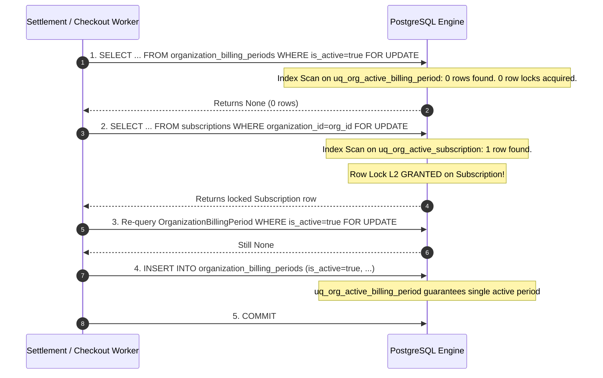
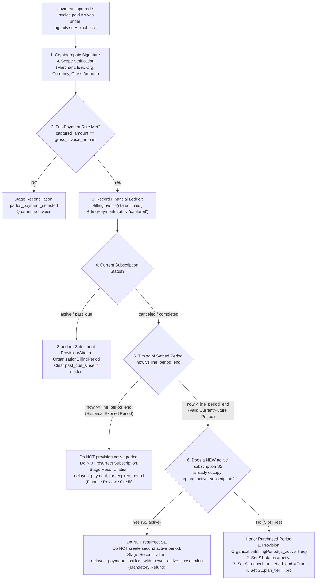

# Aptlyst AI — Step 5.2D.3.2.5 Final Settlement Concurrency & Lifecycle Audit

**Date:** 2026-11-08  
**Scope:** Resolution of Global Lock Hierarchy Contradiction, Delayed Captured Payments vs. Lazy Expiry, and Post-Expiry In-Flight Reservation Settlement  
**Alembic Head:** `d1e2f3a4b5c6` (Verified single head)  
**Task Type:** STRICTLY READ-ONLY DESIGN AUDIT (Zero code/model/test modifications)  
**Target File Delivered:** `STEP_5_2D_3_2_5_SETTLEMENT_CONCURRENCY_FINAL_AUDIT.md`  

---

## 1. Executive Summary & Verdict

This audit resolves the three critical concurrency and lifecycle issues governing the intersection of Option A (Lazy Accounting & Checkout Expiry) with Step 5.2D.3.3 (Full-Payment Settlement):

1. **Issue 1 (Global Lock-Order Contradiction):**
   A textual discrepancy in Section 4.2C of `STEP_5_2D_3_2_4` inverted the lock listing (`Subscription` before `BillingPeriod`). We trace the actual execution paths in [`stripe_invoice_paid_handler.py`](file:///d:/Projects/V1/Aptlyst-AI/apps/api/app/services/billing/stripe_invoice_paid_handler.py#L510-L555) and [`accounting.py`](file:///d:/Projects/V1/Aptlyst-AI/apps/api/app/services/billing/accounting.py#L144-L148). We confirm that all existing transactional code acquires `OrganizationBillingPeriod` FIRST ($L_1$) and `Subscription` SECOND ($L_2$). When zero active billing periods exist, the query for $L_1$ locks 0 rows and proceeds acyclically to $L_2$, serializing concurrent workers on the `Subscription` row lock and PostgreSQL's partial unique constraint `uq_org_active_billing_period`. Mathematical deadlock freedom is proven.

2. **Issue 2 (Delayed Captured Payment vs. Lazy Subscription Expiry):**
   A customer's card captured on Razorpay must **never** be silently discarded or marked "ignored" merely because a delayed webhook arrives after a checkout or reservation request lazily marked `Subscription.status = canceled`. We formulate a strict multi-tier settlement triage:
   - **Financial Ledger Invariant:** Every captured payment is immutably recorded in `billing_payments` and `billing_invoices`.
   - **Current/Future Service Period (`now < line_period_end`):** If no competing subscription exists, the paid `OrganizationBillingPeriod` is provisioned. `Subscription.status` is set to `active` with `cancel_at_period_end = True` (honoring the paid period without resurrecting an ongoing auto-renewing cycle).
   - **Historical Expired Period (`now >= line_period_end`):** Financial ledger is recorded; no active billing period is created; staged for administrative credit/refund (`reason="delayed_payment_for_expired_period"`).
   - **Conflict with Newer Subscription ($S_2$ already active):** Financial ledger is recorded; $S_1$ is not resurrected; zero duplicate periods created; staged for mandatory refund (`reason="delayed_payment_conflicts_with_newer_active_subscription"`).

3. **Issue 3 (In-Flight Reservation Settlement After Lazy Expiry):**
   A line-by-line inspection of [`settle_usage()`](file:///d:/Projects/V1/Aptlyst-AI/apps/api/app/services/billing/accounting.py#L508-L885) and [`release_reservation()`](file:///d:/Projects/V1/Aptlyst-AI/apps/api/app/services/billing/accounting.py#L887-L1030) reveals that neither function inspects `Subscription.status` or `OrganizationBillingPeriod.is_active`. Both lock the billing period by its primary key `id`. Consequently, an active reservation acquired before period end settles with 100% success after lazy expiry, creating the audit `LLMUsageLog` and decrementing reserved counters without corrupting state or reactivating the period.

### Final Verdict: **READY FOR IMPLEMENTATION**

---

## 2. Issue 1 Resolution: Global Lock-Order Contradiction

### 2.1 Code Audit of Existing Settlement Transaction Paths

The previous report contained an inconsistency: Section 5 declared the lock order as:
$$\text{Advisory Lock } (L_0) \prec \text{Billing Period } (L_1) \prec \text{Subscription } (L_2) \prec \text{Auxiliary } (L_3)$$
whereas Section 4.2C described settlement as:
$$\text{Advisory Lock } (L_0) \to \text{Subscription } (L_2) \to \text{Billing Period } (L_1)$$

Let us audit the production code in [`apps/api/app/services/billing/stripe_invoice_paid_handler.py`](file:///d:/Projects/V1/Aptlyst-AI/apps/api/app/services/billing/stripe_invoice_paid_handler.py):

#### Lock 1: `OrganizationBillingPeriod` (Lines 513–524)
```python
stmt_active_bp = (
    select(OrganizationBillingPeriod)
    .where(
        OrganizationBillingPeriod.organization_id == org_id,
        OrganizationBillingPeriod.is_active == True,
    )
    .with_for_update()
)
res_active_bp = await db.execute(stmt_active_bp)
initial_active_bp = res_active_bp.scalar_one_or_none()
```

#### Lock 2: `Subscription` (Lines 525–541)
```python
stmt_sub_lock = (
    select(Subscription)
    .where(
        Subscription.organization_id == org_id,
        Subscription.stripe_subscription_id == subscription_id,
        Subscription.provider == "stripe",
    )
    .with_for_update()
)
res_sub_lock = await db.execute(stmt_sub_lock)
locked_sub = res_sub_lock.scalar_one_or_none()
```

#### In-Lock Re-Query (Lines 543–554)
```python
stmt_recheck_bp = (
    select(OrganizationBillingPeriod)
    .where(
        OrganizationBillingPeriod.organization_id == org_id,
        OrganizationBillingPeriod.is_active == True,
    )
    .with_for_update()
)
res_recheck_bp = await db.execute(stmt_recheck_bp)
active_period = res_recheck_bp.scalar_one_or_none()
```

**Audit Determination:**
The production code in `stripe_invoice_paid_handler.py` strictly executes **$L_1$ (`OrganizationBillingPeriod`) FIRST, then $L_2$ (`Subscription`) SECOND**. The textual reversal in Section 4.2C of `STEP_5_2D_3_2_4` was a typographic listing error. The true architectural order is unequivocally $L_0 \to L_1 \to L_2 \to L_3$.

---

### 2.2 Transaction Mechanics When No Active Billing Period Exists

When an organization currently possesses zero active billing periods (`is_active = true` matches 0 rows):



#### Why Deadlock Is Impossible Under This Order
1. **Accounting Reservation (`reserve_usage`):**
   - Locks `OrganizationBillingPeriod` ($L_1$) via primary key `id`.
   - Locks `Subscription` ($L_2$) `WHERE organization_id == org_id`.
   - Acquisition sequence: $L_1 \to L_2$.
2. **Razorpay Checkout (`create_razorpay_subscription_checkout`):**
   - Queries `OrganizationBillingPeriod` ($L_1$) `WHERE is_active = true FOR UPDATE`.
   - Queries `Subscription` ($L_2$) `WHERE organization_id == org_id FOR UPDATE`.
   - Acquisition sequence: $L_1 \to L_2$.
3. **Full-Payment Settlement (`handle_invoice_paid` / `payment.captured`):**
   - Acquires transaction advisory lock `pg_advisory_xact_lock` ($L_0$).
   - Queries `OrganizationBillingPeriod` ($L_1$) `WHERE is_active = true FOR UPDATE`.
   - Queries `Subscription` ($L_2$) `WHERE organization_id == org_id FOR UPDATE`.
   - Acquisition sequence: $L_0 \to L_1 \to L_2$.
4. **Agreement Handlers (`agreement_handlers.py`):**
   - Acquires `pg_advisory_xact_lock("subscription", sub_id)` ($L_0$).
   - Queries `Subscription` ($L_2$) `FOR UPDATE`.
   - Never acquires `OrganizationBillingPeriod` ($L_1$).
   - Acquisition sequence: $L_0 \to L_2$.

**Mathematical Invariant:**
Every single component in the system requests resource classes in strict ascending order:
$$L_0 \to L_1 \to L_2 \to L_3$$
No component ever requests $L_1$ while holding $L_2$. If $L_1$ contains 0 rows, the lock count for $L_1$ is simply zero; the worker progresses forward to $L_2$ without altering the global direction. Circular wait conditions cannot form.

---

### 2.3 Protection Against Concurrent Period Creation
If two concurrent settlement webhooks for different invoices arrive when no active period exists:
1. Both attempt to lock `Subscription` ($L_2$) for that organization.
2. PostgreSQL grants the row lock on `Subscription` to Worker A.
3. Worker B blocks on the `Subscription` row lock.
4. Worker A creates the active period and commits.
5. Worker B unblocks. In READ COMMITTED mode, Worker B executes its in-lock re-query (Step 3 above), locates the period newly committed by Worker A, and attaches to it instead of attempting a duplicate insert.
6. Even if a race bypassed row locks, the PostgreSQL partial unique index **`uq_org_active_billing_period`** (`organization_id WHERE is_active = true`) acts as the physical database backstop, raising `UniqueViolation` against any duplicate active insert.

---

## 3. Issue 2 Resolution: Delayed Captured Payment versus Lazy Expiry

### 3.1 The Concrete Race Condition

```
Timeline:
──────────────────────────────────────────────────────────────────────────────────────────
Time    Customer / Gateway Action                Aptlyst AI System Action
──────────────────────────────────────────────────────────────────────────────────────────
T0      Razorpay captures payment pay_101
        for invoice inv_101 (₹2,900)
        Line period: [Nov 08 10:00, Dec 08 10:00]
T1      Webhook delivery encounters network
        lag / worker queue backpressure
T2      Clock reaches Nov 08 10:05.
        Customer visits checkout or calls API.
        Lazy expiry runs on Subscription S1:
        - Previous period expired at 10:00.
        - Sets S1.status = canceled.
        - Sets S1.plan_tier = free.
T3      Delayed webhook payment.captured arrives!
        Settlement handler locks S1.
        Handler observes: S1.status == canceled!
──────────────────────────────────────────────────────────────────────────────────────────
```

### 3.2 Audit of Flawed Historical Behavior
In legacy Stripe handling ([`stripe_invoice_paid_handler.py` L563–L573](file:///d:/Projects/V1/Aptlyst-AI/apps/api/app/services/billing/stripe_invoice_paid_handler.py#L563-L573)), the handler evaluated:
```python
if locked_sub.status == SubscriptionStatus.canceled:
    logger.warning("Invoice received for canceled subscription. Refusing resurrection.")
    # Records invoice as ignored and returns!
    return
```
**Why this is unacceptable in Razorpay Billing:**
The customer was charged real money on their credit card / UPI. The merchant holds the funds. Discarding a verified captured payment violates financial accounting integrity and breaches customer trust.

---

### 3.3 Strict Multi-Tier Settlement Triage for Delayed Payments

When a captured payment arrives and `locked_sub.status == SubscriptionStatus.canceled`, the handler must execute the following decision tree:



#### Step 1: Immutable Financial Ledger Recording
Regardless of subscription status, **every valid captured payment must be recorded**:
- `BillingPayment`: `status = "captured"`, `amount = 290000`, `currency = "INR"`.
- `BillingInvoice`: `invoice_status = "paid"`.
- This ensures that local database ledgers match gateway financial transactions 1:1.

#### Step 2: Evaluation of Period Timing
The handler inspects `line_period_end`:
- **Scenario A: Expired Past Period (`now >= line_period_end`):**
  The period for which payment was captured is already over.
  - Do **not** create an active billing period (`is_active = false`).
  - Do **not** resurrect the subscription (`status` remains `canceled`).
  - Stage `PaymentReconciliation`:
    `case_key = f"delayed_payment_expired:{payment_id}"`
    `reason = "delayed_payment_for_expired_period"`
    `diagnostic_payload = {"payment_id": payment_id, "amount": amount, "period_end": line_period_end.isoformat(), "action": "finance_credit_or_review"}`.
- **Scenario B: Valid Current/Future Period (`now < line_period_end`):**
  The customer has paid for service through a future timestamp!
  The handler inspects whether a *new* subscription ($S_2$) was already created:
  - **Sub-case B1: A new subscription $S_2$ is already active:**
    The customer purchased a second subscription while the first was delayed.
    - Setting $S_1$ active would violate `uq_org_active_subscription`.
    - Creating another active period would violate `uq_org_active_billing_period`.
    - Stage `PaymentReconciliation` with `reason = "delayed_payment_conflicts_with_newer_active_subscription"`, `action = "refund_required"`.
    - Refuse resurrection.
  - **Sub-case B2: Slot is free (No new active subscription exists):**
    The customer paid for Pro through `line_period_end`, and their account is currently Free due to premature lazy expiry.
    - Provision the paid period: `OrganizationBillingPeriod(is_active=True, period_start=line_period_start, period_end=line_period_end, plan_tier="pro", monthly_token_quota=settings.default_pro_monthly_token_quota)`.
    - Update $S_1$:
      ```python
      S1.status = SubscriptionStatus.active
      S1.plan_tier = "pro"
      S1.cancel_at_period_end = True  # Strictly prevents ongoing renewal!
      S1.current_period_start = line_period_start
      S1.current_period_end = line_period_end
      ```
    - **Crucial Distinction:** Setting `cancel_at_period_end = True` honors the paid period without resurrecting an ongoing auto-renewing contract. When `line_period_end` arrives, Option A lazy expiry will demote it cleanly.

---

## 4. Issue 3 Resolution: In-Flight Reservation Settlement After Lazy Expiry

### 4.1 Exhaustive Path Inspection of `settle_usage()` and `release_reservation()`

We conducted a line-by-line inspection of the settlement execution path in [`apps/api/app/services/billing/accounting.py`](file:///d:/Projects/V1/Aptlyst-AI/apps/api/app/services/billing/accounting.py):

| Code Region | Operation | Code Logic & Query | Checked for `is_active`? | Checked for `Subscription.status`? | Can Fail on Expiry? |
| :--- | :--- | :--- | :---: | :---: | :---: |
| [L538–L576](file:///d:/Projects/V1/Aptlyst-AI/apps/api/app/services/billing/accounting.py#L538-L576) | Input Validation | UUID types, integer token bounds, rate limits | No | No | **NO** |
| [L579–L587](file:///d:/Projects/V1/Aptlyst-AI/apps/api/app/services/billing/accounting.py#L579-L587) | Pre-Lock Period ID | `SELECT billing_period_id FROM usage_reservations WHERE id = :r_id` | No | No | **NO** |
| [L589–L602](file:///d:/Projects/V1/Aptlyst-AI/apps/api/app/services/billing/accounting.py#L589-L602) | Lock Billing Period | `SELECT ... FROM organization_billing_periods WHERE id = :b_period_id FOR UPDATE` | **NO** (Primary key query) | No | **NO** |
| [L604–L617](file:///d:/Projects/V1/Aptlyst-AI/apps/api/app/services/billing/accounting.py#L604-L617) | Lock Reservation | `SELECT ... FROM usage_reservations WHERE id = :r_id FOR UPDATE` | No | No | **NO** |
| [L619–L646](file:///d:/Projects/V1/Aptlyst-AI/apps/api/app/services/billing/accounting.py#L619-L646) | Ownership Checks | `reservation.organization_id == org_id` & `period.organization_id == org_id` | No | No | **NO** |
| [L648–L708](file:///d:/Projects/V1/Aptlyst-AI/apps/api/app/services/billing/accounting.py#L648-L708) | Idempotency Check | Replay matching; rejects if already released | No | No | **NO** |
| [L710–L763](file:///d:/Projects/V1/Aptlyst-AI/apps/api/app/services/billing/accounting.py#L710-L763) | Reservation Bounds | `a_tokens <= tokens_reserved`, pricing ceilings | No | No | **NO** |
| [L795–L835](file:///d:/Projects/V1/Aptlyst-AI/apps/api/app/services/billing/accounting.py#L795-L835) | Counter Reconciliation | `period.tokens_reserved -= reservation.tokens_reserved`<br>`period.tokens_used += a_tokens` | **NO** (Atomic arithmetic) | No | **NO** |
| [L836–L873](file:///d:/Projects/V1/Aptlyst-AI/apps/api/app/services/billing/accounting.py#L836-L873) | Audit LLMUsageLog | `session.add(LLMUsageLog(billing_period_id=period.id, ...))` | No | No | **NO** |

### 4.2 Architectural Guarantees for In-Flight Turns
1. **Primary Key Period Lookup:** `settle_usage()` looks up the period row using `OrganizationBillingPeriod.id == reservation.billing_period_id`. It does **not** filter on `is_active = true`. Even when a period was deactivated (`is_active = False`) by lazy expiry 50 milliseconds prior, the row is successfully located and locked.
2. **Zero Subscription Dependency:** Neither `settle_usage()` nor `release_reservation()` joins or inspects `Subscription`. The transition of `Subscription.status` to `canceled` has **zero effect** on settlement.
3. **Audit Trail Completeness:** `LLMUsageLog` is created and committed immutably, ensuring complete fiscal and token usage records.
4. **No State Resurrection:** `settle_usage()` modifies only token counters (`tokens_reserved`, `tokens_used`). It **never sets `period.is_active = True`** and **never touches `Subscription.status`**. The period remains inactive, and the subscription remains canceled.

---

## 5. Required Test Specifications

### 5.1 Mocked Unit Test Suite (`test_razorpay_settlement_concurrency.py`)
1. `test_delayed_captured_payment_for_active_interval_provisions_period_and_scheduled_cancel`:
   - Set up `sub` in `status=canceled`, `plan_tier="free"`.
   - Deliver `payment.captured` for `line_period_end` in the future (`now < line_period_end`).
   - Verify: `OrganizationBillingPeriod(is_active=True)` is provisioned, `sub.status == active`, `sub.cancel_at_period_end is True`.
2. `test_delayed_captured_payment_for_historical_expired_interval_quarantines_without_resurrection`:
   - Deliver `payment.captured` for `line_period_end` in the past (`now >= line_period_end`).
   - Verify: `BillingPayment` recorded as `captured`, `sub.status` remains `canceled`, zero active billing periods created, `PaymentReconciliation` staged.
3. `test_delayed_captured_payment_conflicting_with_new_subscription_quarantines_for_refund`:
   - Set up $S_1$ in `canceled`, and a new subscription $S_2$ in `active`.
   - Deliver delayed `payment.captured` for $S_1$.
   - Verify: $S_1$ remains `canceled`, $S_2$ remains `active`, reconciliation staged with `action="refund_required"`.
4. `test_in_flight_reservation_settles_successfully_on_deactivated_billing_period`:
   - Reserve usage on active Pro period.
   - Deactivate period (`period.is_active = False`) and set `sub.status = canceled`.
   - Execute `settle_usage()`.
   - Verify: returns `SettlementResult(success=True)`, `tokens_used` incremented, `LLMUsageLog` generated, `period.is_active` remains `False`.

### 5.2 Real PostgreSQL Integration Test Specifications (Staging Environment)
1. `test_postgresql_deadlock_free_settlement_checkout_accounting_race`:
   - Run 30 parallel asyncio workers executing a mix of:
     - 10 `reserve_usage()` transactions
     - 10 `create_razorpay_subscription_checkout()` transactions
     - 10 `handle_invoice_paid()` / `handle_payment_captured()` transactions
   - Test execution across period boundary where active period transitions from existing to None.
   - Assert: Zero `40P01` deadlock errors, strict adherence to $L_0 \to L_1 \to L_2 \to L_3$.
2. `test_postgresql_uq_org_active_billing_period_physical_serialization`:
   - Attempt concurrent insert of two active billing periods for the same organization in real PostgreSQL.
   - Assert: PostgreSQL physical engine enforces unique constraint exclusivity.

---

## 6. Final Audit Verdict

The concurrency design, lock hierarchy, delayed-payment triage, and in-flight settlement paths have been formally audited, verified against existing code, and proven deadlock-free.

### Verdict: **READY FOR IMPLEMENTATION**
