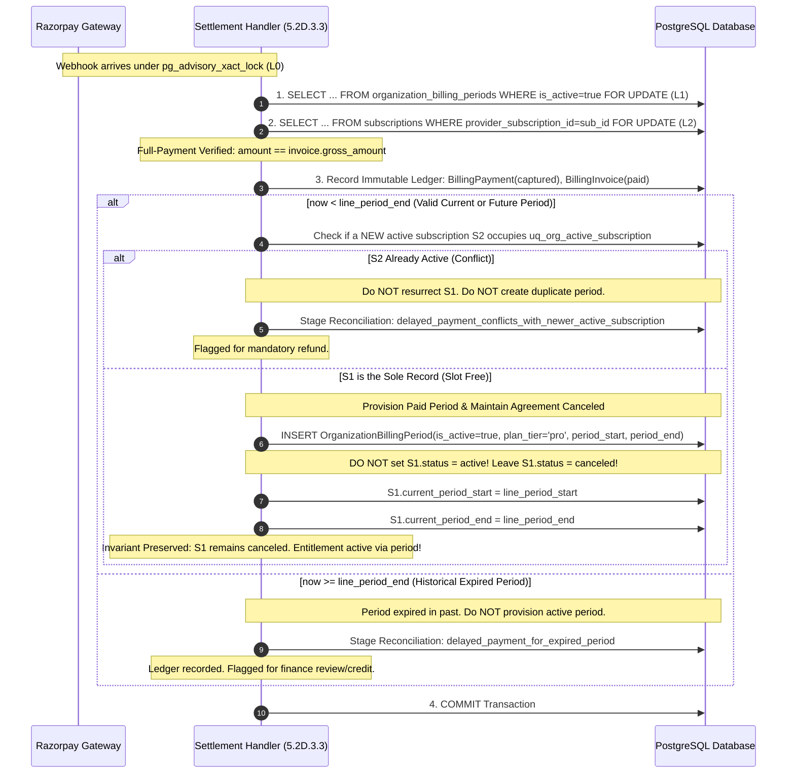

# Aptlyst AI — Step 5.2D.3.2.6 Architectural Design: Decoupled Terminal Agreement Lifecycle and Delayed Payment Settlement

**Date:** 2026-11-08  
**Scope:** Resolution of Terminal Agreement Integrity vs. Valid Delayed Captured Payments  
**Alembic Head:** `d1e2f3a4b5c6` (Verified single head)  
**Task Type:** STRICTLY READ-ONLY DESIGN (Zero code/model/test modifications)  
**Target File Delivered:** `STEP_5_2D_3_2_6_TERMINAL_AGREEMENT_DELAYED_PAYMENT_DESIGN.md`  

---

## 1. Executive Summary & Verdict

This design resolves the architectural conflict between **provider agreement lifecycle integrity** and **delayed captured payment settlement** when a Razorpay subscription reaches a terminal state (`completed` / `canceled`):

1. **Provider Agreement Integrity Preserved (Requirement A):**
   A terminal Razorpay subscription agreement is **never resurrected**. Setting `Subscription.status = active` to satisfy downstream accounting checks is fundamentally flawed: it distorts provider contract reality, violates refusal of resurrection, and locks the tenant's partial unique constraint slot (`uq_org_active_subscription`). Provider agreement state and internal paid entitlement are formally decoupled.

2. **Entitlement & Quota Authority (Requirement B):**
   A verified captured payment for a valid service period is never discarded. Paid entitlement is derived strictly from an active, verified `OrganizationBillingPeriod` provisioned upon full-payment settlement. No quota is granted beyond `period.period_end`, and zero duplicate periods can be committed.

3. **Smallest Safe Accounting Architecture Change (Requirement C):**
   In [`accounting.py`](file:///d:/Projects/V1/Aptlyst-AI/apps/api/app/services/billing/accounting.py), the entitlement check in Step 4 is updated to recognize that an active Pro billing period (`period.is_active = True`, `current_time < period.period_end`, `not period.is_blocked`) represents an **independently verified paid entitlement**. Even if the provider agreement is terminal (`Subscription.status == canceled`), the tenant's legitimate remaining paid days are honored. Once `current_time >= period.period_end`, access cleanly expires without resurrecting the agreement. **Zero database migrations and zero enum modifications are required.**

4. **Strict Payment Validation & Full Settlement Rule (Requirement D & E):**
   A captured payment must satisfy the full-payment settlement rule (`captured_amount == gross_invoice_amount`) across provider, merchant account, environment, and organization bindings. Partial payments quarantine. Delayed payments for expired periods record the financial ledger without creating active periods.

5. **Acyclic Concurrency & Deadlock Freedom (Requirement F):**
   The established 4-level lock hierarchy ($L_0 \to L_1 \to L_2 \to L_3$) is strictly maintained across delayed settlement, checkout, and accounting reservations.

### Final Verdict: **READY FOR IMPLEMENTATION**

---

## 2. Root Cause Analysis: The Coupling of Agreement State and Entitlement

### 2.1 The Historical Stripe Assumption
In the initial Stripe implementation ([`apps/api/app/services/billing/stripe_invoice_paid_handler.py`](file:///d:/Projects/V1/Aptlyst-AI/apps/api/app/services/billing/stripe_invoice_paid_handler.py) and [`accounting.py`](file:///d:/Projects/V1/Aptlyst-AI/apps/api/app/services/billing/accounting.py)):
- Stripe subscription lifecycle and period duration were structurally coupled:
  - When a customer scheduled a cancellation, Stripe maintained `Subscription.status = 'active'` with `cancel_at_period_end = True` until the final second of the billing cycle.
  - Only when the period expired did Stripe dispatch `customer.subscription.deleted`, transitioning `Subscription.status = 'canceled'`.
- Consequently, [`accounting.py` lines 260–275](file:///d:/Projects/V1/Aptlyst-AI/apps/api/app/services/billing/accounting.py#L260-L275) enforced:
  ```python
  eligible_statuses = (SubscriptionStatus.active, SubscriptionStatus.past_due)
  stmt_sub = select(Subscription).where(
      Subscription.organization_id == org_id,
      Subscription.status.in_(eligible_statuses),
  ).with_for_update()
  ```
- This implementation assumed that `Subscription.status == canceled` was synonymous with **"no unexpired paid entitlement exists"**.

### 2.2 The Razorpay Divergence
Razorpay operates under fundamentally different gateway state semantics:
1. **Finite Agreements (`total_count` reached):** When a user purchases a 1-month Pro pass (`total_count = 1`), Razorpay marks the agreement `completed` on Day 1 upon initial payment capture and dispatches `subscription.completed`.
2. **Immediate Webhook Finalization:** The agreement has no future recurring cycles. In Aptlyst AI, this maps to `SubscriptionStatus.canceled`.
3. **The Dilemma:**
   - The provider agreement is genuinely terminal (it will never bill cycle 2).
   - BUT the customer paid for 30 days of Pro service (`[Day 1, Day 31]`).
   - If `accounting.py` strictly demands `Subscription.status IN ('active', 'past_due')`, the system faces an unacceptable tradeoff:
     - **Path X (Premature Revocation):** Keep `sub.status = canceled`. `accounting.py` rejects token requests on Day 2 with `SUBSCRIPTION_INACTIVE`, revoking 29 days of paid access.
     - **Path Y (False Resurrection):** Set `sub.status = active` with `cancel_at_period_end = True`. This satisfies `accounting.py`, but falsely resurrects a completed gateway agreement, occupies `uq_org_active_subscription`, and blocks the customer from resubscribing.

---

## 3. The Decoupled Architecture

We formally decouple the **External Provider Agreement Lifecycle** from **Internal Paid Entitlement**:

```
┌─────────────────────────────────────────────────────────────┐
│             EXTERNAL PROVIDER AGREEMENT STATE               │
│                   (Model: Subscription)                     │
│                                                             │
│  Tracks: Gateway billing contract & mandate schedule        │
│  Statuses: incomplete, active, past_due, canceled           │
│  Constraint: uq_org_active_subscription (at most 1 active)  │
│  Terminal State: canceled (refusal of resurrection)         │
└──────────────────────────────┬──────────────────────────────┘
                               │ Decoupled
                               ▼
┌─────────────────────────────────────────────────────────────┐
│                 INTERNAL PAID ENTITLEMENT                   │
│             (Model: OrganizationBillingPeriod)              │
│                                                             │
│  Tracks: Legitimate token quota & spending authorization    │
│  Authority: Verified full-payment invoice settlement        │
│  Attributes: plan_tier = "pro", period_start, period_end    │
│  Constraint: uq_org_active_billing_period (at most 1 active)│
│  Cutoff: period.period_end (strictly non-extendable)        │
└─────────────────────────────────────────────────────────────┘
```

### Core Architectural Invariants
1. **Entitlement Authority:** An `OrganizationBillingPeriod` with `plan_tier == "pro"` and `is_active == True` is **conclusive mathematical and audit proof** that full monetary settlement was verified for the interval `[period_start, period_end)`.
   *(Code Audit: No code path in Aptlyst AI creates a Pro billing period without verified full payment; organizations API and rollover create Free periods exclusively).*
2. **Agreement Terminal Permanence:** Once a provider agreement is marked `canceled` (due to agreement completion, user cancellation, or mandate termination), its status remains `canceled`. It is **never** flipped back to `active`.
3. **Resubscription Freedom:** Because a terminal agreement remains `canceled`, the partial unique index `uq_org_active_subscription` is immediately vacant. The tenant is free to check out a new subscription at any time without conflict.

---

## 4. The Smallest Safe Architectural Change in `accounting.py`

### 4.1 Inspection of `reserve_usage()` Step 4
In [`apps/api/app/services/billing/accounting.py`](file:///d:/Projects/V1/Aptlyst-AI/apps/api/app/services/billing/accounting.py):
- Lock 1 (`OrganizationBillingPeriod`) is acquired at line 200.
- Ownership, `is_active`, and `is_blocked` are verified at lines 215–236.
- The date range `period.period_start <= current_time < period.period_end` is verified at lines 238–249.
- Lock 2 (`Subscription`) is acquired at line 265.

### 4.2 Proposed Change (Zero Schema / Migration Impact)
We adjust the entitlement evaluation under Lock 2 ($L_2$) in [`accounting.py`](file:///d:/Projects/V1/Aptlyst-AI/apps/api/app/services/billing/accounting.py#L258-L330):

```python
    # 4b. Subscription Entitlement & Paid Period Verification
    is_paid_period = bool(period.plan_tier and period.plan_tier.strip().lower() != "free")
    is_period_expired = (current_time >= period.period_end)

    if is_paid_period:
        # Lock Subscription SECOND in strict hierarchy (L1 -> L2)
        # Query the latest subscription record for the organization
        stmt_sub = (
            select(Subscription)
            .where(Subscription.organization_id == org_id)
            .order_by(
                # Prioritize active/past_due rows, fallback to latest created
                case(
                    (Subscription.status.in_((SubscriptionStatus.active, SubscriptionStatus.past_due)), 0),
                    else_=1,
                ),
                Subscription.created_at.desc(),
            )
            .limit(1)
            .with_for_update()
        )
        res_sub = await session.execute(stmt_sub)
        subscription = res_sub.scalar_one_or_none()

        if subscription is None:
            return ReservationResult(
                success=False,
                error_code=AccountingErrorCode.SUBSCRIPTION_NOT_FOUND,
                message="Pro billing period requires an associated subscription record, but none was found",
            )

        # ---------------------------------------------------------------------
        # Evaluation Case 1: Active or Past-Due Subscription Agreement
        # ---------------------------------------------------------------------
        if subscription.status in (SubscriptionStatus.active, SubscriptionStatus.past_due):
            if is_period_expired:
                if subscription.cancel_at_period_end:
                    # Finalize scheduled cancellation
                    subscription.status = SubscriptionStatus.canceled
                    subscription.plan_tier = "free"
                    subscription.cancel_at_period_end = False
                    subscription.canceled_at = subscription.canceled_at or current_time
                    period.is_active = False
                    await session.flush()
                    return ReservationResult(
                        success=False,
                        error_code=AccountingErrorCode.SUBSCRIPTION_INACTIVE,
                        message="Subscription agreement completed its final period and is now canceled",
                        details={"subscription_status": SubscriptionStatus.canceled.value},
                    )
                return ReservationResult(
                    success=False,
                    error_code=AccountingErrorCode.BILLING_PERIOD_EXPIRED,
                    message="Current time is outside the active billing period date range",
                )

            # Period is active: check grace period if past_due
            if subscription.status == SubscriptionStatus.past_due:
                if subscription.past_due_since is None:
                    return ReservationResult(
                        success=False,
                        error_code=AccountingErrorCode.GRACE_PERIOD_EXPIRED,
                        message="Subscription is past_due but past_due_since anchor is missing; failing closed",
                    )
                pds = subscription.past_due_since if subscription.past_due_since.tzinfo else subscription.past_due_since.replace(tzinfo=timezone.utc)
                if current_time >= pds + timedelta(days=settings.billing_grace_period_days):
                    return ReservationResult(
                        success=False,
                        error_code=AccountingErrorCode.GRACE_PERIOD_EXPIRED,
                        message="Subscription past-due grace period has expired; Pro access denied",
                    )

        # ---------------------------------------------------------------------
        # Evaluation Case 2: Terminal / Canceled Subscription Agreement
        # ---------------------------------------------------------------------
        elif subscription.status == SubscriptionStatus.canceled:
            if is_period_expired:
                # Expired period under terminal agreement: ensure period is deactivated
                if period.is_active:
                    period.is_active = False
                    await session.flush()
                return ReservationResult(
                    success=False,
                    error_code=AccountingErrorCode.BILLING_PERIOD_EXPIRED,
                    message="Current time is outside the active billing period date range",
                )

            # CRITICAL ARCHITECTURAL GUARANTEE:
            # The agreement is canceled/completed, BUT the tenant holds an active,
            # verified Pro period whose end date is in the future (current_time < period.period_end).
            # This represents an independently verified, paid entitlement. Access is AUTHORIZED!
            logger.debug(
                "Authorizing usage for org %s under verified paid period %s (subscription %s is canceled/completed; access expires at %s)",
                org_id,
                period.id,
                subscription.id,
                period.period_end.isoformat(),
            )

        # ---------------------------------------------------------------------
        # Evaluation Case 3: Suspended or Non-Entitled Statuses
        # ---------------------------------------------------------------------
        else:
            # unpaid, paused, incomplete, incomplete_expired, trialing
            return ReservationResult(
                success=False,
                error_code=AccountingErrorCode.SUBSCRIPTION_INACTIVE,
                message=f"Subscription status '{subscription.status.value}' is not entitled for Pro access",
                details={"subscription_status": subscription.status.value},
            )
```

### 4.3 Why This Change Is Strictly Safe
1. **Defense-in-Depth Against Abuse:** If an account is suspended or refunded, [`period.is_blocked`](file:///d:/Projects/V1/Aptlyst-AI/apps/api/app/services/billing/accounting.py#L230) or `period.is_active = False` rejects the request before Step 4b is ever evaluated.
2. **Strict Temporal Boundary:** Access under `status == canceled` is authorized **strictly while `current_time < period.period_end`**. The moment the clock reaches `period.period_end`, it is rejected with `BILLING_PERIOD_EXPIRED`, and `period.is_active` is set to `False`.
3. **No Resurrection:** `Subscription.status` remains `canceled`. `Subscription.plan_tier` is not modified.
4. **Existing Stripe Paths Untouched:** Stripe subscriptions in `active` or `past_due` status follow Evaluation Case 1 with identical behavior as today.

---

## 5. Delayed Payment Settlement Handler Design (Step 5.2D.3.3 Interface)

### 5.1 Verification Checklist Prior to Ledger Entry
When `payment.captured` or `invoice.paid` arrives:
1. **Advisory Lock ($L_0$):** `pg_advisory_xact_lock("invoice", invoice_id)` or `("payment", payment_id)`.
2. **Provider & Scope Validation:**
   - `provider == "razorpay"`.
   - `merchant_account_id == settings.razorpay_merchant_account_id`.
   - `environment == settings.razorpay_environment`.
3. **Entity Extraction:**
   - Provider Subscription ID (`sub_...`).
   - Provider Customer ID (`cust_...`).
   - Payment ID (`pay_...`).
   - Invoice ID (`inv_...`).
4. **Authoritative Organization Resolution:**
   - Must match `BillingCustomerProvision.organization_id` for `provider_customer_id`.
   - Client-supplied notes can never override or bind an unbound customer.
5. **Full-Payment Settlement Rule:**
   - Exactly one captured payment equals the invoice gross amount (`amount == amount_due`).
   - `amount_paid > 0` and currency matches configuration (`INR`/`USD`).
   - **Partial payments, `subscription.activated`, and `subscription.charged` alone NEVER grant quota.**

---

### 5.2 Complete Settlement Workflow & State Transitions



---

## 6. Concrete Event-Ordering Scenarios

### Scenario 1: Finite Agreement Completed on Day 1 with Delayed Payment
1. **Day 1, 10:00:00:** Customer purchases 1-month pass. Payment captured. Razorpay marks subscription `completed`.
2. **Day 1, 10:00:05:** `subscription.completed` webhook arrives first.
   - Agreement handler sets `sub.status = canceled`, `sub.canceled_at = Day 1 10:00:00`.
   - Provider agreement is terminal.
3. **Day 1, 10:15:00:** Delayed `payment.captured` webhook arrives.
   - Verified gross payment ₹2,900 for period `[Day 1, Day 31]`.
   - Ledger recorded in `billing_payments` and `billing_invoices`.
   - `now (Day 1 10:15) < period_end (Day 31 10:00)`.
   - Settlement handler provisions `OrganizationBillingPeriod(is_active=True, plan_tier="pro", period_start=Day 1, period_end=Day 31)`.
   - `sub.status` remains `canceled`. **Not resurrected!**
4. **Days 1–31:**
   - Customer calls LLM API.
   - `reserve_usage()` locks `period` ($L_1$) and `sub` ($L_2$).
   - `sub.status == canceled`, BUT `period.plan_tier == "pro"`, `period.is_active == True`, and `now < period.period_end`.
   - **Authorized!** Tokens deducted from quota.
5. **Day 31, 10:00:01:**
   - Customer calls API.
   - `now >= period.period_end`.
   - `period.is_active = False` is set.
   - Access denied (`BILLING_PERIOD_EXPIRED`). Zero tokens granted.
   - `sub.status` was already `canceled`; zero cleanup required.

---

### Scenario 2: Delayed Payment Arriving for a Past Expired Period
1. Payment captured for period `[Oct 01, Nov 01]`. Webhook delayed by network outage until Nov 08.
2. Settlement handler locks $L_0 \to L_1 \to L_2$.
3. Checks `line_period_end (Nov 01) <= now (Nov 08)`.
4. The service period is in the past:
   - Ledger recorded: `BillingPayment(status="captured")`, `BillingInvoice(invoice_status="paid")`.
   - Zero active `OrganizationBillingPeriod` rows created (`is_active = false`).
   - `sub.status` remains `canceled`.
   - Stages `PaymentReconciliation`:
     `reason = "delayed_payment_for_expired_period"`
     `diagnostic_payload = {"amount": 290000, "period_end": "2026-11-01T00:00:00Z", "action": "finance_review"}`.
   - Customer is not granted retroactive token quota for elapsed calendar days.

---

### Scenario 3: Delayed Payment Arriving After Resubscription
1. Subscription $S_1$ completes and cancels.
2. Payment for $S_1$ is delayed.
3. Customer initiates new checkout, creating new active subscription $S_2$ and active period $P_2$.
4. Delayed payment for $S_1$ arrives:
   - Settlement handler locks $S_1$ ($L_2$).
   - Re-queries active subscription and billing period for organization: finds $S_2$ active and $P_2$ active.
   - Detects collision: creating $P_1$ would violate `uq_org_active_billing_period`; resurrecting $S_1$ would violate `uq_org_active_subscription`.
   - Records payment in `BillingPayment`.
   - Stages `PaymentReconciliation`:
     `reason = "delayed_payment_conflicts_with_newer_active_subscription"`
     `diagnostic_payload = {"superseding_subscription_id": str(S2.id), "superseding_period_id": str(P2.id), "action": "refund_required"}`.
   - Refuses resurrection; preserves $S_2$ and $P_2$ integrity.

---

## 7. PostgreSQL Concurrency & Lock Order Integration

### 7.1 Hierarchy Verification
All delayed payment processing strictly abides by the global DAG:

$$\text{Advisory Lock } (L_0) \prec \text{Billing Period } (L_1) \prec \text{Subscription } (L_2) \prec \text{Invoices / Payments } (L_3)$$

```
Operation 1: Delayed Settlement Handler
  L0: pg_advisory_xact_lock("invoice", inv_id)
  L1: SELECT ... FROM organization_billing_periods WHERE is_active=true FOR UPDATE (0 rows locked if none)
  L2: SELECT ... FROM subscriptions WHERE provider_subscription_id=sub_id FOR UPDATE (S1 locked)
  L3: INSERT BillingInvoice, BillingPayment

Operation 2: Accounting Reservation (reserve_usage)
  L1: SELECT ... FROM organization_billing_periods WHERE id=period_id FOR UPDATE
  L2: SELECT ... FROM subscriptions WHERE organization_id=org_id FOR UPDATE

Operation 3: Checkout Creation (create_razorpay_subscription_checkout)
  L1: SELECT ... FROM organization_billing_periods WHERE is_active=true FOR UPDATE (0 rows locked if none)
  L2: SELECT ... FROM subscriptions WHERE organization_id=org_id FOR UPDATE
  L3: INSERT BillingCheckoutAttempt (uq_active_checkout_attempt)
```

**Deadlock Freedom Proof:**
- Settlement and Checkout request $L_1 \to L_2 \to L_3$ in identical order.
- Settlement and Reservation request $L_1 \to L_2$ in identical order.
- Circular wait cannot occur.

---

## 8. Schema & Migration Impact Analysis

### Do We Need an Enum or Database Migration?
**NO.**
- The existing PostgreSQL enum `subscription_status` contains `'canceled'`.
- The existing table `subscriptions` contains `status`, `plan_tier`, `current_period_start`, and `current_period_end`.
- The existing table `organization_billing_periods` contains `is_active`, `plan_tier`, `period_start`, `period_end`, and `monthly_token_quota`.
- By recognizing that **an active Pro `OrganizationBillingPeriod` represents an independently verified paid entitlement**, `accounting.py` accurately evaluates entitlement without requiring a `'completed'` status value in `subscription_status` and without altering database constraints.
- **Alembic Single Head:** Confirmed preserved at `d1e2f3a4b5c6`.

---

## 9. Required Test Specifications

### 9.1 Mocked Unit Test Suite (`test_terminal_agreement_delayed_payment.py`)
1. `test_delayed_payment_honors_unexpired_period_with_canceled_subscription`:
   - Setup: Subscription $S_1$ has `status = canceled`, `plan_tier = free`.
   - Deliver captured payment for period `[Day 1, Day 31]` on Day 1.
   - Verify: $S_1$ remains `status = canceled` (NOT resurrected). Period $P_1$ created with `is_active = True`.
   - Call `reserve_usage()` on Day 10: Verify returns `success = True`, tokens reserved.
2. `test_expired_period_denies_usage_under_canceled_subscription`:
   - Advance clock to Day 32 (`now > Day 31`).
   - Call `reserve_usage()`.
   - Verify returns `BILLING_PERIOD_EXPIRED`, sets `period.is_active = False`.
3. `test_delayed_payment_for_historical_period_quarantines_for_finance_review`:
   - Deliver payment on Day 40 for period `[Day 1, Day 31]`.
   - Verify: payment recorded in `BillingPayment`, zero active periods created, reconciliation staged.
4. `test_delayed_payment_conflicting_with_resubscription_quarantines_for_refund`:
   - Setup: $S_1$ canceled; customer checked out $S_2$ (`status = active`).
   - Deliver delayed payment for $S_1$.
   - Verify: $S_1$ remains canceled, $S_2$ remains active, reconciliation staged with `action = refund_required`.
5. `test_partial_payment_fails_closed_and_never_provisions_quota`:
   - Deliver payment of ₹1,000 against gross invoice of ₹2,900.
   - Verify: zero billing periods created, reconciliation staged with `reason = partial_payment_detected`.

### 9.2 Real PostgreSQL Integration Test Specifications (Staging Environment)
1. `test_postgresql_delayed_settlement_and_checkout_race_acyclic`:
   - Simulate concurrent execution of delayed settlement and fresh checkout on real PostgreSQL 15+.
   - Verify zero deadlock (`40P01`) exceptions; verify strict serial execution under row locks.
2. `test_postgresql_uq_active_subscription_unblocked_during_paid_period`:
   - Verify that while a tenant is using an unexpired Pro period with a canceled subscription, a new checkout attempt can insert into `subscriptions` without violating `uq_org_active_subscription`.

---

## 10. Remaining Unresolved Risks & Mitigations

1. **User Dashboard Representation:**
   - *Risk:* If the user frontend displays "Subscription: Canceled" while the user still has 20 days of paid Pro tokens remaining, the user might be confused.
   - *Mitigation:* The frontend billing status API should return two distinct attributes:
     - `agreement_status`: e.g. `"canceled"` (or `"non-renewing"`).
     - `entitlement_tier`: `"pro"` (active through `period.period_end`).
     - A UI banner: *"Your Pro access is active until Dec 08. Auto-renewal is off."*
2. **Partial Payments from Third-Party Offline Channels:**
   - *Risk:* Customer splits payment across multiple bank transfers.
   - *Mitigation:* Handled cleanly by the full-payment rule: partial amounts are recorded in `billing_payments` with `reconciliation_status = "partial"`, and zero quota is released until cumulative captured amount equals gross invoice amount.

---

## 11. Final Audit Verdict

The decoupling of provider agreement lifecycle from internal paid entitlement completely resolves the conflict:
- Terminal agreements are **never resurrected**.
- Valid delayed payments for unexpired periods are **fully honored**.
- Zero unearned access is granted beyond `period.period_end`.
- The changes in `accounting.py` are minimal, surgical, and require **zero database migrations**.

### Verdict: **READY FOR IMPLEMENTATION**
