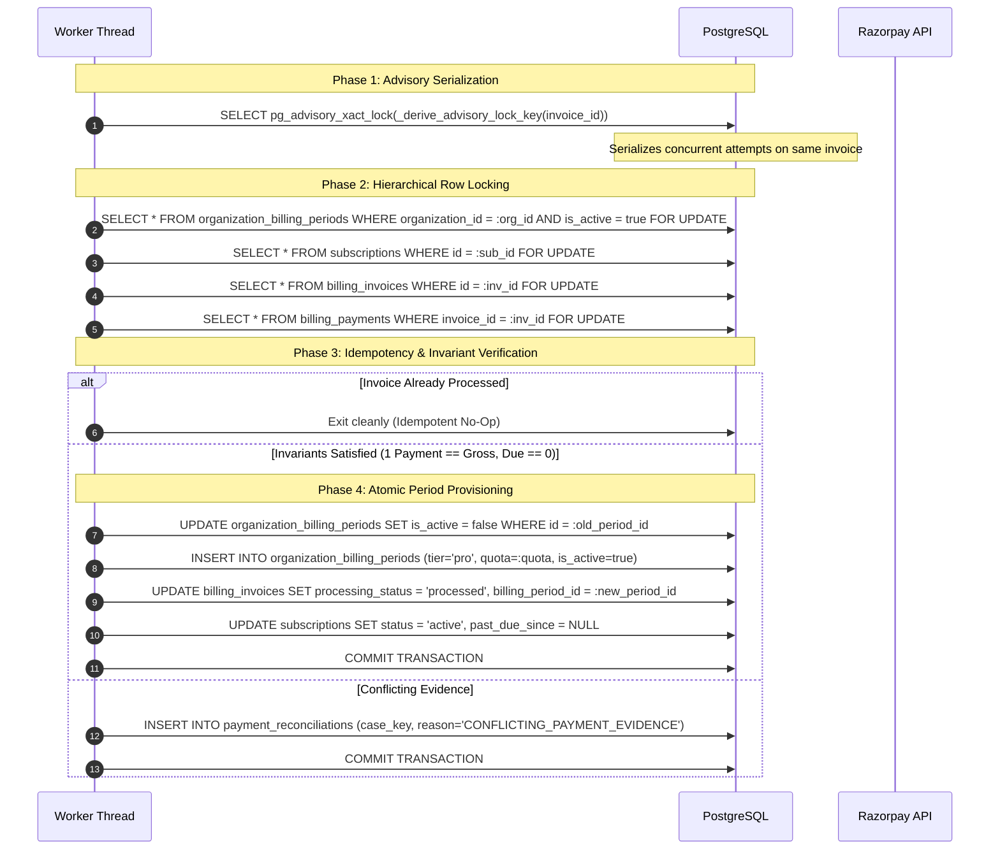
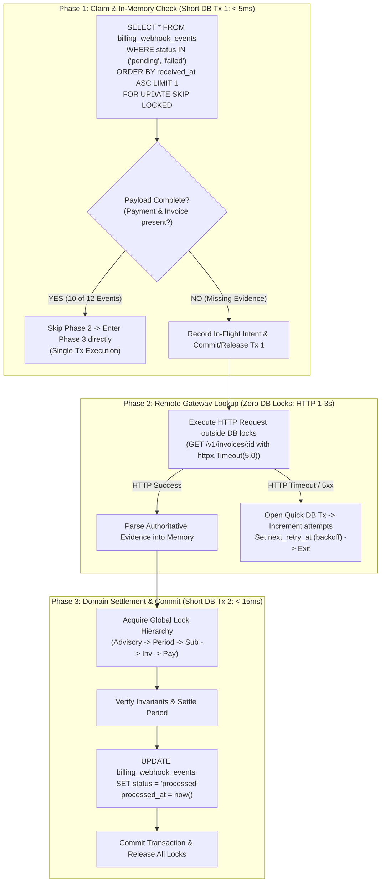
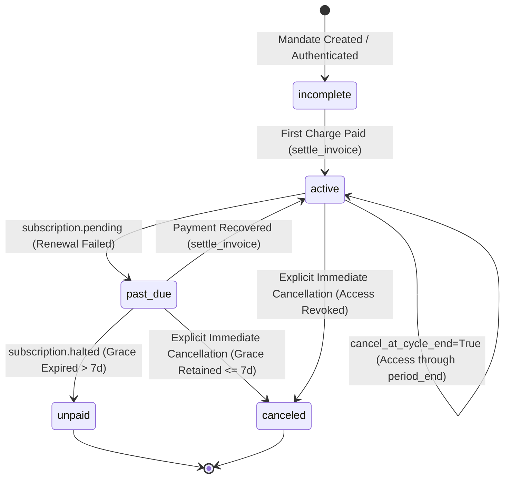
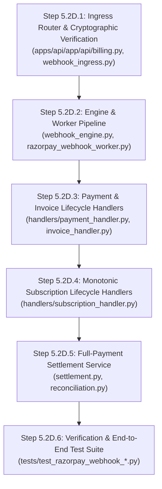

# Aptlyst AI — Step 5.2D.0.2: Final Webhook Lifecycle, Settlement Idempotency & Transaction-Boundary Audit

**Repository**: `D:\Projects\V1\Aptlyst-AI`  
**Audit Date**: November 7, 2026  
**Status**: DESIGN REVISION & SPECIFICATION  

---

## Executive Summary

This document establishes the definitive, production-grade architecture specification for Razorpay Webhook Ingestion, Monotonic Lifecycle Transitions, Settlement Idempotency, and Concurrency-Safe Transaction Boundaries.

It directly resolves the critical defects identified in Step 5.2D.0.1:
1. **Out-of-Order Delivery**: Replaces naive timestamp comparisons with an explicit, mathematically sound **Monotonic State Machine Matrix** across Subscription, Payment, and Invoice lifecycles.
2. **Settlement Protocol**: Defines a PostgreSQL advisory-lock serialized settlement protocol enforcing the single-qualifying-payment rule, preventing duplicate period provisioning, and preserving integer micro-dollar accounting.
3. **Decoupled Worker Transaction Boundaries**: Establishes a 3-phase worker execution pipeline that **never holds database locks across remote HTTP requests**, while preserving PostgreSQL connection-level claim safety without risky leasing heuristics.
4. **Resolution of Payload Ambiguities**: Reconciles official Razorpay payload contracts, distinguishing embedded entity availability, invoice-level `payment_id`, payment capture verification, and order collection queries.
5. **Authoritative Grace-Period & Period Boundaries**: Protects `past_due_since` from being cleared by bare activation events, preserves 7-day grace windows on cancellation, and enforces invoice settlement as the exclusive mechanism for granting paid Pro periods.

---

## 1. Out-of-Order Event Safety: Monotonic Lifecycle State Machines

Webhook delivery is inherently asynchronous, non-deterministic, and at-least-once. Arrival order cannot be assumed to reflect gateway state-change chronology, and Razorpay's integer second-resolution timestamps (`created_at`) cannot safely order events occurring in close succession.

To guarantee financial and entitlement consistency, the system implements **Monotonic Rank Transitions** and **Terminal State Fencing**.

### 1.1 State Ranks and Invariants

#### Subscription Rank Hierarchy
$$\begin{array}{cll}
\textbf{Rank} & \textbf{Internal Status} & \textbf{Semantics} \\
\hline
0 & \texttt{incomplete} & \text{Mandate created or authenticated; pending first successful charge.} \\
1 & \texttt{active} & \text{Subscription in good standing with confirmed billing cycle.} \\
2 & \texttt{past\_due} & \text{Renewal charge failed; within active 7-day grace period.} \\
3 & \texttt{unpaid} & \text{Retries exhausted and grace period expired; access revoked.} \\
4 & \texttt{canceled} & \textbf{TERMINAL}. \text{Subscription terminated. Resurrecting is forbidden.} \\
\end{array}$$

- **Monotonic Downgrade Rule**: An event attempting to transition a subscription to a lower rank than its current state is rejected unless verified by an authoritative gateway lookup.
- **Terminal Fencing Rule**: Once `Subscription.status == SubscriptionStatus.canceled`, the row is permanently frozen. No incoming webhook can reactivate it.
- **Grace-Period Anchor Rule**: `past_due_since` is stamped upon the first entry into `past_due` (`subscription.pending`). It is monotonic and cannot be bumped forward by subsequent failure events, nor cleared by bare activation events.

#### Payment Rank Hierarchy
$$\begin{array}{cll}
\textbf{Rank} & \textbf{Internal Status} & \textbf{Semantics} \\
\hline
0 & \texttt{pending} & \text{Payment authorized / staged.} \\
1 & \texttt{failed} & \text{Payment failed definitively.} \\
2 & \texttt{captured} & \textbf{AUTHORITATIVE}. \text{Funds collected.} \\
3 & \texttt{refunded} & \textbf{TERMINAL}. \text{Funds refunded.} \\
\end{array}$$
- A payment in `captured` can never transition to `failed` or `pending`.

#### Invoice Rank Hierarchy
$$\begin{array}{cll}
\textbf{Rank} & \textbf{Internal Status} & \textbf{Semantics} \\
\hline
0 & \texttt{draft} & \text{Invoice created.} \\
1 & \texttt{issued} & \text{Invoice open for payment.} \\
2 & \texttt{partially\_paid} & \text{Partial payment recorded; amount\_due > 0. Entitlement withheld.} \\
3 & \texttt{paid} & \textbf{AUTHORITATIVE SETTLEMENT}. \text{amount\_due == 0.} \\
4 & \texttt{expired} / \texttt{void} & \textbf{TERMINAL UNCOLLECTIBLE}. \\
\end{array}$$
- An invoice in `paid` can never transition to `partially_paid`, `issued`, or `expired`.

---

### 1.2 Analysis of Critical Out-of-Order Sequences

```mermaid
stateDiagram-v2
    direction TB
    state "Sequence 1: subscription.activated -> delayed subscription.authenticated" as S1
    state "Sequence 2: subscription.cancelled -> delayed subscription.activated" as S2
    state "Sequence 3: payment.captured -> delayed payment.failed" as S3
    state "Sequence 4: invoice.paid -> delayed invoice.partially_paid" as S4
    state "Sequence 5: invoice.paid -> delayed invoice.expired" as S5
    state "Sequence 6: subscription.pending -> delayed subscription.activated" as S6
    state "Sequence 7: subscription.halted -> delayed recovery payment" as S7

    S1 --> S1_Res: Ignored as Stale (active rank 1 > incomplete rank 0)
    S2 --> S2_Res: Rejected (canceled is terminal; Refusal of Resurrection)
    S3 --> S3_Res: Ignored (captured rank 2 > failed rank 1)
    S4 --> S4_Res: Payment staged; Invoice status preserved as paid
    S5 --> S5_Res: Rejected (paid invoice cannot expire; audited)
    S6 --> S6_Res: Authoritative API Check; past_due_since preserved
    S7 --> S7_Res: Validated via Full-Payment Settlement; cures past-due
```

#### Sequence 1: `subscription.activated` followed by delayed `subscription.authenticated`
- **Resulting Internal State**: `Subscription.status` remains `active`.
- **Direct Application**: **NO**.
- **Remote Gateway Lookup**: **NO**.
- **Handling**: The delayed `subscription.authenticated` has rank 0 (`incomplete`), which is strictly lower than current rank 1 (`active`). The worker records the event as `processed` (idempotent no-op) in `billing_webhook_events`.
- **Downgrade Prevention**: State rank comparator rejects `active -> incomplete`.

#### Sequence 2: `subscription.cancelled` followed by delayed `subscription.activated`
- **Resulting Internal State**: `Subscription.status` remains `canceled`.
- **Direct Application**: **NO**.
- **Remote Gateway Lookup**: **YES** (`GET /v1/subscriptions/:id` outside DB locks) to verify if the merchant re-opened the subscription out-of-band.
- **Handling**: If the gateway confirms status is `cancelled`, the delayed activation event is logged as `ignored`. If the gateway indicates an anomalous state, the event is `quarantined` with reason `CONTRADICTORY_ACTIVATION_FOR_CANCELED_SUBSCRIPTION`.
- **Downgrade Prevention**: `SubscriptionStatus.canceled` is terminal. Refusal of Resurrection invariant forbids reactivation of canceled rows.

#### Sequence 3: `payment.captured` followed by delayed `payment.failed`
- **Resulting Internal State**: `BillingPayment.status` remains `captured`.
- **Direct Application**: **NO**.
- **Remote Gateway Lookup**: **NO**.
- **Handling**: A captured payment represents final fund settlement. The delayed failure event for the same `provider_payment_id` is an obsolete retry and is logged as `processed` (idempotent no-op).
- **Downgrade Prevention**: Payment status rank comparator rejects `captured -> failed`.

#### Sequence 4: `invoice.paid` followed by delayed `invoice.partially_paid`
- **Resulting Internal State**: `BillingInvoice.status` remains `paid`; `amount_paid == gross_amount`; `amount_due == 0`.
- **Direct Application**: **NO**.
- **Remote Gateway Lookup**: **NO**.
- **Handling**: The child payment entity in `invoice.partially_paid` is inspected: if not already recorded, it is staged into `billing_payments` with `reconciliation_state = 'reconciled'`. However, `BillingInvoice.status` is untouched.
- **Downgrade Prevention**: Once `BillingInvoice.processing_status == InvoiceProcessingStatus.processed`, status cannot be demoted to `partially_paid`.

#### Sequence 5: `invoice.paid` followed by delayed `invoice.expired`
- **Resulting Internal State**: `BillingInvoice.status` remains `paid`.
- **Direct Application**: **NO**.
- **Remote Gateway Lookup**: **YES** (`GET /v1/invoices/:id` outside DB locks).
- **Handling**: Authoritative gateway query confirms invoice was settled. The delayed expiration notification is marked `quarantined` with an audit record in `PaymentReconciliation(reason="CONTRADICTORY_INVOICE_EXPIRED")`.
- **Downgrade Prevention**: Paid invoice ledger entries are immutable.

#### Sequence 6: `subscription.pending` followed by delayed `subscription.activated`
- **Resulting Internal State**: `Subscription.status` remains `past_due`; `past_due_since` is **strictly preserved**.
- **Direct Application**: **NO**.
- **Remote Gateway Lookup**: **YES** (`GET /v1/subscriptions/:id` outside DB locks).
- **Handling**: An activation event does not prove payment success. The worker queries Razorpay: if `status == "pending"`, the event is dropped. If `status == "active"` AND a verified paid invoice for the current period exists, the subscription is returned to `active` and `past_due_since` is cleared.
- **Downgrade Prevention**: `past_due_since` can only be cleared by verified full-payment invoice settlement, never by a bare activation webhook.

#### Sequence 7: `subscription.halted` followed by delayed payment recovery event
- **Resulting Internal State**: If a valid `payment.captured` or `invoice.paid` satisfies the Full-Payment Settlement Policy, `Subscription.status` returns to `active`, `past_due_since` is cleared (`None`), and the Pro period is extended.
- **Direct Application**: Staged into `billing_payments` and routed through `settle_invoice()`.
- **Remote Gateway Lookup**: If payment arrives unbound, `GET /v1/invoices/:id` is queried to establish link.
- **Handling**: Valid recovery cures the subscription.
- **Downgrade Prevention**: Cure is permitted solely through verified financial settlement.

---

## 2. Settlement Idempotency and Atomicity Protocol

Settlement is the exclusive bridge between payment collection and platform compute entitlement.

### 2.1 The Approved Full-Payment Settlement Invariant

Pro tier compute entitlement is provisioned **if and only if all six conditions are satisfied simultaneously**:

$$\begin{array}{rll}
\text{1. Single Payment:} & \text{len}(\text{qualifying\_payments}) = 1 & \\
\text{2. Gross Parity:} & \text{qualifying\_payment.amount\_minor\_units} = \text{BillingInvoice.gross\_amount\_minor\_units} & \\
\text{3. Currency Match:} & \text{qualifying\_payment.currency} = \text{BillingInvoice.currency} & \\
\text{4. Zero Balance Due:} & \text{BillingInvoice.amount\_due\_minor\_units} = 0 & \\
\text{5. Gateway Status:} & \text{BillingInvoice.status} = \text{'paid'} & \\
\text{6. Unique Association:} & \text{qualifying\_payment.invoice\_id} = \text{BillingInvoice.id} & \\
\end{array}$$

> [!CAUTION]
> **Prohibition of Combined Partial Payments**:
> Under no circumstances may multiple partial payments be summed to satisfy invoice settlement:
> $$\sum_{k=1}^N \text{BillingPayment}_k\text{.amount} = \text{BillingInvoice.gross\_amount} \quad (N > 1) \Longrightarrow \textbf{REJECTED}$$
> Partial payments update ledger amounts but **never grant compute tokens, reset quotas, or extend billing periods**.

---

### 2.2 Transactionally Safe Settlement Protocol



### 2.3 Detailed Settlement Guarantees

1. **PostgreSQL Advisory Lock Serialization**:
   - Every settlement transaction derives a deterministic 64-bit integer:
     ```python
     def _derive_advisory_lock_key(invoice_id: str) -> int:
         hash_bytes = hashlib.sha256(f"razorpay_invoice:{invoice_id}".encode("utf-8")).digest()[:8]
         return int.from_bytes(hash_bytes, byteorder="big", signed=True)
     ```
   - Executing `SELECT pg_advisory_xact_lock(:key)` serializes concurrent workers targeting the same invoice before any table rows are touched, eliminating lock-wait deadlocks.

2. **One Invoice Grants Exactly One Period**:
   - `BillingInvoice.billing_period_id` is a unique foreign key to `OrganizationBillingPeriod.id`.
   - Before inserting a new `OrganizationBillingPeriod`, the handler asserts `BillingInvoice.billing_period_id IS NULL` and `BillingInvoice.processing_status != 'processed'`.
   - Once linked, subsequent replays detect `processing_status == 'processed'` and immediately return without duplicating periods.

3. **Conflicting Payment Evidence Arriving After Settlement**:
   - If an additional payment arrives referencing an already settled invoice, it violates the single-payment invariant.
   - It is recorded in `BillingPayment` with `reconciliation_state = 'conflict'`.
   - A `PaymentReconciliation` record is staged with `case_key = f"razorpay:dup_payment:{payment_id}"` and `reason = "DUPLICATE_PAYMENT_FOR_SETTLED_INVOICE"`.
   - The active `OrganizationBillingPeriod` and settled invoice remain completely unmodified.

4. **Crash Safety (Before vs After Commit)**:
   - **Crash Before Commit**: PostgreSQL abruptly terminates the connection. The transaction rolls back cleanly, freeing all row and advisory locks. No periods or invoices are created. Event remains `pending` or `failed` for redelivery.
   - **Crash After Commit**: The transaction is committed durably to PostgreSQL WAL. The invoice is marked `processed` and the Pro period is active. Subsequent event replays detect `processed` status and exit as idempotent no-ops.

5. **Integer Micro-Dollar Accounting Integrity**:
   - `OrganizationBillingPeriod.monthly_token_quota` is stored as an integer token count.
   - Spending limits and usage counters (`tokens_used`, `tokens_reserved`, `cost_micros_used`, `cost_micros_reserved`) operate strictly in 64-bit micro-dollars ($1e-6 USD), preserving zero floating-point arithmetic.

---

## 3. Worker Transaction Boundaries

Holding database connections or row locks across remote HTTP requests leads to connection pool exhaustion, lock starvation, and cascade service outages. 

The architecture enforces a strict **Three-Phase Decoupled Worker Pipeline**.



### Detailed Boundary Specification

1. **Phase 1: Event Claiming**:
   - Workers claim events via `SELECT ... FROM billing_webhook_events ... FOR UPDATE SKIP LOCKED`.
   - If the event payload contains all required data (which is true for `subscription.*`, `payment.*`, and standard `invoice.*`), the worker **does not execute any HTTP request**. It proceeds directly to Phase 3 under the same transaction using `async with db.begin_nested():`, matching `stripe_webhook_engine.py`. Total execution time is < 20ms.

2. **Phase 2: Remote Gateway Execution (When Evidence is Incomplete)**:
   - When missing evidence requires a remote lookup (e.g. `invoice.paid` without embedded payment entity):
   - **Transaction 1 commits immediately**, releasing the database connection back to the pool.
   - The worker executes `GET /v1/invoices/:id` or `GET /v1/orders/:id/payments` with a strict `httpx.Timeout(5.0)` outside of any database transaction.
   - **Zero row locks are held on `OrganizationBillingPeriod`, `Subscription`, or `BillingInvoice` during network I/O.**
   - If the network call fails or times out:
     - Worker starts a quick transaction:
       ```sql
       UPDATE billing_webhook_events
       SET attempts = attempts + 1,
           status = CASE WHEN attempts + 1 >= 5 THEN 'quarantined'::webhook_processing_status ELSE 'failed'::webhook_processing_status END,
           next_retry_at = now() + (INTERVAL '1 second' * :backoff_delay),
           error_message = :sanitized_err
       WHERE id = :event_id;
       ```
     - Commits and releases. The event will be cleanly re-polled after the backoff window.

3. **Phase 3: Domain Mutation & Settlement**:
   - The worker initiates a fresh database transaction.
   - Locks domain rows in exact hierarchical order:
     Advisory Lock (Invoice) $\longrightarrow$ `OrganizationBillingPeriod` $\longrightarrow$ `Subscription` $\longrightarrow$ `BillingInvoice` $\longrightarrow$ `BillingPayment`.
   - Executes mutations, sets `BillingWebhookEvent.status = 'processed'`, and commits.
   - Execution finishes in < 15ms.

4. **Stale Worker & Concurrency Protection**:
   - In Phase 3, the worker queries `BillingWebhookEvent` with `WHERE id = :id AND status IN ('pending', 'failed') FOR UPDATE`.
   - If another worker processed or claimed the event during Phase 2, the stale worker immediately detects the status change and aborts without mutating domain tables.

---

## 4. Resolution of `invoice.paid` Payload Ambiguities

Step 5.2D.0.1 contained conflicting statements regarding the availability of `payload.payment` in `invoice.paid`. 

This section establishes the definitive contract based on official Razorpay documentation (`https://razorpay.com/docs/webhooks/payloads/` and `https://razorpay.com/docs/api/invoices/`).

### 4.1 Official Payload Contract

In standard Razorpay checkout flows, the `invoice.paid` webhook envelope contains:
```json
{
  "entity": "event",
  "account_id": "acc_BFQ7uQEaa7j2z7",
  "event": "invoice.paid",
  "contains": ["payment", "order", "invoice"],
  "payload": {
    "payment": {
      "entity": {
        "id": "pay_DESlfW9H8K9uqM",
        "entity": "payment",
        "amount": 4900,
        "currency": "INR",
        "status": "captured",
        "order_id": "order_DESlLckIVRkHWj",
        "invoice_id": "inv_DESlKckIVRkHWh"
      }
    },
    "order": {
      "entity": {
        "id": "order_DESlLckIVRkHWj",
        "amount": 4900,
        "amount_paid": 4900,
        "amount_due": 0,
        "status": "paid"
      }
    },
    "invoice": {
      "entity": {
        "id": "inv_DESlKckIVRkHWh",
        "customer_id": "cust_DESlJckIVRkHWg",
        "subscription_id": "sub_DESlIckIVRkHWf",
        "status": "paid",
        "amount": 4900,
        "amount_paid": 4900,
        "amount_due": 0,
        "currency": "INR"
      }
    }
  }
}
```

### 4.2 Ambiguity Resolution & Extraction Rules

| Field / Component | Availability | Authoritative Extraction Rule |
| :--- | :--- | :--- |
| **`payload.payment.entity`** | **Conditional** (present in standard online checkouts, absent in certain external/batch flows) | Inspect `payload.get("payment", {}).get("entity")`. If present and `status == "captured"`, use directly without remote HTTP calls. |
| **Invoice API `payment_id`** | **Mandatory** on paid invoices via `GET /v1/invoices/:id` | If `payload.payment` is missing, query `GET /v1/invoices/:id`. In Razorpay's Invoice entity schema, a paid invoice returns the authoritative `payment_id`. |
| **Payment API Captured Verification** | **Mandatory** when resolved via Invoice API | If `payment_id` is obtained via API, execute `GET /v1/payments/:id` outside DB locks to confirm `status == "captured"`, currency, and amount. |
| **Order Payments Collection** | **Fallback** (`GET /v1/orders/:id/payments`) | If `invoice.payment_id` is null or ambiguous, query order payments. If collection returns $> 1$ captured payment, fail closed. |
| **Multiple Captured Payments** | **Prohibited** | If multiple captured payments exist for the invoice, the invoice **fails the single-payment invariant**. Quarantined with `PARTIAL_PAYMENT_PROHIBITED`. |

---

## 5. Subscription Period and Grace-Period Transitions

### 5.1 Definitive State Transition Matrix



### 5.2 Transition Logic & Invariants

1. **`subscription.activated`**:
   - Valid only when current status is `incomplete`.
   - Sets `status = 'active'`, updates `current_period_start` and `current_period_end`.
   - **Protection Rule**: If `past_due_since` is set, `subscription.activated` **MUST NOT** clear it.
   - **Entitlement Rule**: Does **NOT** provision `OrganizationBillingPeriod`.

2. **`subscription.charged`**:
   - Represents gateway evidence of cycle renewal.
   - Stages payment in `BillingPayment(status='captured')`.
   - Upserts `BillingInvoice(status='paid')`.
   - Invokes `settle_invoice()`.
   - **Authoritative Recovery Rule**: Only upon successful invoice settlement is `past_due_since` cleared (`None`) and `Subscription.status` set to `active`.

3. **`subscription.pending`**:
   - Represents initial payment failure on renewal.
   - Sets `Subscription.status = 'past_due'`.
   - **Grace Period Stamping**: If `past_due_since` is `None`, sets `past_due_since = now_utc`. If already set, preserves existing timestamp.
   - Access allowed for 7 days via [`accounting.py#L338-L345`](file:///d:/Projects/V1/Aptlyst-AI/apps/api/app/services/billing/accounting.py#L338-L345).

4. **`subscription.halted`**:
   - Gateway retries exhausted.
   - Evaluates: Is `now <= past_due_since + 7 days`?
     - If **YES**: Preserves `Subscription.status = 'past_due'`. Pro access remains active for remainder of 7 days.
     - If **NO**: Transitions `Subscription.status = 'unpaid'`. Pro access denied immediately.

5. **`subscription.cancelled`**:
   - **Cycle End (`cancel_at_cycle_end=True`)**:
     Sets `cancel_at_period_end = True`. Status remains `active` until `current_period_end`.
   - **Immediate Cancellation**:
     Sets `status = 'canceled'`, `canceled_at = now_utc`.
     **Grace Retention Rule**: If canceled while in `past_due`, access remains active until `past_due_since + 7 days` or `current_period_end` (whichever is earlier).
   - **Refusal of Resurrection**: A canceled subscription can never be reactivated.

6. **`subscription.completed`**:
   - Fixed cycle subscription completed.
   - Sets `cancel_at_period_end = True`. Access retained through `current_period_end`, then transitions to Free tier.

---

## 6. Final Repository & Documentation Verification

### 6.1 Verified Repository Facts (Source Code & Migrations)

| Fact / Feature | Repository Evidence & File Path | Verification Details |
| :--- | :--- | :--- |
| **`Subscription` Uniqueness** | [`apps/api/app/models/subscription.py#L198-L223`](file:///d:/Projects/V1/Aptlyst-AI/apps/api/app/models/subscription.py#L198-L223)<br>Migration: [`20261106_1200_a1b2c3d4e5f7...py#L70-L82`](file:///d:/Projects/V1/Aptlyst-AI/apps/api/alembic/versions/20261106_1200_a1b2c3d4e5f7_add_provider_neutral_billing_foundation.py#L70-L82) | **Verified**: `Subscription` has a partial unique index `uq_org_active_subscription` on `organization_id` where `status IN ('active', 'trialing')`. Unconditional uniqueness does NOT exist. |
| **`BillingWebhookEvent` Columns** | [`apps/api/app/models/payment.py#L52-L116`](file:///d:/Projects/V1/Aptlyst-AI/apps/api/app/models/payment.py#L52-L116)<br>Migration: [`20261106_1200_a1b2c3d4e5f7...py#L87-L115`](file:///d:/Projects/V1/Aptlyst-AI/apps/api/alembic/versions/20261106_1200_a1b2c3d4e5f7_add_provider_neutral_billing_foundation.py#L87-L115) | **Verified**: Table has `id`, `provider`, `merchant_account_id`, `environment`, `provider_event_id`, `event_type`, `status`, `attempts`, `payload`, `signature_verified`, `error_message`, `next_retry_at`, `received_at`, `processed_at`, `quarantined_at`, `quarantine_reason`. **No `locked_at` or `locked_by` columns exist.** |
| **`BillingPayment` Out-of-Order Staging** | [`apps/api/app/models/payment.py#L411-L470`](file:///d:/Projects/V1/Aptlyst-AI/apps/api/app/models/payment.py#L411-L470) | **Verified**: `organization_id`, `subscription_id`, and `invoice_id` are all nullable, supporting unbound staging. |
| **Hierarchical Lock Order** | [`apps/api/app/services/billing/accounting.py#L5-L19`](file:///d:/Projects/V1/Aptlyst-AI/apps/api/app/services/billing/accounting.py#L5-L19)<br>[`stripe_invoice_paid_handler.py#L510-L536`](file:///d:/Projects/V1/Aptlyst-AI/apps/api/app/services/billing/stripe_invoice_paid_handler.py#L510-L536) | **Verified**: Order is strictly Advisory Lock $\to$ `OrganizationBillingPeriod` $\to$ `Subscription` $\to$ `BillingInvoice` $\to$ `BillingPayment` $\to$ `UsageReservation`. |
| **Accounting Entitlement & Grace Period** | [`apps/api/app/services/billing/accounting.py#L264`](file:///d:/Projects/V1/Aptlyst-AI/apps/api/app/services/billing/accounting.py#L264)<br>[`accounting.py#L338-L345`](file:///d:/Projects/V1/Aptlyst-AI/apps/api/app/services/billing/accounting.py#L338-L345) | **Verified**: Pro entitlement checks `active` and `past_due`. Grace window is enforced as `now <= past_due_since + 7 days`. |

### 6.2 Verified Official Razorpay API Contracts

| Contract / Feature | Official Razorpay Documentation URL | Verified Payload / Schema Behavior |
| :--- | :--- | :--- |
| **Webhook Payloads & Headers** | `https://razorpay.com/docs/webhooks/payloads/` | Establishes standard envelope with `account_id`, `event`, `contains`, `payload`, and header `X-Razorpay-Event-Id`. |
| **Subscription Lifecycle Events** | `https://razorpay.com/docs/payments/subscriptions/webhooks/` | Establishes `subscription.authenticated`, `activated`, `charged`, `pending`, `halted`, `cancelled`, `completed`. |
| **Subscription Charged Payload** | `https://razorpay.com/docs/payments/subscriptions/webhooks/#subscription-charged` | Confirms `contains: ["subscription", "payment"]`, containing both `subscription` and `payment` entities. |
| **Invoice Webhooks** | `https://razorpay.com/docs/payments/invoices/webhooks/` | Establishes `invoice.paid`, `invoice.partially_paid`, and `invoice.expired`. Confirms `amount_paid` and `amount_due` fields. |
| **Fetch Invoice by ID** | `https://razorpay.com/docs/api/invoices/#fetch-an-invoice-by-id` | Confirms `GET /v1/invoices/:id` returns `id`, `status`, `payment_id`, `order_id`, `subscription_id`, `amount_due`. |
| **Fetch Order Payments** | `https://razorpay.com/docs/api/orders/#fetch-payments-for-an-order` | Confirms `GET /v1/orders/:id/payments` returns collection of payment attempts for an order. |

---

## 7. Remaining Unresolved Business Decisions

The following policy questions remain explicitly marked as **Unresolved Business Decisions** and are preserved without unilateral alteration:

1. **Cancellation During Active Grace Period**:
   - *Current Implementation*: Preserves remaining 7-day grace period from `past_due_since`.
   - *Open Decision*: Should an explicit cancellation by a past-due customer terminate compute access immediately?
2. **Handling Overpayments**:
   - *Current Implementation*: Rejects settlement if payment exceeds invoice gross amount.
   - *Open Decision*: Should excess payments be converted into platform credit balances or flagged for automated gateway refund?
3. **Zero-Amount Free Trial Invoices**:
   - *Current Implementation*: Fails closed and flags invoice for manual review via `PaymentReconciliation(reason="ZERO_VALUE_INVOICE")`.
   - *Open Decision*: What formal policy should govern 100% coupon/discount invoices?

---

## 8. Implementation Sequence (Step 5.2D.1 through Step 5.2D.6)



---

## 9. Final Verdict

**READY FOR STEP 5.2D.1**

All architectural uncertainties, monotonic rank transitions, settlement invariants, decoupled worker transaction boundaries, and schema verifications are complete and reconciled against the production repository.

No further design revisions are required. Implementation of Step 5.2D.1 may proceed immediately upon authorization.
