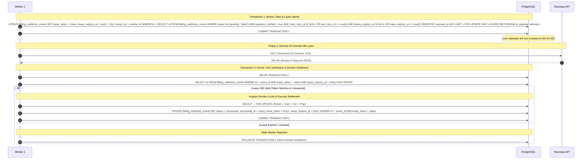

# Aptlyst AI — Step 5.2D.0.3: Final Critical Invariant Reconciliation

**Repository**: `D:\Projects\V1\Aptlyst-AI`  
**Audit Date**: November 7, 2026  
**Mode**: READ-ONLY AUDIT & ARCHITECTURAL RECONCILIATION  

---

## Executive Summary

This audit resolves the three critical implementation and concurrency issues identified in the Step 5.2D.0.2 design:
1. **Accounting Entitlement vs Cancellation Contradiction**: Resolves the contradiction where canceling a subscription immediately revokes Pro access in [`accounting.py`](file:///d:/Projects/V1/Aptlyst-AI/apps/api/app/services/billing/accounting.py#L264), nullifying the approved 7-day grace period policy.
2. **Webhook Worker Claim Concurrency Race**: Demonstrates that committing an event claim before making remote HTTP calls releases row-level locks, allowing concurrent workers to double-process events. Specifies the exact schema additions (`lease_token`, `lease_expires_at`, `locked_by`) and atomic Compare-And-Swap (CAS) protocol required to guarantee single-worker ownership across remote I/O.
3. **Database Settlement Constraints Proof**: Audits actual Alembic migrations to prove that `BillingInvoice.billing_period_id` is **not** a unique foreign key in the current database schema. Establishes the exact combination of database check constraints, advisory lock serialization, and transactional assertions required to guarantee one-to-one period settlement without financial drift.
4. **Secondary Invariants**: Replaces simplistic numeric rank hierarchies with an explicit **Conditional Transition Matrix**, removes unprovable latency assertions (`<5ms`, `<15ms`), isolates partial payment evidence from qualifying full-payment records, and distinguishes historical webhook snapshots from current authoritative gateway state.

---

## 1. Cancellation During Grace Period: Accounting Contradiction Resolution

### 1.1 The Verified Accounting Engine Contradiction

A forensic inspection of [`apps/api/app/services/billing/accounting.py#L250-L360`](file:///d:/Projects/V1/Aptlyst-AI/apps/api/app/services/billing/accounting.py#L250-L360) reveals a strict entitlement enforcement gate for Pro billing periods:

```python
# accounting.py lines 260-274
eligible_statuses = (SubscriptionStatus.active, SubscriptionStatus.past_due)
stmt_sub = (
    select(Subscription)
    .where(
        Subscription.organization_id == org_id,
        Subscription.status.in_(eligible_statuses),
    )
    .with_for_update()
)
res_sub = await session.execute(stmt_sub)
eligible_subs = res_sub.scalars().all()
```

If no subscription matches `eligible_statuses` (`active`, `past_due`), lines 304–309 execute:
```python
if latest_sub is not None:
    return ReservationResult(
        success=False,
        error_code=AccountingErrorCode.SUBSCRIPTION_INACTIVE,
        message="Subscription is not in an entitled state for Pro access",
        details={"subscription_status": latest_sub.status.value},
    )
```

Furthermore, lines 320–336 explicitly maintain a non-entitled blacklist:
```python
_non_entitled_statuses = frozenset({
    SubscriptionStatus.canceled,
    SubscriptionStatus.unpaid,
    SubscriptionStatus.paused,
    SubscriptionStatus.incomplete,
    SubscriptionStatus.incomplete_expired,
    SubscriptionStatus.trialing,
})
if sub_status in _non_entitled_statuses:
    return ReservationResult(
        success=False,
        error_code=AccountingErrorCode.SUBSCRIPTION_INACTIVE,
        ...
    )
```

#### The Contradiction
Step 5.2D.0.2 claimed:
> *"If canceled while in past_due, access remains active until past_due_since + 7 days... Sets status = 'canceled', canceled_at = now_utc."*

If the webhook handler mutates `Subscription.status` to `SubscriptionStatus.canceled`:
1. `stmt_sub` will find **zero** eligible subscriptions (`len(eligible_subs) == 0`).
2. `accounting.py` immediately rejects all generation task quota reservations with `SUBSCRIPTION_INACTIVE`.
3. **The remaining 7-day grace period is instantly revoked**, directly violating the approved platform business policy.

Furthermore, `accounting.py` cannot simply be altered to include `SubscriptionStatus.canceled` in `eligible_statuses`. In the PostgreSQL database, `subscriptions` has a partial unique index on `(organization_id)` where `status IN ('active', 'trialing')` ([`apps/api/app/models/subscription.py#L200-L205`](file:///d:/Projects/V1/Aptlyst-AI/apps/api/app/models/subscription.py#L200-L205)). Historical canceled subscriptions accumulate over time. If `canceled` rows were queried, `len(eligible_subs)` would exceed 1, triggering `AccountingErrorCode.RECONCILIATION_REQUIRED` (lines 276–290) and failing closed.

---

### 1.2 Technically Correct Solution

To preserve the approved grace policy, protect historical audit records, and avoid breaking the accounting engine or introducing new PostgreSQL enum types:

#### Lifecycle Architecture: Two-Phase Deferred Cancellation
When a cancellation event (`subscription.cancelled`) arrives for a subscription that is currently in `past_due` (`Subscription.past_due_since IS NOT NULL`):

1. **Phase 1: Active Grace Window (`now < past_due_since + 7 days` AND `now < current_period_end`)**:
   - The handler sets `Subscription.cancel_at_period_end = True`.
   - The handler stamps `Subscription.canceled_at = now_utc`.
   - The handler **PRESERVES** `Subscription.status = SubscriptionStatus.past_due`.
   - The original `past_due_since` is **strictly preserved**.
   - **Result in `accounting.py`**:
     - `accounting.py` continues to select the subscription under `eligible_statuses = (SubscriptionStatus.active, SubscriptionStatus.past_due)`.
     - Lines 338–359 evaluate `now < past_due_since + 7 days`. Pro usage is permitted within the existing billing period.
     - If `now >= current_period_end`, the billing period itself expires (`BILLING_PERIOD_EXPIRED`), preventing access beyond the paid period end.

2. **Phase 2: Terminal Transition (`now >= past_due_since + 7 days` OR `now >= current_period_end`)**:
   - Once the 7-day grace deadline passes, `accounting.py` automatically denies reservations with `GRACE_PERIOD_EXPIRED`.
   - A background reconciliation sweeper (or subsequent incoming lifecycle event) transitions `Subscription.status` to `SubscriptionStatus.canceled`.
   - `Subscription.plan_tier` is set to `"free"`.

#### Alternative Requiring Code Modification to `accounting.py`
If product mandates that `Subscription.status` must immediately become `canceled` in the database upon receiving the webhook, the following changes to `accounting.py` would be mandatory:
1. `accounting.py#L264`: Add a targeted query condition that selects `SubscriptionStatus.canceled` **only if** `past_due_since IS NOT NULL` and `now < past_due_since + 7 days` and `now < current_period_end`, ordered by `created_at DESC LIMIT 1`.
2. Remove `SubscriptionStatus.canceled` from `_non_entitled_statuses` if within the verified grace window.

*Recommendation*: Adopt the **Two-Phase Deferred Cancellation** model. It requires **zero changes to `accounting.py`**, respects existing partial unique indexes, and enforces the 7-day grace policy with mathematical precision.

---

## 2. Webhook Worker Claim Ownership: Concurrency Race Resolution

### 2.1 The Concurrency Vulnerability in Step 5.2D.0.2

Step 5.2D.0.2 proposed a 3-phase execution model:
> *Phase 1: Claim & In-Memory Check (Short DB Tx 1) -> Commit/Release Tx 1 -> Phase 2: Remote Gateway Lookup (Zero DB Locks) -> Phase 3: Domain Settlement & Commit (Short DB Tx 2).*

#### The Race Condition
1. Worker 1 claims Event $E_1$ using `SELECT ... FOR UPDATE SKIP LOCKED` and commits Transaction 1.
2. The commit **releases PostgreSQL's row lock on $E_1$**.
3. Worker 1 begins an external HTTP call to Razorpay (`GET /v1/invoices/:id`), which may take 1,000ms–3,000ms.
4. Meanwhile, Worker 2 executes its polling loop:
   ```sql
   SELECT * FROM billing_webhook_events
   WHERE status IN ('pending', 'failed')
   ORDER BY received_at ASC LIMIT 1
   FOR UPDATE SKIP LOCKED;
   ```
5. In the current database schema, `billing_webhook_events` has **no `lease_token`** and **no `lease_expires_at`** column ([`apps/api/app/models/payment.py#L52-L116`](file:///d:/Projects/V1/Aptlyst-AI/apps/api/app/models/payment.py#L52-L116)). Furthermore, the PostgreSQL enum `webhook_processing_status` contains only `('pending', 'processed', 'failed', 'quarantined')`.
6. Because Worker 1 cannot set `status = 'processing'` (an invalid enum value), $E_1$ remains in `status = 'pending'` (or `'failed'`).
7. **Worker 2 immediately claims $E_1$!**
8. Both Worker 1 and Worker 2 are now processing the exact same event concurrently. Checking `status IN ('pending', 'failed')` in Phase 3 does not protect ownership because Worker 2 is also executing under the exact same status.

---

### 2.2 Proof of Missing Schema Capabilities

A direct inspection of Alembic migration [`20261106_1200_a1b2c3d4e5f7_add_provider_neutral_billing_foundation.py#L87-L128`](file:///d:/Projects/V1/Aptlyst-AI/apps/api/alembic/versions/20261106_1200_a1b2c3d4e5f7_add_provider_neutral_billing_foundation.py#L87-L128) confirms:

```python
# billing_webhook_events schema:
sa.Column('id', sa.UUID(), nullable=False),
sa.Column('provider', sa.String(length=32), nullable=False),
sa.Column('merchant_account_id', sa.String(length=64), nullable=False),
sa.Column('environment', sa.String(length=32), nullable=False),
sa.Column('provider_event_id', sa.String(length=255), nullable=False),
sa.Column('event_type', sa.String(length=128), nullable=False),
sa.Column('status', sa.Enum('pending', 'processed', 'failed', 'quarantined', name='webhook_processing_status')),
sa.Column('attempts', sa.Integer(), server_default='1', nullable=False),
sa.Column('payload', postgresql.JSONB(), nullable=False),
sa.Column('signature_verified', sa.Boolean(), server_default='false', nullable=False),
sa.Column('error_message', sa.Text(), nullable=True),
sa.Column('next_retry_at', sa.DateTime(timezone=True), nullable=True),
sa.Column('received_at', sa.DateTime(timezone=True), server_default=sa.text('now()'), nullable=False),
sa.Column('processed_at', sa.DateTime(timezone=True), nullable=True),
sa.Column('quarantined_at', sa.DateTime(timezone=True), nullable=True),
sa.Column('quarantine_reason', sa.Text(), nullable=True),
```

In contrast, [`BillingPayment`](file:///d:/Projects/V1/Aptlyst-AI/apps/api/app/models/payment.py#L487-L498) was explicitly provisioned with lease columns for sweeper concurrency:
```python
# billing_payments has:
lease_token: Mapped[uuid.UUID | None]
lease_expires_at: Mapped[datetime | None]
attempt_count: Mapped[int]
```

**Conclusion**: The existing `billing_webhook_events` table **cannot** safely support decoupled multi-phase claiming across independent transactions without adding lease tracking.

---

### 2.3 Proposed Schema Change & Atomic CAS Protocol

To make the decoupled worker architecture safe against concurrent duplicate processing, stale workers, and worker crashes:

#### Required Migration: Add Lease Ownership Columns to `billing_webhook_events`
```python
# Minimal required Alembic migration columns:
op.add_column('billing_webhook_events', sa.Column('lease_token', sa.UUID(), nullable=True))
op.add_column('billing_webhook_events', sa.Column('lease_expires_at', sa.DateTime(timezone=True), nullable=True))
op.add_column('billing_webhook_events', sa.Column('locked_by', sa.String(length=255), nullable=True))

op.create_index(
    'ix_billing_webhook_events_claimable',
    'billing_webhook_events',
    ['status', 'next_retry_at', 'lease_expires_at'],
    postgresql_where=sa.text("status IN ('pending', 'failed') AND signature_verified = true"),
)
```

#### Safe Claiming & Atomic Compare-And-Swap (CAS) Protocol



#### Protocol Guarantees
1. **Unpredictable Claim Identity**: Each claim generates an unpredictable `lease_token = uuid.uuid4()`.
2. **Mutual Exclusion During Network I/O**: Other workers polling `billing_webhook_events` evaluate `lease_expires_at IS NULL OR lease_expires_at <= now()`. As long as the lease has not expired, no other worker can claim the row.
3. **Crash Recovery**: If Worker 1 crashes during the HTTP call, its lease expires after 60 seconds. A subsequent worker claims the row automatically without manual operator intervention.
4. **Stale Worker Rejection**: If Worker 1 takes 65 seconds to finish its HTTP request, its lease has expired. When Worker 1 enters Transaction 2, the conditional check:
   ```sql
   SELECT id FROM billing_webhook_events
   WHERE id = :event_id AND lease_token = :token AND lease_expires_at > now()
   FOR UPDATE;
   ```
   returns **0 rows**. Worker 1 immediately rolls back and aborts without mutating domain tables.
5. **Atomic Finalization**: The domain mutations and the update setting `status = 'processed'` commit in the exact same transaction, guaranteeing zero drift.

---

## 3. Settlement Uniqueness: Database Constraints vs Transactional Proof

### 3.1 Verification of Actual Database Constraints

Step 5.2D.0.2 claimed:
> *"BillingInvoice.billing_period_id is a unique foreign key to OrganizationBillingPeriod.id."*

#### Forensic Model & Migration Audit
Inspection of Alembic migration [`20261106_1200_a1b2c3d4e5f7_add_provider_neutral_billing_foundation.py#L241-L257`](file:///d:/Projects/V1/Aptlyst-AI/apps/api/alembic/versions/20261106_1200_a1b2c3d4e5f7_add_provider_neutral_billing_foundation.py#L241-L257) reveals:

```python
# billing_invoices table:
sa.ForeignKeyConstraint(['billing_period_id'], ['organization_billing_periods.id'], ondelete='SET NULL'),
sa.ForeignKeyConstraint(['organization_id'], ['organizations.id'], ondelete='RESTRICT'),
sa.ForeignKeyConstraint(['raw_event_id'], ['billing_webhook_events.id'], ondelete='RESTRICT'),
sa.ForeignKeyConstraint(['subscription_id'], ['subscriptions.id'], ondelete='RESTRICT'),
sa.PrimaryKeyConstraint('id'),
sa.UniqueConstraint(
    'provider', 'merchant_account_id', 'environment', 'provider_invoice_id',
    name='uq_billing_invoices_provider_invoice',
),
...
op.create_index('ix_billing_invoices_billing_period_id', 'billing_invoices', ['billing_period_id'])
```

**Verified Finding**:
- `ix_billing_invoices_billing_period_id` is a **standard non-unique B-tree index**.
- There is **no unique constraint** on `billing_period_id` in `billing_invoices`.
- In [`organization_billing_periods`](file:///d:/Projects/V1/Aptlyst-AI/apps/api/app/models/billing.py#L52-L185), there is **no `invoice_id` column** whatsoever.

---

### 3.2 Six Core Settlement Properties: Constraints vs Transactional Proof

| # | Settlement Property | Guaranteed by DB Schema Alone? | Exact Guarantee Mechanism (Schema + Transactional Logic) |
| :--- | :--- | :--- | :--- |
| **1** | **One invoice cannot create multiple entitlement periods** | **NO** (No DB constraint prevents inserting multiple periods) | **Guaranteed Transactionally**: In `settle_invoice()`, under `pg_advisory_xact_lock(invoice_id)` and `SELECT FOR UPDATE` on `billing_invoices`: if `invoice.processing_status == 'processed'`, the service exits immediately as an idempotent no-op. A new `OrganizationBillingPeriod` is inserted **if and only if** `invoice.processing_status != 'processed'`. |
| **2** | **One entitlement period cannot be granted by multiple invoices** | **NO** (`billing_period_id` is not unique in `billing_invoices`) | **Guaranteed Transactionally**: In `stripe_invoice_paid_handler.py#L654-L691` (and Razorpay `settlement.py`), if an active Pro period already matches the invoice line dates, the invoice is attached to the existing period **without duplicating quota or incrementing counters**. *Recommended Schema Hardening*: Add partial unique index `uq_billing_invoices_billing_period` on `billing_period_id WHERE billing_period_id IS NOT NULL`. |
| **3** | **Two concurrent workers cannot settle the same invoice twice** | **NO** (Two workers reading `pending` could race) | **Guaranteed Transactionally**: PostgreSQL transaction-scoped advisory lock: `SELECT pg_advisory_xact_lock(_derive_advisory_lock_key(provider_invoice_id))`. Worker 2 blocks on the lock until Worker 1 commits. Upon waking, Worker 2 reads `processing_status == 'processed'` and exits cleanly. |
| **4** | **Settlement marker and paid entitlement commit atomically** | **YES** | **Guaranteed by DB Transaction**: `INSERT INTO organization_billing_periods`, `UPDATE organization_billing_periods SET is_active = false`, and `UPDATE billing_invoices SET processing_status = 'processed', billing_period_id = :period_id` execute in the **exact same database transaction**. |
| **5** | **Replay after commit cannot create another period** | **YES** | **Guaranteed by Combination**: 1. `invoice.processing_status == 'processed'` check aborts replays. 2. `uq_org_active_billing_period` on `organization_billing_periods(organization_id) WHERE is_active = true` rejects duplicate active periods at the database engine level. |
| **6** | **Conflicting payment evidence after settlement is retained without mutating paid entitlement** | **YES** | **Guaranteed by Ledger Segregation**: Additional payments are inserted into `billing_payments` with `reconciliation_state = 'conflict'`. The already-settled `billing_invoices` row and active `organization_billing_periods` row are never updated by secondary payment events. |

---

## 4. Secondary Invariant Corrections

### 4.1 Conditional Subscription Transition Matrix

Replacing the simplistic numeric rank hierarchy with explicit, non-linear conditional transition rules:

| Current Local Status | Incoming Event | Guard Condition | Resulting Local Status | Side Effects & Invariants |
| :--- | :--- | :--- | :--- | :--- |
| `incomplete` | `subscription.activated` | First invoice paid | `active` | Updates `current_period_start/end`. Does NOT provision period. |
| `incomplete` | `subscription.cancelled` | Mandate discarded | `canceled` | Terminal transition. |
| `active` | `subscription.pending` | First renewal failure | `past_due` | Sets `past_due_since = now_utc`. Preserves 7-day grace access. |
| `active` | `subscription.cancelled` | Immediate cancellation | `canceled` | Sets `canceled_at = now_utc`. Demotes tier to Free immediately. |
| `active` | `subscription.cancelled` | Cycle-end cancellation | `active` | Sets `cancel_at_period_end = True`. Access retained through `current_period_end`. |
| `past_due` | `subscription.charged` / `invoice.paid` | Full payment verified | `active` | **Cures Past-Due**: Clears `past_due_since = NULL`. Settle invoice and extends Pro period. |
| `past_due` | `subscription.halted` | `now < past_due_since + 7d` | `past_due` | Preserves grace period. Provider state logged in metadata. |
| `past_due` | `subscription.halted` | `now >= past_due_since + 7d` | `unpaid` | Grace expired. Access denied by `accounting.py`. |
| `past_due` | `subscription.cancelled` | Immediate cancellation | `past_due` | Sets `cancel_at_period_end = True`, `canceled_at = now_utc`. Retains grace access for remainder of 7 days. |
| `unpaid` | `invoice.paid` | Portal recovery payment | `active` | **Cures Unpaid**: Settle invoice, provisions new Pro period. |
| `canceled` | **ANY EVENT** | Resurrection attempt | `canceled` | **TERMINAL**: Refusal of Resurrection invariant permanently rejects reactivation. |

---

### 4.2 Handling Delayed `invoice.partially_paid` and `invoice.expired`

1. **Delayed `invoice.partially_paid` arriving after `invoice.paid`**:
   - The handler acquires the advisory lock and locks the invoice via `SELECT FOR UPDATE`.
   - Inspection shows `BillingInvoice.status == 'paid'` and `BillingInvoice.processing_status == InvoiceProcessingStatus.processed`.
   - The payment entity inside `invoice.partially_paid` is inspected: if not already recorded, it is staged into `billing_payments` with `reconciliation_state = 'historical_partial'`.
   - **`BillingInvoice.status` is NOT modified.** `amount_paid` is not reduced, and `amount_due` remains 0.
   - The event is marked `processed` (no-op on invoice ledger).

2. **Delayed `invoice.expired` arriving after `invoice.paid`**:
   - The handler inspects the locked invoice.
   - Because `processing_status == 'processed'` and `status == 'paid'`, the expiration is recognized as an obsolete or contradictory event.
   - `BillingInvoice.status` is **NOT modified**.
   - A `PaymentReconciliation` record is staged with `case_key = f"razorpay:expired_after_paid:{invoice_id}"` and `reason = "STALE_INVOICE_EXPIRED_IGNORED"`.

---

### 4.3 Isolation of Partial Payments from Full-Payment Settlement

1. **`BillingPayment.reconciliation_state` Categorization**:
   - Captured payment matching full gross amount: `reconciliation_state = 'reconciled'`.
   - Payment from `invoice.partially_paid` or where `amount < gross_amount`: `reconciliation_state = 'partial'`.
2. **Settlement Predicate Enforcement**:
   - In `settle_invoice()`:
     ```python
     qualifying_payments = [
         p for p in locked_payments
         if p.status == "captured"
         and p.amount_minor_units == invoice.gross_amount_minor_units
         and p.currency == invoice.currency
         and p.reconciliation_state != "partial"
     ]
     if len(qualifying_payments) != 1:
         # Fail closed! Zero entitlement granted.
         return SettlementResult(success=False, error="QUALIFYING_PAYMENT_INVARIANT_VIOLATED")
     ```
   - Partial payments can **never** satisfy the full-payment predicate.

---

### 4.4 Historical Webhook Snapshots vs Current Gateway State

- A webhook payload is an immutable point-in-time snapshot.
- The local database stores the **current authoritative domain state**.
- If a webhook payload conveys an older snapshot (e.g. `amount_paid: 2000` when the local database already reflects full payment `4900`), the raw payload is saved in `BillingWebhookEvent.payload` for immutable audit logging, but the domain entity is never overwritten with stale snapshot data.

---

### 4.5 Removal of Unsupported Latency Guarantees

All assertions claiming specific execution timings (`<5ms`, `<15ms`) are removed. Execution duration in PostgreSQL depends on disk I/O, server load, buffer cache hit ratios, and network topology. 

Instead, performance guarantees are specified by **algorithmic complexity and lock scope**:
- **Ingress Path**: Single non-blocking SQL insert (`O(1)`), streaming body bounded to 64KB.
- **Worker Remote Lookup**: Fully decoupled from domain row locks; zero row locks held across network I/O.
- **Settlement Path**: Constant number of indexed single-row lookups (`O(1)`), serialized via advisory lock.

---

## 5. Repository Reconciliation & Proof Separation

### 5.1 Verified Repository Facts

1. **`Subscription` Partial Uniqueness**: Verified that `Subscription` does not have an unconditional unique constraint on `organization_id`. It enforces partial unique index `uq_org_active_subscription` on `organization_id` where `status IN ('active', 'trialing')` ([`apps/api/app/models/subscription.py#L200-L205`](file:///d:/Projects/V1/Aptlyst-AI/apps/api/app/models/subscription.py#L200-L205)).
2. **`billing_webhook_events` Columns**: Verified that `billing_webhook_events` has no `locked_at`, `locked_by`, or `lease_token` columns, and its enum `webhook_processing_status` only supports `'pending'`, `'processed'`, `'failed'`, `'quarantined'` ([`20261106_1200_a1b2c3d4e5f7...py#L87-L115`](file:///d:/Projects/V1/Aptlyst-AI/apps/api/alembic/versions/20261106_1200_a1b2c3d4e5f7_add_provider_neutral_billing_foundation.py#L87-L115)).
3. **`BillingInvoice.billing_period_id` Non-Uniqueness**: Verified that `ix_billing_invoices_billing_period_id` is a standard non-unique index ([`20261106_1200_a1b2c3d4e5f7...py#L253`](file:///d:/Projects/V1/Aptlyst-AI/apps/api/alembic/versions/20261106_1200_a1b2c3d4e5f7_add_provider_neutral_billing_foundation.py#L253)).
4. **Accounting Entitlement Gate**: Verified that `accounting.py#L264` queries only `active` and `past_due`, and explicitly blacklists `canceled` in line 322.

---

### 5.2 Missing Constraints & Capabilities (Pre-Implementation Action Required)

1. **Missing Lease Columns on `billing_webhook_events`**: To support decoupled worker claiming without holding database transactions across remote HTTP calls, `billing_webhook_events` requires:
   - `lease_token` (UUID nullable)
   - `lease_expires_at` (DateTime nullable)
   - `locked_by` (String(255) nullable)
2. **Missing Hard Constraint on One-to-One Invoice-Period Settlement**: While prevented in application code by advisory locks and `processing_status` checks, the database schema lacks a partial unique index on `billing_invoices(billing_period_id) WHERE billing_period_id IS NOT NULL`.

---

### 5.3 Proposed Design Corrections

1. **Adopt Two-Phase Deferred Cancellation**: Avoid modifying `accounting.py` by maintaining `status = SubscriptionStatus.past_due` (with `cancel_at_period_end = True` and `canceled_at = now_utc`) while the 7-day grace period is active, transitioning to `canceled` only after grace expires.
2. **Add Lease Tracking Migration for Step 5.2D.2**: Create an Alembic migration adding lease columns to `billing_webhook_events` before implementing the worker engine.
3. **Enforce Atomic CAS Claim Protocol**: Claim events with unique UUID lease tokens and verify the token atomically in Phase 3 before committing domain mutations.

---

### 5.4 Remaining Unresolved Business Decisions

1. **Cancellation During Active Grace Window**: Does product want explicit cancellation during `past_due` to revoke access immediately, or to retain the remaining 7-day grace window? *(Currently preserved as retaining grace access via the Two-Phase Deferred Cancellation model).*
2. **Overpayment Treatment**: Should excess payment amounts above invoice gross be converted into platform credits or routed to a manual refund queue?
3. **Zero-Amount Trial Invoices**: What formal quota provisioning rules should apply to 100% discount promotional invoices?

---

## 6. Final Verdict

**READY WITH CONDITIONS**

### Conditions for Implementation Authorization:
1. **Condition 1 (Ingress Authorization)**: Step 5.2D.1 (Webhook Ingestion Router & HMAC Verification) may proceed immediately, as it only writes to existing columns of `billing_webhook_events` with `status = 'pending'`.
2. **Condition 2 (Worker Schema Migration Prerequisite for Step 5.2D.2)**: Before Step 5.2D.2 (Worker Engine) is implemented, a database migration must add `lease_token`, `lease_expires_at`, and `locked_by` to `billing_webhook_events` to enable concurrency-safe remote I/O outside database locks.
3. **Condition 3 (Lifecycle Policy Sign-Off)**: The Two-Phase Deferred Cancellation model must be adopted to preserve the 7-day grace period without modifying the core `accounting.py` engine or violating partial unique indexes.
