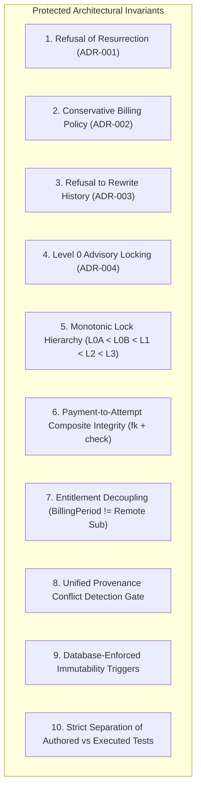

# Aptlyst AI — Comprehensive Documentation Audit & Cleanup Plan
**Document Version:** 1.0.0  
**Audit Date:** 2026-11-08  
**Audit Scope:** Repository-Wide Markdown Inventory, Invariant Preservation & Reorganization Architecture  
**Execution Mode:** STRICTLY READ-ONLY (Zero code, configuration, or documentation files moved/altered)  
**Deliverable File:** `DOCUMENTATION_AUDIT_REPORT.md`  

---

## 1. Executive Summary & Inventory Metrics

A complete, exhaustive read-only audit of all Markdown (`.md`) documentation across the Aptlyst AI repository was conducted. Virtual environments (`.venv/`), third-party dependency directories (`node_modules/`), Next.js build caches (`.next/`), Git metadata (`.git/`), and testing cache artifacts (`.pytest_cache/`) were excluded.

### 1.1 High-Level Inventory Metrics
- **Total Project Markdown Files Inspected:** **33 files**
- **Total Lines of Documentation:** **11,393 lines**
- **Total Volume of Documentation:** **760,434 bytes (~742.6 KB)**
- **Files at Repository Root (`.`):** **32 files** (97.0%)
- **Files in Subdirectories (`apps/api/`):** **1 file** (3.0%)
- **Primary Finding:** 29 milestone and audit reports from Phase 5.2D have accumulated directly at the repository root, creating visual clutter and making it difficult to distinguish canonical architecture from historical step-by-step deliberations.

---

## 2. Directory & Category Breakdown

### 2.1 Files Grouped by Current Directory

```text
D:\Projects\V1\Aptlyst-AI\
│
├── [Root Directory] (32 files, 759,569 bytes, 11,357 lines)
│   ├── AGENTS.md                                                      (678 B, 9 lines)
│   ├── CLAUDE.md                                                      (11 B, 1 line)
│   ├── README.md                                                      (1,450 B, 36 lines)
│   ├── STEP_5_2D_0_2_FINAL_WEBHOOK_DESIGN_AUDIT.md                    (31,612 B, 486 lines)
│   ├── STEP_5_2D_0_3_CRITICAL_INVARIANT_RECONCILIATION.md             (28,569 B, 410 lines)
│   ├── STEP_5_2D_1_WEBHOOK_INGESTION_IMPLEMENTATION_REPORT.md         (18,243 B, 311 lines)
│   ├── STEP_5_2D_2_1_WEBHOOK_WORKER_FINAL_AUDIT.md                    (22,378 B, 374 lines)
│   ├── STEP_5_2D_2_2_WEBHOOK_WORKER_CLI_REPORT.md                     (20,293 B, 459 lines)
│   ├── STEP_5_2D_2_3_WORKER_LIFECYCLE_FINAL_AUDIT.md                  (16,347 B, 303 lines)
│   ├── STEP_5_2D_2_WEBHOOK_WORKER_IMPLEMENTATION_REPORT.md            (17,798 B, 299 lines)
│   ├── STEP_5_2D_3A_1_DESIGN_CORRECTION_REPORT.md                     (18,402 B, 251 lines)
│   ├── STEP_5_2D_3A_SUBSCRIPTION_LIFECYCLE_DESIGN.md                  (40,675 B, 609 lines)
│   ├── STEP_5_2D_3_1_1_SHARED_HANDLER_FINAL_AUDIT.md                  (28,246 B, 423 lines)
│   ├── STEP_5_2D_3_1_SHARED_HANDLER_FOUNDATION_REPORT.md              (26,958 B, 362 lines)
│   ├── STEP_5_2D_3_2_10_FINAL_TECHNICAL_CORRECTIONS.md                (30,278 B, 389 lines)
│   ├── STEP_5_2D_3_2_11_FINAL_RACE_AND_MIGRATION_AUDIT.md             (32,514 B, 549 lines)
│   ├── STEP_5_2D_3_2_12_PAYMENT_ATTEMPT_LIFECYCLE_AUDIT.md            (28,990 B, 315 lines)
│   ├── STEP_5_2D_3_2_13_FINAL_PAYMENT_ASSOCIATION_VERIFICATION.md     (21,435 B, 277 lines)
│   ├── STEP_5_2D_3_2_14_PAYMENT_ASSOCIATION_HARDENING.md              (25,178 B, 307 lines)
│   ├── STEP_5_2D_3_2_1_AGREEMENT_HANDLERS_FINAL_AUDIT.md              (24,420 B, 208 lines)
│   ├── STEP_5_2D_3_2_2_AGREEMENT_HANDLER_CORRECTIONS_REPORT.md        (19,875 B, 313 lines)
│   ├── STEP_5_2D_3_2_3_OPTION_A_DESIGN_VALIDATION.md                  (29,579 B, 400 lines)
│   ├── STEP_5_2D_3_2_4_OPTION_A_FINAL_CONCURRENCY_DESIGN.md           (31,801 B, 480 lines)
│   ├── STEP_5_2D_3_2_5_SETTLEMENT_CONCURRENCY_FINAL_AUDIT.md          (22,599 B, 323 lines)
│   ├── STEP_5_2D_3_2_6_TERMINAL_AGREEMENT_DELAYED_PAYMENT_DESIGN.md   (28,222 B, 454 lines)
│   ├── STEP_5_2D_3_2_7_ENTITLEMENT_ASSOCIATION_RESUBSCRIPTION_DESIGN.md (48,676 B, 772 lines)
│   ├── STEP_5_2D_3_2_8_DESIGN_CORRECTIONS.md                          (42,515 B, 674 lines)
│   ├── STEP_5_2D_3_2_9_FINAL_BILLING_POLICY_REVIEW.md                 (33,199 B, 488 lines)
│   ├── STEP_5_2D_3_2_AGREEMENT_HANDLERS_REPORT.md                     (13,730 B, 214 lines)
│   ├── STEP_5_2D_3_3A_1_PROVENANCE_VALIDATION_REPORT.md               (21,303 B, 341 lines)
│   ├── STEP_5_2D_3_3A_2_POSTGRESQL_CI_VALIDATION_REPORT.md            (13,452 B, 222 lines)
│   └── STEP_5_2D_3_3A_SCHEMA_MIGRATION_REPORT.md                      (20,143 B, 298 lines)
│
└── apps/api/ (1 file, 865 bytes, 36 lines)
    └── README.md                                                      (865 B, 36 lines)
```

*(Note: Two third-party cache placeholder files `.pytest_cache/README.md` and `apps/api/.pytest_cache/README.md` were identified and excluded from project documentation metrics).*

### 2.2 Category Breakdown

| Category | File Count | Total Size (Bytes) | Description |
| :--- | :---: | :---: | :--- |
| **System & Tool Configuration** | 2 | 689 | `AGENTS.md` (Next.js agent harness rules), `CLAUDE.md` (pointer) |
| **Project & Package Readmes** | 2 | 2,315 | Root `README.md` (boilerplate), `apps/api/README.md` (backend setup) |
| **Architectural Specifications & Designs** | 8 | 280,314 | Detailed designs for subscription lifecycle, Option A decoupling, lock hierarchies |
| **Audit Reports & Technical Verification** | 13 | 329,663 | Concurrency race audits, lock order verification, migration safety reviews |
| **Implementation Milestone Reports** | 8 | 147,463 | Formal reports delivered at the completion of code/migration milestones |
| **Total** | **33** | **760,434** | |

---

## 3. Complete File-by-File Inventory & Audit Table

The table below catalogs every Markdown document in the repository with its current location, classification, importance, reference dependencies, and proposed lifecycle action:

| Filename | Current Location | Category | Status | Importance | Dependencies & Cross-References | Recommendation |
| :--- | :--- | :--- | :--- | :--- | :--- | :--- |
| `AGENTS.md` | `AGENTS.md` | Configuration | Current | **Critical** | Referenced by `CLAUDE.md`, generated/updated by `next dev`. | **Keep at root** |
| `CLAUDE.md` | `CLAUDE.md` | Configuration | Current | **Useful** | References `AGENTS.md`. | **Keep at root** |
| `README.md` | `README.md` | Project Readme | Outdated | **Critical** | GitHub repository landing page. Contains Next.js boilerplate. | **Keep at root & Overhaul** |
| `apps/api/README.md` | `apps/api/README.md` | Package Readme | Current | **Useful** | Backend quickstart guide for FastAPI and PostgreSQL. | **Keep in `apps/api/`** |
| `STEP_5_2D_0_2_FINAL_WEBHOOK_DESIGN_AUDIT.md` | Root | Architecture Audit | Historical | Useful | Referenced by `STEP_5_2D_1`. Audits signature verification & event deduplication. | **Archive to `docs/archive/phase_5_2d_foundation/`** |
| `STEP_5_2D_0_3_CRITICAL_INVARIANT_RECONCILIATION.md` | Root | Architecture Reconciliation | Historical | Useful | Referenced by `STEP_5_2D_1`. Reconciled Stripe legacy vs neutral models. | **Archive to `docs/archive/phase_5_2d_foundation/`** |
| `STEP_5_2D_1_WEBHOOK_INGESTION_IMPLEMENTATION_REPORT.md` | Root | Implementation Report | Canonical Milestone | High | Documents `/api/v1/billing/razorpay/webhook` ingestion endpoint implementation. | **Archive to `docs/archive/phase_5_2d_foundation/`** |
| `STEP_5_2D_2_WEBHOOK_WORKER_IMPLEMENTATION_REPORT.md` | Root | Implementation Report | Canonical Milestone | High | Documents `RazorpayWebhookWorker` claim loop and lease ownership. | **Archive to `docs/archive/phase_5_2d_foundation/`** |
| `STEP_5_2D_2_1_WEBHOOK_WORKER_FINAL_AUDIT.md` | Root | Architecture Audit | Superseded | Useful | Audited worker claim isolation. Superseded by Step 5.2D.2.2 CLI report. | **Archive to `docs/archive/phase_5_2d_foundation/`** |
| `STEP_5_2D_2_2_WEBHOOK_WORKER_CLI_REPORT.md` | Root | Implementation Report | Canonical Milestone | High | Documents CLI argument parser and signal handling (`SIGTERM`/`SIGINT`). | **Archive to `docs/archive/phase_5_2d_foundation/`** |
| `STEP_5_2D_2_3_WORKER_LIFECYCLE_FINAL_AUDIT.md` | Root | Architecture Audit | Historical | Useful | Final verification of worker lifecycle and CLI runner. | **Archive to `docs/archive/phase_5_2d_foundation/`** |
| `STEP_5_2D_3A_SUBSCRIPTION_LIFECYCLE_DESIGN.md` | Root | Architecture Design | Partially Superseded | Useful | Initial subscription state machine design. Superseded by 5.2D.3A.1 & Option A. | **Archive to `docs/archive/phase_5_2d_lifecycle_design/`** |
| `STEP_5_2D_3A_1_DESIGN_CORRECTION_REPORT.md` | Root | Architecture Correction | **Active Decision** | **Critical** | Established foundational **"Refusal of Resurrection"** architectural rule. | **Archive & Extract to `docs/decisions/`** |
| `STEP_5_2D_3_1_SHARED_HANDLER_FOUNDATION_REPORT.md` | Root | Implementation Report | Canonical Milestone | High | Documents `handler_base.py`, advisory locks, and idempotency infrastructure. | **Archive to `docs/archive/phase_5_2d_lifecycle_design/`** |
| `STEP_5_2D_3_1_1_SHARED_HANDLER_FINAL_AUDIT.md` | Root | Architecture Audit | Historical | Useful | Deadlock-freedom proof and exception mapping audit for shared handlers. | **Archive to `docs/archive/phase_5_2d_lifecycle_design/`** |
| `STEP_5_2D_3_2_AGREEMENT_HANDLERS_REPORT.md` | Root | Implementation Report | Canonical Milestone | High | Documents initial implementation of Razorpay agreement handlers. | **Archive to `docs/archive/phase_5_2d_agreement_handlers/`** |
| `STEP_5_2D_3_2_1_AGREEMENT_HANDLERS_FINAL_AUDIT.md` | Root | Architecture Audit | Superseded | Low | Audit of initial handlers. Identified race conditions; superseded by 5.2D.3.2.2. | **Archive to `docs/archive/phase_5_2d_agreement_handlers/`** |
| `STEP_5_2D_3_2_2_AGREEMENT_HANDLER_CORRECTIONS_REPORT.md` | Root | Implementation Report | Canonical Milestone | High | Documents lease refresh and exception fixes in agreement handlers. | **Archive to `docs/archive/phase_5_2d_agreement_handlers/`** |
| `STEP_5_2D_3_2_3_OPTION_A_DESIGN_VALIDATION.md` | Root | Architecture Design | **Active Decision** | **Critical** | Validates **Option A**: Entitlement decoupled from finite agreement lifecycle. | **Archive & Extract to `docs/architecture/`** |
| `STEP_5_2D_3_2_4_OPTION_A_FINAL_CONCURRENCY_DESIGN.md` | Root | Architecture Design | Active Design | High | Concurrency design for Option A lazy accounting rollover. | **Archive to `docs/archive/phase_5_2d_agreement_handlers/`** |
| `STEP_5_2D_3_2_5_SETTLEMENT_CONCURRENCY_FINAL_AUDIT.md` | Root | Architecture Audit | Historical | Useful | Concurrency audit between settlement webhooks and token reservations. | **Archive to `docs/archive/phase_5_2d_agreement_handlers/`** |
| `STEP_5_2D_3_2_6_TERMINAL_AGREEMENT_DELAYED_PAYMENT_DESIGN.md` | Root | Architecture Design | **Active Decision** | **Critical** | Design for delayed payments on canceled subscriptions without resurrection. | **Archive & Extract to `docs/decisions/`** |
| `STEP_5_2D_3_2_7_ENTITLEMENT_ASSOCIATION_RESUBSCRIPTION_DESIGN.md` | Root | Architecture Design | Partially Corrected | High | Detailed queued-period rollover and explicit period `subscription_id` linking. | **Archive to `docs/archive/phase_5_2d_agreement_handlers/`** |
| `STEP_5_2D_3_2_8_DESIGN_CORRECTIONS.md` | Root | Architecture Correction | Active Design | High | Clarified invoice service intervals vs internal entitlement dates. Authoritative `start_at`. | **Archive to `docs/archive/phase_5_2d_agreement_handlers/`** |
| `STEP_5_2D_3_2_9_FINAL_BILLING_POLICY_REVIEW.md` | Root | Policy Review | **Active Decision** | **Critical** | Excised immediate-reset; established conservative core billing policy. (SQL superseded). | **Archive & Extract to `docs/decisions/`** |
| `STEP_5_2D_3_2_10_FINAL_TECHNICAL_CORRECTIONS.md` | Root | Technical Correction | **Active Decision** | **Critical** | Fixed Postgres migration SQL; introduced Level 0 Organization Advisory Lock. | **Archive & Extract to `docs/architecture/`** |
| `STEP_5_2D_3_2_11_FINAL_RACE_AND_MIGRATION_AUDIT.md` | Root | Concurrency Audit | Active Design | High | Three-layer race prevention design between Checkout T1/T2 and settlement webhooks. | **Archive to `docs/archive/phase_5_2d_agreement_handlers/`** |
| `STEP_5_2D_3_2_12_PAYMENT_ATTEMPT_LIFECYCLE_AUDIT.md` | Root | Architecture Audit | **Active Decision** | **Critical** | Proved 5-level monotonic lock hierarchy; specified payment composite FK. | **Archive & Extract to `docs/architecture/`** |
| `STEP_5_2D_3_2_13_FINAL_PAYMENT_ASSOCIATION_VERIFICATION.md` | Root | Architecture Audit | Active Design | High | Defined `pending_attempt_binding` state for webhooks arriving before Phase 4 commits. | **Archive to `docs/archive/phase_5_2d_agreement_handlers/`** |
| `STEP_5_2D_3_2_14_PAYMENT_ASSOCIATION_HARDENING.md` | Root | Implementation Gate | **Active Decision** | **Critical** | Designed Tier-2 `PaymentBindingSweeper`; established "Refusal to Rewrite History". | **Archive & Extract to `docs/decisions/`** |
| `STEP_5_2D_3_3A_SCHEMA_MIGRATION_REPORT.md` | Root | Implementation Report | Canonical Milestone | High | Documents implementation of migration `e2f3a4b5c6d1`, composite FKs, and triggers. | **Archive to `docs/archive/phase_5_2d_schema_migration/`** |
| `STEP_5_2D_3_3A_1_PROVENANCE_VALIDATION_REPORT.md` | Root | Implementation Report | Canonical Milestone | **Critical** | Unified candidate backfill SQL, pre-backfill conflict gates, authored 14 PG tests. | **Archive to `docs/archive/phase_5_2d_schema_migration/`** |
| `STEP_5_2D_3_3A_2_POSTGRESQL_CI_VALIDATION_REPORT.md` | Root | Implementation Report | Canonical Milestone | **Critical** | Documented GitHub Actions CI workflow, PG 16 container, multi-connection concurrency. | **Archive to `docs/archive/phase_5_2d_schema_migration/`** |

---

## 4. Documentation Problems & Supersession Analysis

### 4.1 Multiple Iterative Audits Covering the Same Milestone
During Phase 5.2D, rigorous verification required multiple successive audit passes before implementation authorization:
- **Agreement Handlers:** Progressed through `5.2D.3.2` $\to$ `5.2D.3.2.1` (Audit) $\to$ `5.2D.3.2.2` (Corrections).
- **Concurrency & Option A:** Progressed through `5.2D.3.2.3` $\to$ `5.2D.3.2.4` $\to$ `5.2D.3.2.5` $\to$ `5.2D.3.2.6` $\to$ `5.2D.3.2.7` $\to$ `5.2D.3.2.8` $\to$ `5.2D.3.2.9` $\to$ `5.2D.3.2.10` $\to$ `5.2D.3.2.11` $\to$ `5.2D.3.2.12` $\to$ `5.2D.3.2.13` $\to$ `5.2D.3.2.14`.
- **Schema Migration:** Progressed through `5.2D.3.3A` $\to$ `5.2D.3.3A.1` $\to$ `5.2D.3.3A.2`.

### 4.2 Specific Conflicting / Superseded Content
1. **Invalid PostgreSQL Window Aggregate in `5.2D.3.2.9`:**  
   `STEP_5_2D_3_2_9` proposed `COUNT(DISTINCT s.id) OVER (PARTITION BY si.billing_period_id)`. PostgreSQL raises a syntax error on distinct window aggregates. This was formally superseded and corrected in `STEP_5_2D_3_2_10` and `STEP_5_2D_3_3A_1` with ANSI-compliant `GROUP BY ... HAVING COUNT(DISTINCT s.id) = 1`.
2. **Immediate-Reset vs. Conservative Core Policy:**  
   Early drafts in `5.2D.3.2.7` discussed immediate-reset and quota truncation options upon renewal. `STEP_5_2D_3_2_9` and `STEP_5_2D_3_2_10` formally **excised all immediate-reset mechanisms** in favor of conservative billing (customers retain full service interval and unconsumed quota until authoritative expiration).
3. **Rewriting Attempt History vs. Refusal to Rewrite History:**  
   `STEP_5_2D_3_2_12` suggested mutating `BillingCheckoutAttempt.status` from `expired` to `complete` upon late capture. `STEP_5_2D_3_2_14` superseded this with the **"Refusal to Rewrite History"** rule (the attempt status remains strictly `expired`, while payment link and settlement audit timestamps are stamped in `request_payload["settlement"]`).
4. **Separate vs. Unified Backfill SQL:**  
   `STEP_5_2D_3_3A` performed Stripe and neutral backfills as separate sequential updates. `STEP_5_2D_3_3A_1` superseded this with a single unified candidate `UNION` CTE and pre-backfill cross-source conflict detection gates.

### 4.3 Broken References & Outdated Links
- **Root `README.md`:** Currently points to generic Next.js tutorials and Vercel hosting docs. It does not mention Aptlyst AI, the FastAPI backend, PostgreSQL, or billing architecture.
- **Relative Link Assumptions:** Many step reports contain relative links like `apps/api/app/models/billing.py`. If files are moved into nested subdirectories without path adjustments, those relative markdown links would break.
- **Local Absolute URIs:** Several reports reference `file:///d:/Projects/V1/Aptlyst-AI/...`. While functional in local IDE environments, these paths are non-portable in remote Git viewers (GitHub/GitLab).

---

## 5. Critical Information That Must Be Protected

The audit identified 10 fundamental architectural decisions and invariants established across the Phase 5.2D reports. These must **never be discarded** and must be consolidated into primary canonical documentation:



### Detailed Invariant Summary
1. **Refusal of Resurrection (`STEP_5_2D_3A_1`, `STEP_5_2D_3_2_6`):** Terminal subscription states (`canceled`, `completed`) are strictly immutable. Incoming webhooks for completed subscriptions cannot resurrect them to `active`.
2. **Conservative Billing Policy (`STEP_5_2D_3_2_9`):** No immediate period resets or quota truncation. Active paid entitlements run to their authoritative expiration date. Resubscriptions queue periods (`P2`) to begin after current period (`P1.period_end`).
3. **Refusal to Rewrite History (`STEP_5_2D_3_2_14`):** Late captured payments do not overwrite `attempt.status = 'expired'` to `'complete'`. Historical timeout reality is preserved with bidirectional foreign keys and audit payloads.
4. **Level 0 Organization Advisory Lock (`STEP_5_2D_3_2_10`):** `pg_advisory_xact_lock` on tenant ID closes the concurrency void when an organization has zero active billing periods.
5. **Monotonic Lock Hierarchy (`STEP_5_2D_3_2_12`):** Global ascending acquisition order prevents deadlocks across all transactional paths:  
   $$L_{0A}(\text{"organization"}) \prec L_{0B}(\text{"subscription"} \mid \text{"payment"} \mid \text{"invoice"}) \prec L_1(\text{Billing Period}) \prec L_2(\text{Subscription}) \prec L_3(\text{Auxiliary Rows})$$
   Network HTTP calls to Razorpay are strictly executed outside database locks.
6. **Payment Composite Identity & Null-Bypass Guard (`STEP_5_2D_3_2_12`, `STEP_5_2D_3_3A`):** 6-column composite foreign key `fk_billing_payments_checkout_attempt_composite` paired with `ck_billing_payments_checkout_attempt_complete` closes the PostgreSQL `MATCH SIMPLE` loophole.
7. **Entitlement Decoupling (`STEP_5_2D_3_2_3`, `STEP_5_2D_3_2_7`):** Tokens and spending caps live on `OrganizationBillingPeriod`. Subscriptions represent payment agreements. A customer retain their full paid quota even if the remote agreement terminates.
8. **Unified Provenance Conflict Detection (`STEP_5_2D_3_3A_1`):** Invoices across all providers are evaluated together. Disagreements abort the migration before modifying data. No heuristic tie-breaking (`MIN()`, timestamps, amounts).
9. **Database Immutability Triggers (`STEP_5_2D_3_3A`):** Database triggers prevent reassignment of `subscription_id`, `checkout_attempt_id`, or `provider_payment_id` once established.
10. **Authored vs. Executed Test Separation (`STEP_5_2D_3_3A_1`, `STEP_5_2D_3_3A_2`):** Clearly distinguish the 17 unit/model tests executed locally from the 14 PostgreSQL integration scenarios authored for disposable CI execution.

---

## 6. Proposed Canonical Documentation Hierarchy

To clean the repository root while giving developers immediate access to authoritative architecture, the following structure is recommended for Phase 2:

```text
Aptlyst-AI/
│
├── README.md                                  # Canonical project overview, tech stack, architecture diagram, quickstart
├── AGENTS.md                                  # Next.js agent instruction block (retained at root)
├── CLAUDE.md                                  # Agent instruction pointer (retained at root)
├── PROJECT_STATUS.md                          # Live project dashboard: passing tests (634), active milestone, gates
├── TECHNICAL_DECISIONS.md                     # Consolidated index of Architecture Decision Records (ADRs)
├── BILLING_ROADMAP.md                         # Authoritative billing architecture & implementation milestone tracker
│
├── docs/
│   ├── architecture/                          # Canonical system specifications (Living Architecture)
│   │   ├── system_overview.md                 # Next.js frontend + FastAPI backend + PostgreSQL + Redis overview
│   │   ├── billing_architecture.md            # Provider-neutral generalized billing engine
│   │   ├── webhook_pipeline.md                # Webhook ingestion, signature verification, and worker queue
│   │   ├── concurrency_and_locking.md         # Monotonic lock hierarchy & advisory locking proofs
│   │   └── entitlement_provenance.md          # Subscription decoupling, composite FKs, and period rollover
│   │
│   ├── development/                           # Practical developer workflows
│   │   ├── setup.md                           # Local developer onboarding (frontend, backend, environment vars)
│   │   ├── database_and_migrations.md         # Alembic migration conventions, offline DDL generation, RLS
│   │   ├── testing_guide.md                   # Unit tests, integration tests, mock vs live test guidelines
│   │   └── ci_cd.md                           # GitHub Actions workflows, service containers, artifact policies
│   │
│   ├── decisions/                             # Formal Architecture Decision Records (ADRs)
│   │   ├── ADR-001-refusal-of-resurrection.md # Terminal agreements cannot be resurrected
│   │   ├── ADR-002-conservative-billing-policy.md # Excising immediate reset; retaining unexpired paid quota
│   │   ├── ADR-003-refusal-to-rewrite-history.md # Preserving historical timeout on late payment captures
│   │   └── ADR-004-level-0-tenant-advisory-locking.md # Organization-level advisory locking
│   │
│   └── archive/                               # Preserved historical milestone reports (Permanent Audit Trail)
│       ├── README.md                          # Guide and chronological index to archived step reports
│       ├── phase_5_2d_foundation/             # Step 5.2D.0.2 to 5.2D.2.3 (Ingestion & Worker reports)
│       ├── phase_5_2d_lifecycle_design/       # Step 5.2D.3A to 5.2D.3.1.1 (Lifecycle & Shared Handler reports)
│       ├── phase_5_2d_agreement_handlers/     # Step 5.2D.3.2 to 5.2D.3.2.14 (Agreement handlers & concurrency audits)
│       └── phase_5_2d_schema_migration/       # Step 5.2D.3.3A to 5.2D.3.3A.2 (Schema migration & CI reports)
```

---

## 7. Complete Move, Archive, and Consolidation Plan

The following table details the recommended migration path for all 33 Markdown files:

| Existing File Path | Proposed Destination | Action Type | Source Contributing to Canonical Docs | Justification |
| :--- | :--- | :---: | :--- | :--- |
| `AGENTS.md` | `AGENTS.md` | **Keep** | None | Preserved at root; required by Next.js and Antigravity. |
| `CLAUDE.md` | `CLAUDE.md` | **Keep** | None | Preserved at root; required by Anthropic Claude tooling. |
| `README.md` | `README.md` | **Overhaul** | `apps/api/README.md`, `system_overview.md` | Overhaul boilerplate with real Aptlyst AI product & architecture overview. |
| `apps/api/README.md` | `apps/api/README.md` | **Keep** | `setup.md` | Keep in place as package-level readme; cross-link from `docs/development/`. |
| `STEP_5_2D_0_2_FINAL_WEBHOOK_DESIGN_AUDIT.md` | `docs/archive/phase_5_2d_foundation/` | **Archive** | `docs/architecture/webhook_pipeline.md` | Historical audit. Preserve exact filename and content in archive. |
| `STEP_5_2D_0_3_CRITICAL_INVARIANT_RECONCILIATION.md` | `docs/archive/phase_5_2d_foundation/` | **Archive** | `docs/architecture/billing_architecture.md` | Historical reconciliation. Preserve in archive. |
| `STEP_5_2D_1_WEBHOOK_INGESTION_IMPLEMENTATION_REPORT.md` | `docs/archive/phase_5_2d_foundation/` | **Archive** | `docs/architecture/webhook_pipeline.md` | Milestone completion report. Preserve in archive. |
| `STEP_5_2D_2_WEBHOOK_WORKER_IMPLEMENTATION_REPORT.md` | `docs/archive/phase_5_2d_foundation/` | **Archive** | `docs/architecture/webhook_pipeline.md` | Milestone completion report. Preserve in archive. |
| `STEP_5_2D_2_1_WEBHOOK_WORKER_FINAL_AUDIT.md` | `docs/archive/phase_5_2d_foundation/` | **Archive** | None (Superseded by 5.2D.2.2) | Historical audit report. Preserve in archive. |
| `STEP_5_2D_2_2_WEBHOOK_WORKER_CLI_REPORT.md` | `docs/archive/phase_5_2d_foundation/` | **Archive** | `docs/architecture/webhook_pipeline.md` | Milestone completion report. Preserve in archive. |
| `STEP_5_2D_2_3_WORKER_LIFECYCLE_FINAL_AUDIT.md` | `docs/archive/phase_5_2d_foundation/` | **Archive** | None | Historical audit report. Preserve in archive. |
| `STEP_5_2D_3A_SUBSCRIPTION_LIFECYCLE_DESIGN.md` | `docs/archive/phase_5_2d_lifecycle_design/` | **Archive** | `docs/architecture/billing_architecture.md` | Design report. Preserve in archive. |
| `STEP_5_2D_3A_1_DESIGN_CORRECTION_REPORT.md` | `docs/archive/phase_5_2d_lifecycle_design/` | **Archive & Consolidate** | `docs/decisions/ADR-001-...` | Extract Refusal of Resurrection to ADR-001; archive original report. |
| `STEP_5_2D_3_1_SHARED_HANDLER_FOUNDATION_REPORT.md` | `docs/archive/phase_5_2d_lifecycle_design/` | **Archive** | `docs/architecture/concurrency_and_locking.md` | Milestone completion report. Preserve in archive. |
| `STEP_5_2D_3_1_1_SHARED_HANDLER_FINAL_AUDIT.md` | `docs/archive/phase_5_2d_lifecycle_design/` | **Archive** | None | Historical audit report. Preserve in archive. |
| `STEP_5_2D_3_2_AGREEMENT_HANDLERS_REPORT.md` | `docs/archive/phase_5_2d_agreement_handlers/` | **Archive** | `docs/architecture/billing_architecture.md` | Milestone completion report. Preserve in archive. |
| `STEP_5_2D_3_2_1_AGREEMENT_HANDLERS_FINAL_AUDIT.md` | `docs/archive/phase_5_2d_agreement_handlers/` | **Archive** | None (Superseded by 5.2D.3.2.2) | Historical audit report. Preserve in archive. |
| `STEP_5_2D_3_2_2_AGREEMENT_HANDLER_CORRECTIONS_REPORT.md` | `docs/archive/phase_5_2d_agreement_handlers/` | **Archive** | `docs/architecture/billing_architecture.md` | Milestone completion report. Preserve in archive. |
| `STEP_5_2D_3_2_3_OPTION_A_DESIGN_VALIDATION.md` | `docs/archive/phase_5_2d_agreement_handlers/` | **Archive & Consolidate** | `docs/architecture/entitlement_provenance.md` | Extract Option A decoupling to architecture spec; archive original. |
| `STEP_5_2D_3_2_4_OPTION_A_FINAL_CONCURRENCY_DESIGN.md` | `docs/archive/phase_5_2d_agreement_handlers/` | **Archive** | `docs/architecture/concurrency_and_locking.md` | Concurrency design. Preserve in archive. |
| `STEP_5_2D_3_2_5_SETTLEMENT_CONCURRENCY_FINAL_AUDIT.md` | `docs/archive/phase_5_2d_agreement_handlers/` | **Archive** | None | Historical audit report. Preserve in archive. |
| `STEP_5_2D_3_2_6_TERMINAL_AGREEMENT_DELAYED_PAYMENT_DESIGN.md` | `docs/archive/phase_5_2d_agreement_handlers/` | **Archive & Consolidate** | `docs/decisions/ADR-001-...` | Reinforces Refusal of Resurrection; archive original report. |
| `STEP_5_2D_3_2_7_ENTITLEMENT_ASSOCIATION_RESUBSCRIPTION_DESIGN.md` | `docs/archive/phase_5_2d_agreement_handlers/` | **Archive** | `docs/architecture/entitlement_provenance.md` | Foundational period rollover design. Preserve in archive. |
| `STEP_5_2D_3_2_8_DESIGN_CORRECTIONS.md` | `docs/archive/phase_5_2d_agreement_handlers/` | **Archive** | `docs/architecture/billing_architecture.md` | Authoritative invoice interval spec. Preserve in archive. |
| `STEP_5_2D_3_2_9_FINAL_BILLING_POLICY_REVIEW.md` | `docs/archive/phase_5_2d_agreement_handlers/` | **Archive & Consolidate** | `docs/decisions/ADR-002-...` | Extract conservative billing policy to ADR-002; archive original. |
| `STEP_5_2D_3_2_10_FINAL_TECHNICAL_CORRECTIONS.md` | `docs/archive/phase_5_2d_agreement_handlers/` | **Archive & Consolidate** | `docs/architecture/concurrency_and_locking.md`, `ADR-004` | Extract Level 0 advisory lock to ADR-004; archive original. |
| `STEP_5_2D_3_2_11_FINAL_RACE_AND_MIGRATION_AUDIT.md` | `docs/archive/phase_5_2d_agreement_handlers/` | **Archive** | `docs/architecture/concurrency_and_locking.md` | Three-layer race audit. Preserve in archive. |
| `STEP_5_2D_3_2_12_PAYMENT_ATTEMPT_LIFECYCLE_AUDIT.md` | `docs/archive/phase_5_2d_agreement_handlers/` | **Archive & Consolidate** | `docs/architecture/concurrency_and_locking.md` | Extract 5-level monotonic lock hierarchy; archive original. |
| `STEP_5_2D_3_2_13_FINAL_PAYMENT_ASSOCIATION_VERIFICATION.md` | `docs/archive/phase_5_2d_agreement_handlers/` | **Archive** | `docs/architecture/billing_architecture.md` | Lifecycle audit. Preserve in archive. |
| `STEP_5_2D_3_2_14_PAYMENT_ASSOCIATION_HARDENING.md` | `docs/archive/phase_5_2d_agreement_handlers/` | **Archive & Consolidate** | `docs/decisions/ADR-003-...` | Extract Refusal to Rewrite History to ADR-003; archive original. |
| `STEP_5_2D_3_3A_SCHEMA_MIGRATION_REPORT.md` | `docs/archive/phase_5_2d_schema_migration/` | **Archive** | `docs/development/database_and_migrations.md` | Milestone completion report. Preserve in archive. |
| `STEP_5_2D_3_3A_1_PROVENANCE_VALIDATION_REPORT.md` | `docs/archive/phase_5_2d_schema_migration/` | **Archive & Consolidate** | `docs/architecture/entitlement_provenance.md` | Core provenance conflict gate spec. Preserve in archive. |
| `STEP_5_2D_3_3A_2_POSTGRESQL_CI_VALIDATION_REPORT.md` | `docs/archive/phase_5_2d_schema_migration/` | **Archive & Consolidate** | `docs/development/ci_cd.md` | CI workflow documentation. Preserve in archive. |

---

## 8. Broken-Link & Dependency Impact Analysis

A path dependency analysis was conducted to assess the impact of moving the 29 step reports into `docs/archive/`:

1. **Python and TypeScript Code References:**
   - **Zero code breakages:** No Python or TypeScript files import, open, or read Markdown files at runtime.
   - Comment strings in `apps/api/tests/` cite milestones (e.g., `# Step 5.2D.3.3A`), but do not reference `.md` filenames or filesystem paths.
2. **CI Workflow Dependencies:**
   - `.github/workflows/ci.yml` invokes pytest against test script paths (`tests/test_postgres_provenance_integration.py` and `tests/test_payment_association_migration.py`). It contains zero references to Markdown files.
3. **Cross-Document Markdown Links:**
   - Several archived reports reference sibling step files using relative paths (e.g., `STEP_5_2D_0_2_...md`).
   - If reports are grouped into chronological subfolders (`docs/archive/phase_5_2d_foundation/`, etc.), sibling links within the same phase will continue to resolve cleanly, while cross-phase links would require path updates.
   - **Mitigation Strategy:** In `docs/archive/README.md`, provide an authoritative chronological index mapping every legacy step report to its archived path, preventing link ambiguity.

---

## 9. Uncertain Classifications Requiring Human Alignment

The audit identified three minor classification questions for project owner confirmation:

1. **Root `README.md` Overhaul vs. Preservation:**  
   *Current State:* Contains standard `create-next-app` boilerplate.  
   *Recommendation:* Replace with a production-grade README introducing Aptlyst AI, linking to frontend and backend quickstarts, and mapping the documentation hierarchy in `docs/`.
2. **`AGENTS.md` and `CLAUDE.md` Root Placement:**  
   *Current State:* Located at root.  
   *Recommendation:* Keep both strictly at root. `AGENTS.md` is auto-updated by `next dev` and enforced by rule; `CLAUDE.md` is required by Claude tooling.
3. **Archiving Granularity:**  
   *Option A (Recommended):* Group step reports into 4 chronological phase subdirectories (`phase_5_2d_foundation`, `phase_5_2d_lifecycle_design`, `phase_5_2d_agreement_handlers`, `phase_5_2d_schema_migration`).  
   *Option B (Flat Archive):* Place all 29 step reports in a single flat directory `docs/archive/`.  
   *Assessment:* Option A provides vastly better organization and reflects the natural milestone progression of the codebase.

---

## 10. Recommended Step-by-Step Execution Sequence

When authorization for Phase 2 is granted, the cleanup should proceed in the following deterministic sequence:

1. **Step 1: Directory Scaffolding**  
   Create the directory tree:
   `docs/architecture/`, `docs/development/`, `docs/decisions/`, `docs/archive/phase_5_2d_foundation/`, `docs/archive/phase_5_2d_lifecycle_design/`, `docs/archive/phase_5_2d_agreement_handlers/`, `docs/archive/phase_5_2d_schema_migration/`.
2. **Step 2: Archive Relocation (Git MV)**  
   Move the 29 root `STEP_...` reports into their respective `docs/archive/` subfolders preserving original filenames intact.
3. **Step 3: Author Canonical Living Documentation**  
   Generate:
   - `docs/architecture/system_overview.md`
   - `docs/architecture/billing_architecture.md`
   - `docs/architecture/webhook_pipeline.md`
   - `docs/architecture/concurrency_and_locking.md`
   - `docs/architecture/entitlement_provenance.md`
4. **Step 4: Author Architecture Decision Records (ADRs)**  
   Extract core invariants into:
   - `docs/decisions/ADR-001-refusal-of-resurrection.md`
   - `docs/decisions/ADR-002-conservative-billing-policy.md`
   - `docs/decisions/ADR-003-refusal-to-rewrite-history.md`
   - `docs/decisions/ADR-004-level-0-tenant-advisory-locking.md`
5. **Step 5: Author Root Summary & Navigation Portals**  
   Create:
   - `PROJECT_STATUS.md` (Active test count 634, current gate status)
   - `TECHNICAL_DECISIONS.md` (Index of ADRs)
   - `BILLING_ROADMAP.md` (Milestones 5.1 through 5.3)
   - Overhaul root `README.md`
6. **Step 6: Author Archive Index & Verify Reference Integrity**  
   Create `docs/archive/README.md` with complete links to all 29 archived files. Run a validation scan to confirm zero broken links.

---

## 11. Final Audit Status and Working Tree Verification

- **Audit Completion:** Complete and exhaustive across the entire repository.
- **Uninspectable Directories:** None. Every non-generated directory was successfully traversed and analyzed.
- **Pre-existing Changes:** All pre-existing modified files in `apps/api/` and untracked files from earlier milestones were detected and preserved.
- **Final Git Status (`git status --short`):**
```
 M apps/api/alembic/env.py
 M apps/api/app/api/billing.py
 M apps/api/app/config.py
 M apps/api/app/models/billing.py
 M apps/api/app/models/organization.py
 M apps/api/app/models/subscription.py
 M apps/api/app/schemas/billing.py
 M apps/api/app/services/billing/__init__.py
 M apps/api/app/services/billing/stripe_checkout_handler.py
 M apps/api/app/services/billing/stripe_customer.py
 M apps/api/app/services/billing/stripe_invoice_paid_handler.py
 M apps/api/app/services/billing/stripe_invoice_payment_failed_handler.py
 M apps/api/app/services/billing/stripe_subscription_deleted_handler.py
 M apps/api/app/services/billing/stripe_subscription_updated_handler.py
 M apps/api/tests/test_billing_api.py
 M apps/api/tests/test_stripe_checkout_handler.py
 M apps/api/tests/test_stripe_customer.py
?? .github/
?? DOCUMENTATION_AUDIT_REPORT.md
?? STEP_5_2D_0_2_FINAL_WEBHOOK_DESIGN_AUDIT.md
?? STEP_5_2D_0_3_CRITICAL_INVARIANT_RECONCILIATION.md
?? STEP_5_2D_1_WEBHOOK_INGESTION_IMPLEMENTATION_REPORT.md
?? STEP_5_2D_2_1_WEBHOOK_WORKER_FINAL_AUDIT.md
?? STEP_5_2D_2_2_WEBHOOK_WORKER_CLI_REPORT.md
?? STEP_5_2D_2_3_WORKER_LIFECYCLE_FINAL_AUDIT.md
?? STEP_5_2D_2_WEBHOOK_WORKER_IMPLEMENTATION_REPORT.md
?? STEP_5_2D_3A_1_DESIGN_CORRECTION_REPORT.md
?? STEP_5_2D_3A_SUBSCRIPTION_LIFECYCLE_DESIGN.md
?? STEP_5_2D_3_1_1_SHARED_HANDLER_FINAL_AUDIT.md
?? STEP_5_2D_3_1_SHARED_HANDLER_FOUNDATION_REPORT.md
?? STEP_5_2D_3_2_10_FINAL_TECHNICAL_CORRECTIONS.md
?? STEP_5_2D_3_2_11_FINAL_RACE_AND_MIGRATION_AUDIT.md
?? STEP_5_2D_3_2_12_PAYMENT_ATTEMPT_LIFECYCLE_AUDIT.md
?? STEP_5_2D_3_2_13_FINAL_PAYMENT_ASSOCIATION_VERIFICATION.md
?? STEP_5_2D_3_2_14_PAYMENT_ASSOCIATION_HARDENING.md
?? STEP_5_2D_3_2_1_AGREEMENT_HANDLERS_FINAL_AUDIT.md
?? STEP_5_2D_3_2_2_AGREEMENT_HANDLER_CORRECTIONS_REPORT.md
?? STEP_5_2D_3_2_3_OPTION_A_DESIGN_VALIDATION.md
?? STEP_5_2D_3_2_4_OPTION_A_FINAL_CONCURRENCY_DESIGN.md
?? STEP_5_2D_3_2_5_SETTLEMENT_CONCURRENCY_FINAL_AUDIT.md
?? STEP_5_2D_3_2_6_TERMINAL_AGREEMENT_DELAYED_PAYMENT_DESIGN.md
?? STEP_5_2D_3_2_7_ENTITLEMENT_ASSOCIATION_RESUBSCRIPTION_DESIGN.md
?? STEP_5_2D_3_2_8_DESIGN_CORRECTIONS.md
?? STEP_5_2D_3_2_9_FINAL_BILLING_POLICY_REVIEW.md
?? STEP_5_2D_3_2_AGREEMENT_HANDLERS_REPORT.md
?? STEP_5_2D_3_3A_1_PROVENANCE_VALIDATION_REPORT.md
?? STEP_5_2D_3_3A_2_POSTGRESQL_CI_VALIDATION_REPORT.md
?? STEP_5_2D_3_3A_SCHEMA_MIGRATION_REPORT.md
?? apps/api/alembic/versions/20261106_1200_a1b2c3d4e5f7_add_provider_neutral_billing_foundation.py
?? apps/api/alembic/versions/20261107_1900_b1c2d3e4f5a6_add_billing_customer_provisions.py
?? apps/api/alembic/versions/20261107_2000_c1d2e3f4a5b7_scope_active_checkout_attempt_uniqueness.py
?? apps/api/alembic/versions/20261108_1200_d1e2f3a4b5c6_add_webhook_event_lease_ownership.py
?? apps/api/alembic/versions/20261108_1600_e2f3a4b5c6d1_add_payment_association_and_entitlement_provenance.py
?? apps/api/app/models/payment.py
?? apps/api/app/services/billing/razorpay/
?? apps/api/app/workers/razorpay_webhook_worker.py
?? apps/api/tests/test_payment_association_migration.py
?? apps/api/tests/test_postgres_provenance_integration.py
?? apps/api/tests/test_provider_neutral_billing_models.py
?? apps/api/tests/test_provider_neutral_migration.py
?? apps/api/tests/test_razorpay_agreement_handlers.py
?? apps/api/tests/test_razorpay_checkout.py
?? apps/api/tests/test_razorpay_client.py
?? apps/api/tests/test_razorpay_config.py
?? apps/api/tests/test_razorpay_customer.py
?? apps/api/tests/test_razorpay_handler_foundation.py
?? apps/api/tests/test_razorpay_webhook_ingestion.py
?? apps/api/tests/test_razorpay_webhook_worker.py
```

**Phase 1 Read-Only Documentation Audit is complete. Awaiting user authorization before performing any file movements, consolidations, or restructuring.**
