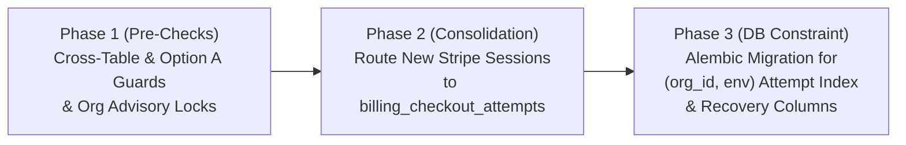

# ADR-006: Organization-Wide Checkout Exclusivity, Recovery Lifecycle, and Webhook Reconciliation Policy

## Status
**Accepted (Architectural Policy Authorized — Option A; Implementation Pending)**

- **Architectural Governance:** Option A (live-only production billing databases; isolated non-production test billing) has been explicitly authorized by the Product Owner (see supporting rationale in `docs/decisions/ADR-006-TEST-LIVE-SUBSCRIPTION-DECISION-BRIEF.md`). ADR-006 documentation is finalized at the architectural-decision level.
- **Implementation Status:** **NOT IMPLEMENTED.** No application code, database migrations, Stripe `livemode` enforcement, accounting environment safeguards, recovery worker, or platform-staff authentication boundaries have been implemented. All implementation remains blocked pending separate implementation authorization and clearance of BLK-04, BLK-06, and BLK-07.

---

## 1. Context and Verified Current Behavior

Aptlyst AI provides subscription billing for organizations across two payment providers: legacy Stripe subscriptions and active provider-neutral Razorpay Subscriptions.

A comprehensive architectural audit of the checkout subsystem (investigations BLK-04 and BLK-05) verified the following baseline behaviors in the codebase (`D:\Projects\V1\Aptlyst-AI-d2-stage2-locks` at commit `72e1084`):

1. **Decoupled Checkout Transaction Lifecycle**:  
   Razorpay checkout ([checkout.py:230-755](file:///d:/Projects/V1/Aptlyst-AI-d2-stage2-locks/apps/api/app/services/billing/razorpay/checkout.py#L230-L755)) is structured in decoupled phases:
   - *Phase A (Customer Provisioning)*: Pre-allocates gateway customer in an isolated transaction.
   - *Phase B (Attempt Staging)*: Locks `Organization` $\to$ `BillingCustomerProvision` $\to$ `Subscription` $\to$ `BillingCheckoutAttempt` via `SELECT ... FOR UPDATE`, validates active subscriptions and attempts, commits a staged record with `status = 'creating'` and `attempt_lease_expires_at = now() + 60s`, and releases all locks before external network dispatch.
   - *Phase 3 (Gateway Dispatch)*: Invokes `client.create_subscription()` with zero open database transactions or locks.
   - *Phase 4 (Success Persistence)*: Re-locks the subscription and attempt to commit `status = 'open'` and record `provider_subscription_id`.

2. **Split Storage and Incomplete Exclusivity**:  
   - Stripe checkout attempts are stored in `stripe_checkout_attempts` ([subscription.py:304-400](file:///d:/Projects/V1/Aptlyst-AI-d2-stage2-locks/apps/api/app/models/subscription.py#L304-L400)) with partial unique index `uq_org_active_checkout_attempt` on `(organization_id)` WHERE `status IN ('creating', 'recovery_required', 'open', 'payment_pending')`.
   - Razorpay checkout attempts are stored in `billing_checkout_attempts` ([payment.py:155-275](file:///d:/Projects/V1/Aptlyst-AI-d2-stage2-locks/apps/api/app/models/payment.py#L155-L275)) with partial unique index `uq_org_scoped_active_billing_checkout_attempt` on `(organization_id, provider, merchant_account_id, environment)` WHERE `status IN ('creating', 'recovery_required', 'open', 'payment_pending')`.
   - The application route guards only inspect their own provider table:
     - Stripe's `create_stripe_checkout_session` queries `get_active_checkout_attempt` on `stripe_checkout_attempts` ([stripe_checkout.py:249-273, 725](file:///d:/Projects/V1/Aptlyst-AI-d2-stage2-locks/apps/api/app/services/billing/stripe_checkout.py#L249-L273)).
     - Razorpay's `create_razorpay_checkout_attempt` queries `billing_checkout_attempts` filtered by `provider == "razorpay"` ([checkout.py:393-406](file:///d:/Projects/V1/Aptlyst-AI-d2-stage2-locks/apps/api/app/services/billing/razorpay/checkout.py#L393-L406)).
   - Neither route inspects the other provider's attempt table.

3. **Active Subscription Database Invariant**:  
   The `subscriptions` table enforces a global partial unique index:
   ```python
   Index(
       "uq_org_active_subscription",
       "organization_id",
       unique=True,
       postgresql_where=text("status IN ('active', 'trialing')"),
   )
   ```
   ([subscription.py:204-208](file:///d:/Projects/V1/Aptlyst-AI-d2-stage2-locks/apps/api/app/models/subscription.py#L204-L208)). This prevents two active subscriptions from coexisting for one organization in the database across all providers and environments.

4. **Quarantined Ambiguous Errors & Operational Void**:  
   Ambiguous gateway outcomes (HTTP 408, 429, 5xx, post-dispatch network timeouts, or malformed success payloads) and expired creation leases transition checkout attempts to `status = 'recovery_required'` ([checkout.py:574-711, 474-484](file:///d:/Projects/V1/Aptlyst-AI-d2-stage2-locks/apps/api/app/services/billing/razorpay/checkout.py#L574-L711)).  
   However, `recover_razorpay_checkout_attempt()` ([checkout.py:762-1260](file:///d:/Projects/V1/Aptlyst-AI-d2-stage2-locks/apps/api/app/services/billing/razorpay/checkout.py#L762-L1260)) has **zero callers** in API routes or workers. A `recovery_required` attempt permanently occupies the partial unique index and blocks all subsequent checkout requests with HTTP 409 Conflict.

5. **Early Webhook Arrival Reconciliation**:  
   If Razorpay issues `subscription.authenticated` before Phase 4 commits the server-owned `provider_subscription_id`, the agreement handler finds 0 matching checkout attempts ([agreement_handlers.py:239-264](file:///d:/Projects/V1/Aptlyst-AI-d2-stage2-locks/apps/api/app/services/billing/razorpay/agreement_handlers.py#L239-L264)). The handler creates `PaymentReconciliation(case_key=f"missing_checkout_attempt:{sub_id}", reason="missing_checkout_attempt")` and returns 200 OK. However, **no background worker or resolution task currently processes or links these reconciliation cases**.

---

## 2. Problem Statement and Identified Risks

1. **Cross-Provider Double-Charging Risk**:  
   Because checkout attempt exclusivity is enforced independently per provider table, an organization can initiate a Stripe checkout session and a Razorpay checkout subscription simultaneously within the live environment. An end-user can pay both checkout sessions.  
   While `uq_org_active_subscription` prevents duplicate active subscriptions in PostgreSQL, whichever webhook or callback commits second fails with a unique constraint violation. Consequently, **the customer is charged twice by two different gateways, and one payment is left in an unhandled, orphaned error state**.
2. **Permanent Tenant Lockout ("Ambiguous Wedging")**:  
   When a network timeout occurs during subscription creation, the attempt transitions to `recovery_required` to protect the tenant slot. However, because no background worker or operational endpoint invokes `recover_razorpay_checkout_attempt()`, the attempt remains in `recovery_required` indefinitely, permanently blocking the tenant from ever subscribing.
3. **Early Webhook Provenance Disconnect**:  
   When `subscription.authenticated` arrives prior to Phase 4 completion, the subscription record is created with `plan_tier = 'free'` and `status = 'incomplete'`, but the originating `BillingCheckoutAttempt` is never updated to `payment_pending` or `complete`. The reconciliation case remains unaddressed, breaking the audit trail linking payments to checkout attempts.

---

## 3. Decision A — Checkout-Attempt and Subscription Environment Scope (Option A Authorized)

> **Authorized Architectural Decision (Product Owner — Option A):**
> **Production billing databases are live-only. Test-mode billing and test subscription lifecycles must run in isolated development, staging, or CI databases.**
>
> Full option evaluation, failure-scenario traces, rejected Option B, and deferred Option C are preserved in `docs/decisions/ADR-006-TEST-LIVE-SUBSCRIPTION-DECISION-BRIEF.md`.

### 3.1 Policy Definition

#### Checkout Attempts: Defensive `(organization_id, environment)` Scoping
An organization may possess **at most ONE active checkout attempt per `(organization_id, environment)`**:
- **Active Status Definition**: An attempt is active if and only if:
  $$\text{status} \in \{\texttt{creating}, \texttt{recovery\_required}, \texttt{open}, \texttt{payment\_pending}\}$$
- **Terminal Status Definition**: An attempt is terminal if and only if:
  $$\text{status} \in \{\texttt{complete}, \texttt{expired}, \texttt{failed}\}$$
- **Cross-Provider Exclusivity Within Environment**: Within the same environment (e.g., `live` in production), uniqueness applies across all payment providers. An organization cannot open a live Stripe checkout while a live Razorpay checkout is active.
- **Defensive Isolation Boundary (Not Production Coexistence)**: Retaining `environment` in `billing_checkout_attempts` and scoping active attempt uniqueness to `(organization_id, environment)` preserves defensive isolation and explicit environment provenance in non-production/CI databases and test harnesses. It does **not** authorize executing test-mode checkout attempts or test subscription lifecycles inside a production database. In production, only verified `live` checkout attempts are permitted; checkout creation must fail safely if environment provenance cannot be established.

#### Active Subscriptions: Live-Only Production Policy & Preserved Global Uniqueness
The existing global partial unique index `uq_org_active_subscription` on `subscriptions(organization_id)` WHERE `status IN ('active', 'trialing')` ([subscription.py:204-208](file:///d:/Projects/V1/Aptlyst-AI-d2-stage2-locks/apps/api/app/models/subscription.py#L204-L208)) is **preserved without modification**, governed by the following approved Option A constraints:

1. **Live-Only Production Subscriptions**: Production `subscriptions` records are strictly **live-only** (retaining existing historical `legacy` Stripe rows during transition). Test-mode subscriptions **cannot** enter `active` or `trialing` in the production subscription table.
2. **Database & Operational Isolation**: Test-mode billing, test Razorpay credentials, test webhook endpoints, test workers, and test databases must be strictly isolated from production. Non-production database snapshots or test billing rows must never be replicated or promoted into production.
3. **Strict Webhook Rejection**: A test webhook must never activate or modify a production subscription. Production checkout and webhook handling must fail safely whenever environment provenance cannot be established.
4. **Live-Only Production Entitlements & Accounting**: `OrganizationBillingPeriod` ([billing.py:43-196](file:///d:/Projects/V1/Aptlyst-AI-d2-stage2-locks/apps/api/app/models/billing.py#L43-L196)) remains the single entitlement authority per organization without environment scoping. Production entitlements must be derived exclusively from verified `live` billing events. Test-mode billing must never grant production Pro quotas or interfere with production usage accounting.
5. **Mandatory Implementation Safeguards (Pending — Not Yet Implemented)**:
   - **Accounting Exclusion**: `reserve_tokens()` ([accounting.py:258-336](file:///d:/Projects/V1/Aptlyst-AI-d2-stage2-locks/apps/api/app/services/billing/accounting.py#L258-L336)) currently queries `Subscription` by `(organization_id, status IN ('active', 'past_due'))` with **no `environment` filter**. As a mandatory implementation safeguard, accounting must explicitly exclude test-environment subscriptions (`environment != 'test'`) from production entitlement decisions.
   - **Stripe `livemode` Validation**: Legacy Stripe webhook ingestion and handlers (`stripe_checkout_handler.py`, `stripe_subscription_handler.py`, `stripe_subscription_updated_handler.py`, `stripe_invoice_paid_handler.py`) currently perform **zero `livemode` or `environment` validation** and default `Subscription.environment` to `"legacy"` ([subscription.py:171-175](file:///d:/Projects/V1/Aptlyst-AI-d2-stage2-locks/apps/api/app/models/subscription.py#L171-L175)). Validating Stripe `livemode` and trusted environment provenance before any subscription or billing-period mutation is a mandatory prerequisite before production rollout.
   - **Razorpay Pre-Activation Conflict Guard**: `handle_subscription_activated` ([agreement_handlers.py:305-442](file:///d:/Projects/V1/Aptlyst-AI-d2-stage2-locks/apps/api/app/services/billing/razorpay/agreement_handlers.py#L305-L442)) currently lacks a pre-activation conflict query and lets PostgreSQL raise SQLSTATE `23505` on `uq_org_active_subscription`, causing immediate attempt-1 quarantine with no `PaymentReconciliation` case ([webhook_errors.py:611](file:///d:/Projects/V1/Aptlyst-AI-d2-stage2-locks/apps/api/app/services/billing/webhook_errors.py#L611), [webhook_engine.py:1373-1411](file:///d:/Projects/V1/Aptlyst-AI-d2-stage2-locks/apps/api/app/services/billing/razorpay/webhook_engine.py#L1373-L1411)). Adding an explicit conflict guard with reconciliation staging is required under BLK-06.
6. **Future Architecture Boundary**: If a genuine product requirement ever emerges for customer-facing sandbox billing inside production, that capability must be designed as a separate architectural milestone adopting Option C (isolated test subscription records and environment-aware entitlement boundaries).

### 3.2 Resolution of Investigated Test/Live Failure Scenarios

Because Option A confines all test-mode billing to isolated development, staging, and CI databases, **no test-mode `Subscription` record can ever exist in or occupy `uq_org_active_subscription` within a production database**. This directly resolves the five failure scenarios identified during BLK-05 review:

| Investigated Scenario | Failure Mechanism in a Shared Database | Resolution Under Authorized Option A |
| :--- | :--- | :--- |
| **1. Test activation before live checkout** | Active test subscription (`plan_tier='free'`) bypasses Phase B (`checkout.py:375`) and occupies `uq_org_active_subscription`, causing live `subscription.activated` to hit SQLSTATE `23505` and quarantine permanently after real payment. | **Eliminated in production:** Test subscriptions are never created or activated in the production database, so `uq_org_active_subscription` can never be occupied by test data. |
| **2. Live subscription followed by test checkout (incl. `past_due`)** | Test checkout is blocked on active `pro` subs (`checkout.py:370-388`), quarantines on `free` active subs, or — critically — **succeeds** while live is `past_due` (excluded from `uq_org_active_subscription`), causing `accounting.py:276-290` to fail closed (`RECONCILIATION_REQUIRED`) and block live LLM traffic. | **Eliminated in production:** Test checkouts and test webhooks cannot target production databases (`customer.py:163-171`, `webhook_engine.py:1062-1082`); pending `accounting.py` test-environment exclusion and Stripe `livemode` enforcement provide defense-in-depth. |
| **3. Test authentication (`incomplete`) followed by live checkout** | Live activates, while a delayed test `subscription.activated` later collides on `uq_org_active_subscription` (or triggers the `past_due` accounting outage / false Pro authorization after live cancellation). | **Eliminated in production:** Test authentication events never write `Subscription` rows to the production database. |
| **4. Concurrent test & live webhook delivery** | Independent Level 0 `sub_id` advisory locks (`agreement_handlers.py:335`) allow parallel test and live activations to race on `uq_org_active_subscription`, risking permanent quarantine of the paying live event. | **Eliminated in production:** Separate test/live webhook endpoints, secrets, workers, and databases prevent test and live workers from ever contending against the same database; live workers quarantine mismatched environments (`scope_mismatch`). |
| **5. Test completion/cancellation followed by live activation** | Safe even in shared DBs once test sub reaches `canceled`, vacating `uq_org_active_subscription`. | **Cleanly avoided in production:** Test lifecycles complete strictly inside isolated non-production databases and never share organization rows with production billing. |

> [!NOTE]
> **Implementation Boundary Reminder:** Existing Razorpay deployment guards (`customer.py:162-176`, `webhook_ingress.py:87-100`, `webhook_engine.py:1062-1082`, `handler_base.py:544-549`) enforce single-environment Razorpay configuration today, **but** Stripe `livemode` validation, `accounting.py` test-environment exclusion, and Razorpay pre-activation conflict reconciliation are **proposed safeguards not yet implemented**.

---

## 4. Decision B — Historical Stripe Data and Migration Strategy

### 4.1 Historical Stripe Data Preservation
1. **Preserve Legacy Archive**: All existing rows in `stripe_checkout_attempts` must be **preserved 100% as read-only historical audit records**.
2. **Prohibition on Speculative Backfills**: Historical records must **never be backfilled by guessing their environment**. While session IDs starting with `cs_test_` or `cs_live_` provide deterministic evidence of test vs live origin, attempts that failed during creation or timed out have `stripe_session_id IS NULL` ([subscription.py:330-334](file:///d:/Projects/V1/Aptlyst-AI-d2-stage2-locks/apps/api/app/models/subscription.py#L330-L334)). These ambiguous rows must remain in `stripe_checkout_attempts` unless authoritative persisted proof is established.
3. **No Blind Global Assignment**: Historical Stripe rows must not be assigned to `live` merely because production is currently deployed in live mode.
4. **No Arbitrary Expiration**: Old Stripe checkout attempts must not be automatically mutated to `expired` solely based on being older than 24 hours. Any historical cleanup requires authoritative gateway evidence and an independently reviewed reconciliation plan.

### 4.2 Future Stripe Checkout Routing
When Stripe checkout creation is updated:
1. **Unified Table Ingestion**: Route all new Stripe checkout creations into `billing_checkout_attempts` with `provider = 'stripe'` and an explicitly resolved `environment` matching the active configuration.
2. **Dual-Reader Webhook Lookup**: `handle_checkout_session_completed` will execute a deliberate two-stage lookup:
   - Primary: Query `billing_checkout_attempts` by `provider_session_id == session.id` and `provider == 'stripe'`.
   - Fallback: Query legacy `stripe_checkout_attempts` by `stripe_session_id == session.id` for in-flight legacy sessions.
3. **Compatibility Testing**: Prior to cutover, compatibility tests must verify duplicate webhook delivery, in-flight legacy session completion, missing session ID handling, and rollback behavior.
4. **Read-Only Transition**: The legacy table `stripe_checkout_attempts` will become strictly read-only after cutover once all operational and webhook readers support the unified path.

---

## 5. Decision C — Recovery Worker Scheduling and Claim Leases

### 5.1 Proposed Schema Additions (Future Alembic Migration)
To resolve ambiguous timer overloading, support stale-worker fencing, and enable robust background polling, the following separate fields are proposed for `billing_checkout_attempts` (**not yet implemented**):

| Field Name | Type | Purpose & Lifecycle |
| :--- | :--- | :--- |
| `next_recovery_retry_at` | `DateTime(timezone=True), nullable=True` | Earliest timestamp at which an eligible `recovery_required` attempt may be claimed. Initialized to `now()` upon entering `recovery_required`; set to `NULL` when automated retry budget is exhausted or attempt exits `recovery_required`. |
| `recovery_claim_expires_at` | `DateTime(timezone=True), nullable=True` | Expiry of the active recovery worker claim. `NULL` when unclaimed; set to `now() + 60s` while claimed so another worker can reclaim the job if the claiming worker crashes. |
| `recovery_claim_id` | `UUID, nullable=True` | Unique fencing token generated and stamped when a worker atomically claims an attempt. Validated under row lock before persisting any recovery outcome so a stale/slow worker can never overwrite a newer worker's claim or state transition; cleared to `NULL` when the claim is released or resolved. |
| `recovery_attempts` | `Integer, nullable=False, default=0` | Persisted count of automated recovery attempts executed for this checkout attempt. |

> [!IMPORTANT]
> The existing column `attempt_lease_expires_at` must **not** be overloaded for recovery scheduling. It retains its original checkout-creation lease semantics exclusively. All four fields above (`next_recovery_retry_at`, `recovery_claim_expires_at`, `recovery_claim_id`, `recovery_attempts`) are proposed schema additions requiring a future Alembic migration.

### 5.2 Intended Worker Lifecycle (Steps 1–10)

#### Explicit NULL-Safe Claim Eligibility Predicate
A recovery worker may claim an attempt if and only if `status = 'recovery_required'` and the following SQL NULL-safe predicate holds:

```sql
next_recovery_retry_at IS NOT NULL
  AND next_recovery_retry_at <= :now
  AND (recovery_claim_expires_at IS NULL OR recovery_claim_expires_at <= :now)
  AND recovery_attempts < 5
```

- **Initial Entry (Step 1):** Any transition into `recovery_required` must explicitly initialize `next_recovery_retry_at = now()` (non-`NULL`), `recovery_claim_expires_at = NULL`, `recovery_claim_id = NULL`, and `recovery_attempts = 0` so the attempt is immediately eligible for first claim.
- **Budget Exhaustion (Step 9):** Setting `next_recovery_retry_at = NULL` (along with `recovery_attempts >= 5`, `recovery_claim_id = NULL`, and `recovery_claim_expires_at = NULL`) unambiguously excludes the quarantined row from all future worker queries without SQL `NULL` comparison ambiguity.

```mermaid
sequenceDiagram
    autonumber
    participant App as Checkout API
    participant DB as PostgreSQL
    participant Worker as Recovery Worker
    participant RZP as Razorpay Gateway

    App->>DB: 1. Enter recovery_required: set next_recovery_retry_at = now(), recovery_claim_expires_at = NULL, recovery_claim_id = NULL, recovery_attempts = 0
    Note over DB: 2. Eligible iff next_recovery_retry_at IS NOT NULL AND next_recovery_retry_at <= now AND (recovery_claim_expires_at IS NULL OR recovery_claim_expires_at <= now) AND recovery_attempts < 5
    Worker->>DB: 3. Atomically claim eligible attempt using row locking (FOR UPDATE SKIP LOCKED)
    Worker->>DB: 4. Set recovery_claim_expires_at = now + 60s, stamp fresh recovery_claim_id (UUID); COMMIT claim txn
    Worker->>RZP: 5. Execute client.list_subscriptions(...) [ZERO DB locks held]
    alt Gateway confirms exactly 1 candidate remote subscription
        Worker->>DB: 6. Reacquire attempt lock; Validate recovery_claim_id matches; Set status='open', provider_subscription_id=sub_id, next_recovery_retry_at=NULL, recovery_claim_id=NULL, recovery_claim_expires_at=NULL; COMMIT
    else Gateway outcome inconclusive (0 results, >1 candidates, or transient gateway 5xx)
        Worker->>DB: 7. Reacquire attempt lock; Validate recovery_claim_id matches; increment recovery_attempts (if non-5xx); Set next_recovery_retry_at = now + backoff + jitter, recovery_claim_id=NULL, recovery_claim_expires_at=NULL; COMMIT
    else Worker crash / unhandled failure
        Note over DB: 8. Stale worker claim expires at recovery_claim_expires_at; next worker overwrites recovery_claim_id (fencing out the crashed worker if it resumes)
    else recovery_attempts >= 5 (Budget Exhausted)
        Worker->>DB: 9. Reacquire attempt lock; Validate recovery_claim_id matches; Set next_recovery_retry_at = NULL, recovery_claim_id = NULL, recovery_claim_expires_at = NULL; Stage PaymentReconciliation(pending_review); Emit Sev 1 Alert; Attempt remains QUARANTINED in recovery_required
    end
    Note over Worker,DB: 10. Exhausting retries is NEVER treated as proof that remote subscription does not exist
```

### 5.3 Operational & Resilience Specifications
- **Stale-Worker Fencing (`recovery_claim_id`):** Before persisting any Step 6, Step 7, or Step 9 mutation, the worker must reacquire the `BillingCheckoutAttempt` row lock (`SELECT ... FOR UPDATE`) and verify that `row.recovery_claim_id == worker_claim_id` and `row.status == 'recovery_required'`. If the claim ID no longer matches (another worker reclaimed the attempt after lease expiry), the stale worker must abort and roll back without mutating state.
- **Bounded Backoff & Jitter**:  
  Retry intervals follow $\Delta t \in \{60\text{s}, 300\text{s}, 900\text{s}, 1800\text{s}, 3600\text{s}\}$ with $\pm 15\%$ randomized jitter.
- **Gateway Pagination Ceilings**:  
  Recovery searches are bounded to 3 pages (50 items/page, 150 items max) within a $\pm 180\text{s}$ time window. Hitting the 3-page ceiling is treated as an inconclusive search, halting automated recovery and triggering operational escalation.
- **Gateway Outages**:  
  Network timeouts and HTTP 5xx responses from Razorpay do not increment the retry budget; they trigger transient backoff without exhausting the attempt count.
- **Permanent Quarantine**:  
  Exhausting the retry budget leaves the attempt in `recovery_required` with `next_recovery_retry_at = NULL`, preserving the active checkout guard to prevent double-billing until human operator intervention.

---

## 6. Decision D — Platform Staff Authorization and Two-Person Approval

### 6.1 Platform Staff Authorization Boundary
1. **Tenant Role Exclusion**: Existing organization roles (`MemberRole.owner`, `MemberRole.admin` in [organizations.py:40](file:///d:/Projects/V1/Aptlyst-AI-d2-stage2-locks/apps/api/app/api/organizations.py#L40)) represent customer tenant memberships. **Tenant administrators must NEVER be permitted to authorize platform billing recovery overrides.**
2. **Dedicated Platform Staff Boundary**: A dedicated platform staff authentication boundary is proposed:
   - Proposed mechanism: Supabase JWT claim `app_metadata.is_platform_staff == true`.
   - *Current Reality*: This claim does **not** currently exist in the codebase.
   - Supabase service-role credentials are static API keys and do **not** identify a human operator. Staff claim issuance, revocation, and individual operator attribution require a dedicated security design and approval prior to implementation.

### 6.2 Distinct Operational Recovery Interfaces

#### Operation A: Link Verified Remote Subscription
- **Purpose**: Associate an orphaned remote subscription discovered out-of-band with an attempt in `recovery_required`.
- **Authorization**: Requires authenticated Platform Staff.
- **Verification Invariant**: Must verify that the remote subscription matches the attempt's provider, merchant account, environment, organization, and plan tier via live gateway inquiry before committing.
- **Transaction Safety**: Gateway inquiry executes outside database transactions.
- **Auditability**: Records operator identity, timestamp, ticket reference, and remote subscription ID. Idempotent on replay.

#### Operation B: Mark Attempt Failed and Release Quarantine
- **Purpose**: Forcibly mark a `recovery_required` attempt as `failed` to release the active checkout reservation.
- **Risk Assessment**: **CRITICAL RISK**. If the gateway actually created a subscription, releasing the quarantine allows the customer to check out again and incur double recurring charges.
- **Stronger Authorization & Two-Person Approval**:
  - Requires **two distinct authorized staff operators** (`executing_operator_id != approving_operator_id`) or an equivalent separately approved, cryptographically signed approval workflow.
  - Requires mandatory external incident/ticket reference (`ticket_reference`) and explicit documented evidence (`definitive_evidence`).
  - Caller-supplied evidence must never be trusted without independent verification.
- **Audit Requirements**:  
  Because `PaymentReconciliation` is not a tamper-resistant security audit log, an append-only, tamper-resistant audit mechanism must be evaluated for high-risk overrides to record:
  `{attempt_id, executing_operator_id, approving_operator_id, ticket_reference, previous_status, resulting_status, definitive_evidence, timestamp}`.

---

## 7. State-Machine and Webhook Clarifications

### 7.1 Separation of the Five Billing Lifecycles

To prevent architectural confusion, the following five lifecycles must be strictly distinguished:

| Lifecycle Concept | Mechanism & Source | State Representation | Entitlement Effect |
| :--- | :--- | :--- | :--- |
| **1. Checkout Session Expiration** | Frontend TTL timer | `session_expires_at` reached; attempt moves to `expired`. | None. User cannot pay via old URL. |
| **2. Remote Subscription Creation** | Gateway API dispatch | Razorpay object in state `created`. | None. Customer has not authorized payment. |
| **3. Mandate Authentication / Activation** | Bank 2FA / Mandate webhooks | `subscription.authenticated` $\to$ `incomplete`; `subscription.activated` $\to$ `active`. | **Zero Pro quota granted.** Subscription remains `plan_tier = 'free'` ([agreement_handlers.py:437](file:///d:/Projects/V1/Aptlyst-AI-d2-stage2-locks/apps/api/app/services/billing/razorpay/agreement_handlers.py#L437)). |
| **4. Payment Authorization / Capture** | Gateway payment webhooks | `BillingPayment` record created; status `authorized` or `captured`. | None until settled into period. |
| **5. Entitlement Settlement** | Full-payment settlement engine | `OrganizationBillingPeriod` created with `plan_tier = 'pro'`, token quotas provisioned (ADR-002/003). | **Only mechanism that grants paid Pro entitlements.** |

> [!CAUTION]
> Setting `BillingCheckoutAttempt.status = 'complete'` represents checkout staging closure only. It does **not**, by itself, grant paid entitlements or mutate `Subscription.plan_tier`.

### 7.2 Webhook Handler Readiness Distinction

The webhook engine distinguishes between implemented agreement handlers and pending settlement handlers:

1. **Implemented Agreement Handlers**:
   - `subscription.authenticated` ([agreement_handlers.py:80-299](file:///d:/Projects/V1/Aptlyst-AI-d2-stage2-locks/apps/api/app/services/billing/razorpay/agreement_handlers.py#L80-L299))
   - `subscription.activated` ([agreement_handlers.py:305-510](file:///d:/Projects/V1/Aptlyst-AI-d2-stage2-locks/apps/api/app/services/billing/razorpay/agreement_handlers.py#L305-L510))
   - `subscription.updated` ([agreement_handlers.py:517-645](file:///d:/Projects/V1/Aptlyst-AI-d2-stage2-locks/apps/api/app/services/billing/razorpay/agreement_handlers.py#L517-L645))
   - `subscription.completed` ([agreement_handlers.py:650-755](file:///d:/Projects/V1/Aptlyst-AI-d2-stage2-locks/apps/api/app/services/billing/razorpay/agreement_handlers.py#L650-L755))
2. **Pending Settlement Handlers (Stage 2 Implementation)**:
   - `subscription.charged` / `payment.captured`
   - `payment.authorized`
   - `payment.failed`
   - Under current implementation, any payment webhook delivered to the worker is **quarantined as `unknown_event`** ([webhook_engine.py:1084-1107](file:///d:/Projects/V1/Aptlyst-AI-d2-stage2-locks/apps/api/app/services/billing/razorpay/webhook_engine.py#L1084-L1107)). Payment webhooks are not yet registered.

### 7.3 Terminal-State Safety & Refusal of Resurrection
- **Refusal of Resurrection**: Webhooks associated with an attempt already in `expired` or `failed` must **never** mutate the attempt status back to active or complete.
- **Accounting Provenance**: When payment settlement handlers are implemented, payment records must be recorded for accounting provenance even if the originating attempt is expired, accompanied by a `PaymentReconciliation(reason='payment_on_expired_attempt')` review case.
- **Missing Attempt in Activation**: In future settlement implementation, `handle_subscription_activated` must stage a `missing_checkout_attempt` reconciliation case if 0 matching checkout attempts are found, mirroring `handle_subscription_authenticated`.

---

## 8. Lock Ordering and Transaction Boundaries

All operations governed by this policy strictly adhere to the monotonic lock hierarchy established in ADR-005 ([ADR-005-BILLING-LOCK-ORDERING.md:30-43](file:///d:/Projects/V1/Aptlyst-AI-d2-stage2-locks/docs/decisions/ADR-005-BILLING-LOCK-ORDERING.md#L30-L43)):

```
Level 0A: Organization Advisory Lock (derive_advisory_lock_key("organization", org_id))
  │
  ▼
Level 0B: Entity Advisory Lock (derive_advisory_lock_key("subscription", sub_id))
  │
  ▼
Level 1:  OrganizationBillingPeriod Row Lock (FOR UPDATE)
  │
  ▼
Level 2:  Subscription Row Lock (FOR UPDATE)
  │
  ▼
Level 3:  Auxiliary Entity Row Locks (BillingCheckoutAttempt, BillingPayment, BillingInvoice FOR UPDATE)
```

### Specific Enforcement Rules:
1. **Checkout Staging (Phase B)**:
   - Acquire Level 0A Organization Advisory Lock.
   - Acquire `Organization` row lock.
   - Query active checkout attempts under the lock.
   - Commit and release all locks prior to external gateway HTTP dispatch.
2. **Recovery Worker Execution**:
   - Claim attempt via `FOR UPDATE SKIP LOCKED`.
   - Persist claim and commit immediately before making external gateway calls.
   - Execute Razorpay API calls with zero open database transactions or held database locks.
   - Reacquire attempt row lock and assert `recovery_claim_id` ownership before committing results.
3. **Deadlock Qualification**:  
   Because Phase B and Agreement Handlers acquire row-level locks on `Subscription` ($L_2$) before `BillingCheckoutAttempt` ($L_3$) in identical ascending sequence, no circular-wait row lock deadlocks exist between these specific paths. Full deadlock prevention across the wider system remains bounded by adherence to ADR-005.

---

## 9. Migration and Rollout Strategy

A phased rollout ensures zero downtime and protects historical financial data:



### Phase 1: Cross-Table Application Pre-Checks & Option A Guards (Pending Implementation)
- Update `create_stripe_checkout_session`: Check `billing_checkout_attempts` for active attempts in the active environment.
- Update `create_razorpay_checkout_attempt`: Check `stripe_checkout_attempts` for active attempts.
- Enforce canonical `Level 0A` Organization Advisory Lock at service entry.
- Enforce Option A production safety safeguards:
  - Validate Stripe `livemode` and trusted environment provenance before any subscription or billing-period mutation.
  - Exclude `environment == 'test'` subscriptions from production entitlement checks in `accounting.py:258-336`.
  - Add an explicit pre-activation conflict guard with `PaymentReconciliation` staging in Razorpay `handle_subscription_activated`.
- *Zero schema migrations; zero historical data mutation.*

### Phase 2: Write Consolidation for New Stripe Sessions (Pending Implementation)
- Route new Stripe checkout creations into `billing_checkout_attempts` with `provider = 'stripe'` and resolved `environment`.
- Webhook handler uses unified-table lookup first with fallback to `stripe_checkout_attempts`.
- Legacy `stripe_checkout_attempts` remains read-only historical archive.

### Phase 3: Physical Database Constraint & Worker Schema Migration (Pending Implementation)
- Execute an Alembic migration on `billing_checkout_attempts`:
  1. Add proposed recovery worker columns:
     - `next_recovery_retry_at` (`DateTime(timezone=True), nullable=True`)
     - `recovery_claim_expires_at` (`DateTime(timezone=True), nullable=True`)
     - `recovery_claim_id` (`UUID, nullable=True`)
     - `recovery_attempts` (`Integer, nullable=False, default=0`)
  2. Drop scoped index `uq_org_scoped_active_billing_checkout_attempt`.
  3. Create environment-scoped active attempt index:
     ```sql
     CREATE UNIQUE INDEX uq_org_env_active_billing_checkout_attempt
     ON billing_checkout_attempts (organization_id, environment)
     WHERE status IN ('creating', 'recovery_required', 'open', 'payment_pending');
     ```
  4. Create recovery claim index supporting the NULL-safe eligibility predicate:
     ```sql
     CREATE INDEX ix_billing_checkout_attempts_recovery_claim
     ON billing_checkout_attempts (status, next_recovery_retry_at, recovery_claim_expires_at)
     WHERE status = 'recovery_required' AND next_recovery_retry_at IS NOT NULL;
     ```

---

## 10. Observability, Alerting, and Manual Intervention

1. **Metrics**:
   - `billing_checkout_attempt_staged_total{provider, environment}`
   - `billing_checkout_recovery_claimed_total`
   - `billing_checkout_recovery_resolved_total{outcome="open|failed|quarantined"}`
   - `billing_early_webhook_reconciled_total{event_type}`
2. **Alerting Thresholds**:
   - **Sev 2 Alert**: Any attempt remaining in `recovery_required` for $\ge 30\text{ minutes}$.
   - **Sev 1 Alert**: Recovery attempts exhausted ($\ge 5$ attempts); automated retry halted.
   - **Sev 1 Alert**: Payment received for an `expired` or `failed` attempt.
3. **Manual Intervention**:
   - Dedicated administrative operations (Operation A and Operation B) with mandatory ticket references and audit logging.

---

## 11. Test Requirements & Implementation Gates

Prior to merging implementation code, the following test specifications must be verified:

1. **Environment, Option A Isolation & Exclusivity Tests**:
   - `test_cross_provider_checkout_rejected_same_environment`: Confirms HTTP 409 when opening Stripe while Razorpay is open in `live`.
   - `test_attempt_index_scoped_by_environment_in_isolation`: Confirms the defensive `(organization_id, environment)` database index constraint in isolated test fixtures (without permitting test traffic in production).
   - `test_production_rejects_test_webhooks_and_unverified_provenance`: Confirms production checkout and webhook paths fail closed on `test` or indeterminate environment provenance.
   - `test_stripe_livemode_mismatch_rejected_before_mutation`: Confirms Stripe `livemode=false` events cannot activate production subscriptions or create Pro `OrganizationBillingPeriod` rows.
   - `test_accounting_excludes_test_subscriptions_from_entitlements`: Confirms `reserve_tokens()` never authorizes or fails closed on `environment='test'` subscription rows.
   - `test_active_subscription_collision_rejected_globally`: Confirms `uq_org_active_subscription` prevents dual active subscriptions and triggers reconciliation staging.
2. **Recovery Worker Lifecycle Tests**:
   - `test_worker_claims_eligible_recovery_job_skip_locked`: Verifies atomic claiming using the NULL-safe predicate without contention.
   - `test_worker_backoff_and_jitter_scheduling`: Asserts exponential backoff on inconclusive search and verifies `recovery_claim_id` fencing.
   - `test_worker_quarantines_after_max_retries`: Confirms attempt remains `recovery_required` with `next_recovery_retry_at IS NULL` after 5 failures and is never re-claimed.
   - `test_worker_claim_expiration_allows_reclaim_and_fences_stale_worker`: Asserts crashed worker lease can be reclaimed with a new `recovery_claim_id` and stale worker writes are rejected.
3. **Security & Audit Tests**:
   - `test_tenant_owner_cannot_invoke_platform_recovery`: Asserts HTTP 403 when customer admin calls recovery override.
   - `test_mark_failed_requires_two_person_approval`: Asserts rejection if secondary approver is missing.

---

## 12. Source References

- **Razorpay Checkout Service**: [checkout.py](file:///d:/Projects/V1/Aptlyst-AI-d2-stage2-locks/apps/api/app/services/billing/razorpay/checkout.py)
  - Phase B active attempt check & lock acquisition: Lines 393–465
  - Phase B lease expiration transition: Lines 474–484
  - Phase 3 gateway call & error classification: Lines 544–712
  - Phase 4 remote success persistence: Lines 714–754
  - `recover_razorpay_checkout_attempt()` implementation: Lines 762–1260
- **Stripe Checkout Service**: [stripe_checkout.py](file:///d:/Projects/V1/Aptlyst-AI-d2-stage2-locks/apps/api/app/services/billing/stripe_checkout.py)
  - `get_active_checkout_attempt()`: Lines 249–273
  - `create_stripe_checkout_session()`: Lines 614–820
- **Billing Models & Invariants**: [payment.py](file:///d:/Projects/V1/Aptlyst-AI-d2-stage2-locks/apps/api/app/models/payment.py)
  - `BillingCheckoutAttempt` model: Lines 155–272
  - `BillingWebhookEvent` leased worker model: Lines 53–125
  - `PaymentReconciliation` review model: Lines 651–775
- **Subscription Models & Constraints**: [subscription.py](file:///d:/Projects/V1/Aptlyst-AI-d2-stage2-locks/apps/api/app/models/subscription.py)
  - `Subscription` and index `uq_org_active_subscription`: Lines 55–208
  - `CheckoutAttemptStatus` enum: Lines 284–294
  - `StripeCheckoutAttempt`: Lines 304–392
- **Agreement Handlers**: [agreement_handlers.py](file:///d:/Projects/V1/Aptlyst-AI-d2-stage2-locks/apps/api/app/services/billing/razorpay/agreement_handlers.py)
  - `handle_subscription_authenticated`: Lines 80–299
  - `handle_subscription_activated`: Lines 305–510
- **Accounting & Entitlements**: [accounting.py](file:///d:/Projects/V1/Aptlyst-AI-d2-stage2-locks/apps/api/app/services/billing/accounting.py)
  - Single active billing period queries: Lines 1172–1175
- **Advisory Locks**: [advisory_lock.py](file:///d:/Projects/V1/Aptlyst-AI-d2-stage2-locks/apps/api/app/services/billing/advisory_lock.py)
  - Canonical 64-bit advisory locks: Lines 75–150
