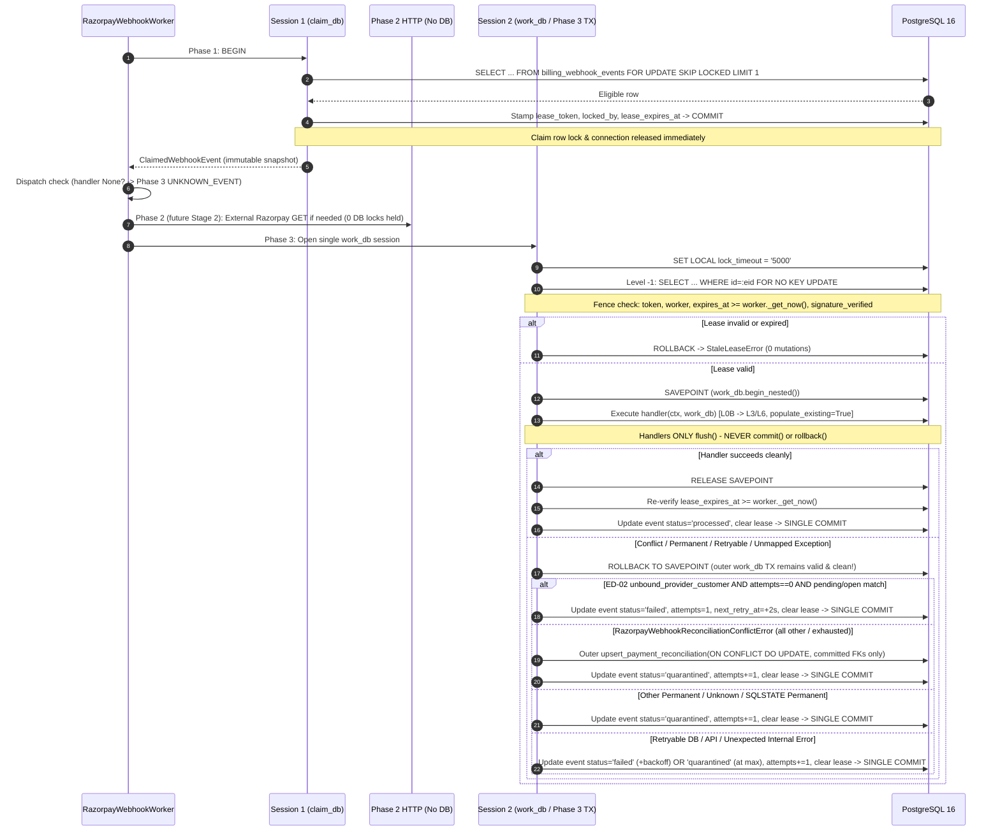

# Aptlyst AI — D-04A.1: Razorpay Webhook Exception Architecture — Implementation Blueprint

**Document ID:** D-04A.1 (`D2_D04A1_IMPLEMENTATION_BLUEPRINT.md`)  
**Task Mode:** **PLANNING ONLY** *(zero changes applied to source code, tests, models, migrations, CI YAML, existing documentation, Git branches/worktrees, live databases, or external payment providers)*  
**Target Worktree:** [`D:/Projects/V1/Aptlyst-AI-d2-stage1-pg16`](file:///D:/Projects/V1/Aptlyst-AI-d2-stage1-pg16)  
**Verified Branch / Baseline HEAD:** `validation/d2-stage1-customer-pg16` @ `497852e19360d85787107dbae6921519074f0773`  
**Parallel Dirty Reference Worktree (Preserved Untouched):** [`D:/Projects/V1/Aptlyst-AI`](file:///D:/Projects/V1/Aptlyst-AI) (`main` @ `027ab7ad3ee8a02fb20823a4f743e29b03c0f248`)  
**Upstream Design Specification:** [`D2_D04A_EXCEPTION_ARCHITECTURE_DESIGN.md`](file:///D:/Projects/V1/Aptlyst-AI-d2-stage1-pg16/docs/reports/D2_D04A_EXCEPTION_ARCHITECTURE_DESIGN.md)  
**Prior Investigation:** [`D2_D04_RAZORPAY_WEBHOOK_SAFETY_INVESTIGATION.md`](file:///D:/Projects/V1/Aptlyst-AI-d2-stage1-pg16/docs/reports/D2_D04_RAZORPAY_WEBHOOK_SAFETY_INVESTIGATION.md)  
**Final Verdict:** **`READY FOR D-04A IMPLEMENTATION.`**

---

## 1. Executive Summary

This blueprint converts the D-04A design specification in [`D2_D04A_EXCEPTION_ARCHITECTURE_DESIGN.md`](file:///D:/Projects/V1/Aptlyst-AI-d2-stage1-pg16/docs/reports/D2_D04A_EXCEPTION_ARCHITECTURE_DESIGN.md) into an implementation-ready engineering execution plan anchored on the accepted Stage 1 baseline (`497852e`). It resolves all six open engineering trade-offs (`ED-01` through `ED-06`), reconciles subtle PostgreSQL/SQLAlchemy concurrency and Stage 1 mock-harness constraints uncovered during code verification, and partitions delivery into five independently reviewable implementation stages ending with live PostgreSQL 16 verification and fail-closed CI wiring.

### Key Architectural Resolutions Established Before Coding

1. **`ED-01` (Unexpected Python Exceptions vs. Known Failures):** Unmapped runtime `Exception` instances default to bounded retry (`max_attempts = 5`, schedule `5s / 15s / 45s / 120s`) with a distinct `failure_category="unexpected_internal_error"` telemetry tag, high-severity non-secret ops alerting on attempt `1`, and hard quarantine on attempt `5`. All deterministic database errors (`P0001`, `23502`, `23503`, `23514`, `22*`, `42*`, deterministic `23505` domain conflicts), client 4xx/config/auth failures, validation errors, and reconciliation conflicts already quarantine immediately on attempt `1`.
2. **`ED-02` (`unbound_provider_customer` Checkout-Commit Race):** Qualifying `unbound_provider_customer` conflicts trigger at most **1 bounded race retry** (`cap = 1`, `attempts == 0` guard, `2s` queue-backed backoff) when an outer clean session confirms either a pending/resolved `BillingCustomerProvision` or an in-flight `BillingCheckoutAttempt` (`creating`, `recovery_required`, `open`). The transaction rolls back and closes the session completely so the retry acquires a fresh `AsyncSession` and PostgreSQL snapshot; on attempt `2` (`attempts >= 1`), any continuing unbound outcome immediately upserts `PaymentReconciliation` and transitions `BillingWebhookEvent` to `quarantined`.
3. **`ED-03` (Constraint-Aware `23505` Classification):** PostgreSQL `SQLSTATE 23505` is no longer treated blindly: unique violations are classified via constraint name extracted by a cycle-safe exception chain walker into **idempotent convergence** (`uq_billing_invoices_provider_invoice`, `uq_billing_payments_provider_payment`), **concurrency race retries** (`uq_billing_customer_provisions_*`, `uq_subscriptions_provider_subscription`, `uq_checkout_attempts_provider_*`), and **immediate attempt-1 permanent data-integrity quarantines** (`uq_org_active_subscription`, `uq_subscriptions_provider_customer`, `uq_billing_payments_checkout_attempt`).
4. **`ED-04` (`ON CONFLICT DO UPDATE` Without Breaking Stage 1 Mocks):** Introduce native PostgreSQL `build_payment_reconciliation_upsert_stmt()` + `upsert_payment_reconciliation()` in [`handler_base.py`](file:///D:/Projects/V1/Aptlyst-AI-d2-stage1-pg16/apps/api/app/services/billing/razorpay/handler_base.py) for webhook conflict/observational paths, while **preserving [`stage_or_update_payment_reconciliation()`](file:///D:/Projects/V1/Aptlyst-AI-d2-stage1-pg16/apps/api/app/services/billing/razorpay/handler_base.py#L818-L912) intact for [`customer.py`](file:///D:/Projects/V1/Aptlyst-AI-d2-stage1-pg16/apps/api/app/services/billing/razorpay/customer.py) and [`checkout.py`](file:///D:/Projects/V1/Aptlyst-AI-d2-stage1-pg16/apps/api/app/services/billing/razorpay/checkout.py)**. This protects all `375` existing regression tests—including [`_make_real_asyncpg_session_harness()`](file:///D:/Projects/V1/Aptlyst-AI-d2-stage1-pg16/apps/api/tests/test_razorpay_customer.py#L3043) SQL subset parsing—from churn while delivering atomic PG16 JSONB reconciliation merging in D-04A.
5. **`ED-05` (Python 3.11 `asyncio.CancelledError` Teardown):** Remove the silent `break` swallow in [`RazorpayWebhookWorker.start()`](file:///D:/Projects/V1/Aptlyst-AI-d2-stage1-pg16/apps/api/app/workers/razorpay_webhook_worker.py#L325-L326) so `asyncio.CancelledError` (`BaseException`) propagates out of `claim_one()`, `process_one()`, `run_batch()`, `run_once()`, and `start()` with **zero extra DB writes** during cancellation, relying on SQLAlchemy `NullPool` connection close + natural `lease_expires_at` expiry while preserving `worker.stop()` clean exit `0`.
6. **`ED-06` (Non-Destructive Redaction & Committed-FK Safety):** Redact keys, auth headers, PostgreSQL DSN/libpq secrets, SQLAlchemy `[parameters: ...]` blobs, emails, strictly bounded phones, and PANs while preserving UUIDs (`8-4-4-4-12`), payment IDs (`sub_*`, `pay_*`, `inv_*`, `cust_*`, `evt_*`), correlation IDs, `SQLSTATE` codes, and constraint names. In addition, fix the pre-existing `23503` trap in [`resolve_tenant_organization()`](file:///D:/Projects/V1/Aptlyst-AI-d2-stage1-pg16/apps/api/app/services/billing/razorpay/handler_base.py#L800-L810) (`organization_id=notes_org_id` for unbound payloads) and [`agreement_handlers.py`](file:///D:/Projects/V1/Aptlyst-AI-d2-stage1-pg16/apps/api/app/services/billing/razorpay/agreement_handlers.py) (`subscription_id=sub.id`, raw `ctx.raw_payload`), plus the savepoint-rollback trap in [`assert_valid_worker_lease()`](file:///D:/Projects/V1/Aptlyst-AI-d2-stage1-pg16/apps/api/app/services/billing/razorpay/handler_base.py#L959-L1003).

---

## 2. Verified Baseline and Git State

All checks were run read-only in [`D:/Projects/V1/Aptlyst-AI-d2-stage1-pg16`](file:///D:/Projects/V1/Aptlyst-AI-d2-stage1-pg16) prior to authoring this blueprint.

### 2.1 Repository, Remote & Worktree State

| Check | Verified Value |
|---|---|
| **Remote (`origin`)** | `https://github.com/Sahibnarulaofficial/Aptlyst-AI.git` (`fetch` & `push`) |
| **Target Worktree** | `D:/Projects/V1/Aptlyst-AI-d2-stage1-pg16` |
| **Branch & HEAD** | `validation/d2-stage1-customer-pg16` @ `497852e19360d85787107dbae6921519074f0773` |
| **Tracked File Modifications** | **Zero** (`git diff --stat` empty; working tree clean relative to `497852e`) |
| **Preserved Untracked Root Reports** | `STEP_5_2D_3_3B_1E_Z1` through `Z8` `*_REPORT.md` |
| **Preserved Untracked `docs/reports/`** | `D2_STAGE1_FORMAL_CLOSURE_REPORT.md`, `D2_STAGE2_READINESS_AUDIT.md`, `D2_D04_RAZORPAY_WEBHOOK_SAFETY_INVESTIGATION.md`, `D2_D04A_EXCEPTION_ARCHITECTURE_DESIGN.md` |
| **Sibling Main Worktree (Untouched)** | `D:/Projects/V1/Aptlyst-AI` on `main` @ `027ab7ad3ee8a02fb20823a4f743e29b03c0f248` (`13` modified tracked files preserved untouched) |
| **Sibling PG Hardening Worktree (Untouched)** | `D:/Projects/V1/Aptlyst-AI-pg16-validation` on `validation/postgres16-ci-hardening` @ `c932cc480f82b2eea11c7616bf9290e255cffd31` |
| **Runtime & CI Dependency Baseline** | Python `3.11` ([`.github/workflows/ci.yml#L78`](file:///D:/Projects/V1/Aptlyst-AI-d2-stage1-pg16/.github/workflows/ci.yml#L78)), PostgreSQL `16-alpine` ([`.github/workflows/ci.yml#L44`](file:///D:/Projects/V1/Aptlyst-AI-d2-stage1-pg16/.github/workflows/ci.yml#L44)), `fastapi==0.115.12`, `sqlalchemy==2.0.41`, `asyncpg==0.30.0`, `alembic==1.15.2`, `psycopg2-binary==2.9.10` ([`apps/api/requirements.txt`](file:///D:/Projects/V1/Aptlyst-AI-d2-stage1-pg16/apps/api/requirements.txt)) |

### 2.2 Baseline Defects Confirmed Directly in Code (Verified Line Anchors)

- **Disjoint Hierarchies & Package Shadowing (`D04-02`):** [`webhook_engine.py#L135-L148`](file:///D:/Projects/V1/Aptlyst-AI-d2-stage1-pg16/apps/api/app/services/billing/razorpay/webhook_engine.py#L135-L148) and [`handler_base.py#L73-L131`](file:///D:/Projects/V1/Aptlyst-AI-d2-stage1-pg16/apps/api/app/services/billing/razorpay/handler_base.py#L73-L131) declare separate `RazorpayWebhookPermanentError` / `RazorpayWebhookRetryableError` pairs; [`razorpay/__init__.py#L68-L95`](file:///D:/Projects/V1/Aptlyst-AI-d2-stage1-pg16/apps/api/app/services/billing/razorpay/__init__.py#L68-L95) exports `webhook_engine`'s base pair alongside `handler_base`'s subclasses; [`razorpay_webhook_worker.py#L49-L51, #L203-L208`](file:///D:/Projects/V1/Aptlyst-AI-d2-stage1-pg16/apps/api/app/workers/razorpay_webhook_worker.py#L49-L51) catches only `webhook_engine`'s class.
- **Zero Domain Commit & Split-Session Outcome Persistence (`D04-01`):** [`process_one()`](file:///D:/Projects/V1/Aptlyst-AI-d2-stage1-pg16/apps/api/app/workers/razorpay_webhook_worker.py#L178-L237) runs `handler` inside `handler_db` without calling `commit()`, discards domain + reconciliation mutations on session exit, and marks `status = 'processed'` in `outcome_db`.
- **Savepoint FK & Inner-Rollback Traps Newly Verified for Blueprinting:**
  1. [`agreement_handlers.py#L229, #L264, #L293, #L498, #L537`](file:///D:/Projects/V1/Aptlyst-AI-d2-stage1-pg16/apps/api/app/services/billing/razorpay/agreement_handlers.py#L229) passes savepoint-local `sub.id` before raising `RazorpayWebhookReconciliationConflictError`.
  2. [`handler_base.py#L804`](file:///D:/Projects/V1/Aptlyst-AI-d2-stage1-pg16/apps/api/app/services/billing/razorpay/handler_base.py#L804) passes unverified `notes_org_id` as `organization_id` on `unbound_provider_customer`, risking `SQLSTATE 23503` against `organizations.id` if `notes.organization_id` is nonexistent or spoofed.
  3. [`handler_base.py#L971, #L982, #L990`](file:///D:/Projects/V1/Aptlyst-AI-d2-stage1-pg16/apps/api/app/services/billing/razorpay/handler_base.py#L971-L990) uses wall clock `datetime.now(timezone.utc)`, acquires `FOR UPDATE` (instead of `FOR NO KEY UPDATE`), and calls `await db.rollback()` inside `assert_valid_worker_lease()`—which, if invoked inside a handler `begin_nested()` savepoint, aborts the entire outer session before savepoint cleanup runs.
  4. [`agreement_handlers.py#L644, #L767`](file:///D:/Projects/V1/Aptlyst-AI-d2-stage1-pg16/apps/api/app/services/billing/razorpay/agreement_handlers.py#L644) writes unredacted `ctx.raw_payload` into `PaymentReconciliation.diagnostic_payload`; [`razorpay_webhook_worker.py#L153, #L189, #L240, #L255-L259, #L328`](file:///D:/Projects/V1/Aptlyst-AI-d2-stage1-pg16/apps/api/app/workers/razorpay_webhook_worker.py#L153) logs raw exceptions with `exc_info=True`; [`start()` #L313-L326](file:///D:/Projects/V1/Aptlyst-AI-d2-stage1-pg16/apps/api/app/workers/razorpay_webhook_worker.py#L313-L326) busy-loops on partial batches (`1 <= len(results) < batch_size`) and swallows `asyncio.CancelledError` with `break`.

---

## 3. Engineering Decisions (`ED-01` through `ED-06`)

### ED-01: Classification of Unexpected Python Exceptions vs. Known Retryable & Permanent Failures

1. **Underlying Problem:** When an unmapped Python exception (`TypeError`, `KeyError`, `AttributeError`, `ValueError`, `ZeroDivisionError`, or unforeseen third-party/driver exception) escapes a webhook handler, treating it identically to an ordinary transient error hides software defects in generic retry noise, whereas immediately quarantining every unmapped exception on attempt `1` risks dropping real webhooks if an unforeseen transient OS, SSL, or driver exception misses the explicit SQLSTATE/client matchers.
2. **Available Options:**
   - **Option A — Bounded Retry with Distinct Diagnostic Alerting (`max_attempts = 5`):** Keep deterministic permanent failures (validation, handler permanent/conflict, `RazorpayDatabasePermanentError`, `RazorpayProviderPermanentError`) at attempt-1 quarantine, and map remaining unmapped `Exception` types to `RETRYABLE_FAILURE` up to `max_attempts` (`5`, schedule `5s / 15s / 45s / 120s`, total max delay `185s`) with a distinct `failure_category="unexpected_internal_error"`, critical non-secret ops alert on attempt `1`, and quarantine on attempt `5`. Matches [`stripe_webhook_engine.py#L639-L662`](file:///D:/Projects/V1/Aptlyst-AI-d2-stage1-pg16/apps/api/app/services/billing/stripe_webhook_engine.py#L639-L662).
   - **Option B — Strict Bug Type Allowlist Immediate Quarantine:** Immediately quarantine a narrow whitelist of pure-Python programmer bugs (`TypeError`, `AttributeError`, `NameError`, `NotImplementedError`, `UnboundLocalError`, `SyntaxError`) on attempt `1`, while bounding other unmapped `Exception`s (`OSError`, `RuntimeError`, third-party library exceptions) to `max_attempts = 5`. *(Exclude `KeyError`/`ValueError` from immediate quarantine because unmapped dict/format parsing against external inputs can blur validation vs bugs).*
   - **Option C — Immediate Attempt-1 Quarantine for All Unmapped `Exception`:** Zero retries for any unmapped exception.
3. **Recommended Option:** **Option A (Bounded `max_attempts = 5` Retry with Distinct `unexpected_internal_error` Telemetry)** for D-04A launch, designed with an explicit single classifier hook (`_UNEXPECTED_FAIL_FAST_TYPES: tuple[type[Exception], ...] = ()`) so switching to Option B (`(TypeError, AttributeError, NameError, NotImplementedError, UnboundLocalError)`) requires changing one constant tuple and zero control-flow changes.
4. **Technical Reasoning:** Because D-04A already adds explicit classifiers for all known permanent failure families—all handler validation/scope/conflict subclasses, all permanent PostgreSQL SQLSTATEs (`P0001`, `23502`, `23503`, `23514`, `22*`, `42*`, deterministic `23505`), and all client 4xx/config/auth errors—Option C risks turning an unanticipated transient `asyncpg`/`ssl`/`os` exception shape into irreversible attempt-1 data loss. Meanwhile, Option A strictly guarantees termination at attempt `5` (never infinite retry), preserves atomic savepoint rollback (zero DB corruption during retries), and avoids hiding bugs via a dedicated `unexpected_internal_error` metric/alert and exception class name in logs.
5. **Failure Scenarios:**
   - *Savepoint side effects on retry:* Handler mutates `Subscription` then raises `KeyError` -> savepoint rolls back completely -> outer TX commits `status='failed'`, `attempts=1`, `next_retry_at=+5s` -> retry attempts `2..5` encounter clean pre-handler state -> attempt `5` commits `status='quarantined'` with `quarantine_reason="Quarantined: exceeded max attempts (5/5) [unexpected_internal_error]"`.
   - *Misclassified permanent DB/API failure:* Caught BEFORE Option A fallback by `classify_db_exception()` / `classify_client_error()`, guaranteeing attempt-1 quarantine.
6. **Required Tests:**
   - `UNIT-EXC-02`: Verify classifier priority order (`StaleLease` -> `RazorpayPermanent` -> `RazorpayRetryable` -> `RazorpayClientError` -> `SQLSTATE` classifier -> unmapped `Exception` fallback).
   - `MOCK-WRK-04`: Inject `KeyError("secret=sk_live_abc")` and `TypeError("bad attr")` -> verify attempt `1` rolls back savepoint, sets `status='failed'`, `attempts=1`, `next_retry_at = now + 5s`, logs sanitized `failure_category="unexpected_internal_error"` without `exc_info=True`, progresses `5s -> 15s -> 45s -> 120s`, and transitions to `quarantined` at `attempts == 5`.
   - `PG-WRK-02` / `PG-WRK-07`: Confirm real PG16 handler exceptions and `P0001` never hit Option A fallback.
7. **Compatibility Implications:** Preserves `MAX_WEBHOOK_ATTEMPTS = 5` and backoff parity with [`WEBHOOK_RETRY_BACKOFF_SCHEDULE`](file:///D:/Projects/V1/Aptlyst-AI-d2-stage1-pg16/apps/api/app/services/billing/razorpay/webhook_engine.py#L55-L60) and Stripe worker semantics; requires zero model or migration changes.
8. **Remaining Uncertainty:** Backend operations preference on whether pure programmer bugs (`TypeError`, `AttributeError`, `NameError`, `NotImplementedError`) should use `_UNEXPECTED_FAIL_FAST_TYPES` (Option B) from day one rather than waiting `185s` across 5 attempts before quarantine.

---

### ED-02: Concurrent Checkout-Commit / Provisioning Race (`unbound_provider_customer`)

1. **Underlying Problem:** [`resolve_tenant_organization()`](file:///D:/Projects/V1/Aptlyst-AI-d2-stage1-pg16/apps/api/app/services/billing/razorpay/handler_base.py#L682-L811) queries only `BillingCustomerProvision` and `Subscription`. When Razorpay delivers a webhook immediately while checkout/customer creation (`get_or_create_razorpay_customer()` TX2 or checkout attempt TX commits `provider_subscription_id`) is still committing concurrently under `READ COMMITTED`, `resolve_tenant_organization()` raises `RazorpayWebhookReconciliationConflictError(reason="unbound_provider_customer")`. Without a bounded race retry, legitimate in-flight checkouts unnecessarily quarantine webhooks into manual `PaymentReconciliation` triage. Conversely, blindly retrying every unknown customer ID floods the queue with illegitimate/orphan traffic.
2. **Available Options:**
   - **Option A — Immediate Quarantine on `unbound_provider_customer`:** Zero retries; every miss immediately creates `PaymentReconciliation(pending_review)` and quarantines the event.
   - **Option B — Strictly Gated Single-Retry (`cap = 1`, Fresh Session Restart) + Escalation:** Permit at most **1 retry** (`claimed.attempts == 0` guard -> `2` total executions) ONLY when a clean outer verification confirms an active in-flight or just-committed local provisioning/checkout record for the customer or subscription; otherwise quarantine immediately on attempt `1`. Always quarantine and upsert `PaymentReconciliation` if still unbound on attempt `2`.
3. **Recommended Option:** **Option B (Strictly Gated `cap = 1` Fresh-Session Race Retry + Deterministic Escalation)**.
4. **Technical Reasoning (Answering All 5 Design Sub-Questions Explicitly):**
   - **(i) Qualifying Errors, SQLSTATEs & Local Evidence:**
     - *Qualifying DB concurrency SQLSTATEs* (standard `max_attempts = 5` backoff): `40001` (`serialization_failure`), `40P01` (`deadlock_detected`), `55P03` (`lock_not_available` from `SET LOCAL lock_timeout = '5000'`), plus concurrency-eligible `23505` (see `ED-03` Bucket 2).
     - *Qualifying `unbound_provider_customer` race* (`cap = 1` only): `RazorpayWebhookReconciliationConflictError` with `reason == "unbound_provider_customer"` AND `claimed.attempts == 0`, PLUS an outer post-savepoint-rollback query confirming **at least one** matching record in the same `(provider, merchant_account_id, environment)`:
       1. `BillingCustomerProvision` matching `provider_customer_id == clean_cust_id` (`status == 'resolved'` committed *during* the savepoint!) OR an active `BillingCustomerProvision` (`status == 'pending'` and `(lease_expires_at IS NULL OR lease_expires_at > now_utc - 5s)`); OR
       2. `BillingCheckoutAttempt` matching `provider_subscription_id == clean_sub_id` or `provider_customer_id == clean_cust_id` with `status IN ('creating', 'recovery_required', 'open')`.
     - *Non-qualifying errors (immediate attempt-1 quarantine, 0 race retries):* Unknown external `customer_id`/`subscription_id` with zero matching `BillingCustomerProvision` or `BillingCheckoutAttempt` rows; `metadata_tenant_mismatch`; `conflicting_tenant_records`; `checkout_attempt_tenant_mismatch`; `ambiguous_checkout_attempt`; any validation/scope error; any `P0001`/`23502`/`23503`/`23514`/`22*`/`42*` SQLSTATE.
   - **(ii) Permitted Attempt Count:**
     - **Exactly `1` race retry** (`cap = 1`, meaning total executions = `2`: initial `attempts == 0 -> failed (attempts=1, next_retry_at = now + 2s)` with `RACE_RETRY_DELAY_SECONDS = 2`, followed by 2nd execution where `claimed.attempts >= 1`). Note: using `next_retry_at = now + 2s` via the durable queue (rather than `asyncio.sleep(2)` inside an open DB transaction) guarantees zero held DB connections/locks during backoff.
   - **(iii) Must the Transaction Restart Entirely?**
     - **YES — mandatory full transaction and `AsyncSession` restart.** An in-place savepoint retry inside the same transaction/session is unsafe because: (a) under PostgreSQL snapshot isolation or stale ORM identity maps, re-reading inside the same session can miss or collide with cached state; (b) `BillingWebhookEvent` `Level -1` lock and any `L0B` advisory lock would stay held across the wait, risking lock starvation/deadlock against checkout's `L0A -> L0B -> L6` commit; (c) releasing `work_db` via `ROLLBACK` + `__aexit__` and re-claiming via Phase 1 guarantees a brand-new `AsyncSession`, empty identity map, fresh PostgreSQL transaction snapshot, and re-evaluated fencing lease.
   - **(iv) How Idempotency Is Preserved Across the Retry:**
     - Attempt `1`'s `begin_nested()` rollback guarantees zero committed rows in `subscriptions`, `billing_checkout_attempts`, or `payment_reconciliations`. `BillingWebhookEvent` retains its unique ingress identity (`uq_billing_webhook_provider_event`) with `attempts = 1` and `lease = NULL`. Attempt `2` acquires a fresh `lease_token`, locks `Level -1 -> L0B -> L3/L6` using `.execution_options(populate_existing=True)`, and enforces monotonic `is_stale_event()` and terminal guards cleanly.
   - **(v) Behavior When Retries Are Exhausted:**
     - When `claimed.attempts >= 1` and `unbound_provider_customer` is raised again—**even if a `BillingCustomerProvision(pending)` or `BillingCheckoutAttempt(creating)` row still exists**—race retry eligibility is unconditionally `False`. The outer Phase 3 transaction executes `upsert_payment_reconciliation(reason="unbound_provider_customer", status='pending_review', raw_event_id=claimed.event_id, organization_id=None)` (or verified committed `org_id`) and sets `BillingWebhookEvent.status = 'quarantined'`, `attempts += 1`, `quarantined_at = now_utc`, clearing the lease in one atomic `COMMIT`.
5. **Failure Scenarios:**
   - *Genuine orphan webhook with no local checkout/customer:* Outer check finds `0` qualifying rows -> immediate attempt-1 quarantine + `PaymentReconciliation` upsert (`2s` never wasted).
   - *Checkout commits right after webhook savepoint began:* Attempt `1` rolls back savepoint -> outer check sees pending/resolved provision or creating attempt -> schedules `next_retry_at = now + 2s`, `attempts = 1` -> Attempt `2` opens fresh TX, finds bound `org_id`, activates subscription, commits `processed` with zero reconciliation ticket noise.
   - *Checkout crashes and never finishes within 2s:* Attempt `2` sees `claimed.attempts == 1`, declines second race retry, persists `PaymentReconciliation`, and quarantines deterministically.
6. **Required Tests:**
   - `UNIT-RACE-01`: Verify qualification matrix (`attempts == 0` + matching provision/attempt -> race retry; `attempts >= 1` -> escalate; non-matching external IDs -> attempt-1 quarantine; `metadata_tenant_mismatch` -> never race-retried).
   - `MOCK-WRK-10`: Verify full TX close + fresh session creation between attempt `1` (`attempts=1`, `failed`, `next_retry_at=now+2s`) and attempt `2` (`processed` once binding commits, or `quarantined` + `PaymentReconciliation` if still unbound).
   - `PG-WRK-04B` `[MULTI-CONN]`: Real PG16 two-connection race test: Connection A holds uncommitted `BillingCustomerProvision(pending)`/`BillingCheckoutAttempt(creating)` while Connection B runs `worker.process_one()` -> verify Connection B stores `failed (attempts=1, next_retry_at=+2s)` without `23505` or `PaymentReconciliation`; Connection A commits `resolved`; advance `worker.clock` by `2s` -> Connection B re-claims, binds tenant, commits `processed`. Repeat with Connection A rolling back -> verify Attempt `2` commits `PaymentReconciliation` + `quarantined`.
7. **Compatibility Implications:** Uses existing `BillingCustomerProvision` ([`payment.py#L772-L864`](file:///D:/Projects/V1/Aptlyst-AI-d2-stage1-pg16/apps/api/app/models/payment.py#L772-L864)) and `BillingCheckoutAttempt` ([`payment.py#L155-L305`](file:///D:/Projects/V1/Aptlyst-AI-d2-stage1-pg16/apps/api/app/models/payment.py#L155-L305)) schemas verbatim; invents zero new TTLs, cancellation rules, or `P-01`–`P-04` policies. Note: because [`handle_subscription_completed()`](file:///D:/Projects/V1/Aptlyst-AI-d2-stage1-pg16/apps/api/app/services/billing/razorpay/agreement_handlers.py#L728-L735) omits `customer_id`, outer qualification inspects `clean_sub_id` (`BillingCheckoutAttempt.provider_subscription_id`) as well as `clean_cust_id`.
8. **Remaining Uncertainty:** Under heavy checkout API latency (>2s Razorpay API call), a single `2s` retry may fire before a slow checkout TX finishes TX2; if production telemetry shows excessive `unbound_provider_customer` quarantines after 2s, bumping `RACE_RETRY_DELAY_SECONDS` (e.g. `2s` -> `5s`, strictly keeping `cap = 1`) is a single-constant operational tuning option requiring zero schema or architecture changes.

---

### ED-03: Constraint-Aware Classification of PostgreSQL `23505` (`unique_violation`)

1. **Underlying Problem:** Treating all PostgreSQL `SQLSTATE 23505` (`UniqueViolationError`) exceptions identically causes opposing failures: classifying all `23505`s as permanent quarantines transient concurrent creation races that retry cleanly under `READ COMMITTED`, while classifying all `23505`s as retryable loops deterministic data-integrity collisions (such as inserting a second `active`/`trialing` subscription violating `uq_org_active_subscription`) five pointless times instead of quarantining immediately.
2. **Available Options:**
   - **Option A — All `23505` Retryable:** Retries everything 5 times (wastes retries on deterministic integrity violations).
   - **Option B — All `23505` Permanent:** Quarantines transient creation races on attempt 1.
   - **Option C — Constraint-Aware Classification via Generalized Exception-Chain Inspector:** Extract `(sqlstate, constraint_name, table_name, detail)` safely across the nested `__cause__`/`__context__`/`orig` chain and classify `23505` into four explicit constraint buckets.
3. **Recommended Option:** **Option C (Constraint-Aware Classification via Cycle-Safe Chain Inspector)**.
4. **Technical Reasoning & Exact Constraint Taxonomy:**
   Generalize [`customer.py#L346-L431`](file:///D:/Projects/V1/Aptlyst-AI-d2-stage1-pg16/apps/api/app/services/billing/razorpay/customer.py#L346-L431) (`_iter_db_exception_chain`, `_extract_db_error_details`) into `billing/webhook_errors.py`, extracting `sqlstate`, `constraint_name` (normalized lowercase), `table_name`, and sanitized `detail`. On `sqlstate == "23505"`, inspect `constraint_name` (checking `.diag.constraint_name` / `.constraint_name` first, falling back to safe regex extraction of `unique constraint "<name>"` ONLY when driver attrs are stripped):

   | Bucket | Exact Constraints / Indexes Verified in Models ([`payment.py`](file:///D:/Projects/V1/Aptlyst-AI-d2-stage1-pg16/apps/api/app/models/payment.py), [`subscription.py`](file:///D:/Projects/V1/Aptlyst-AI-d2-stage1-pg16/apps/api/app/models/subscription.py)) | Root Cause Semantics | Mapped Exception & Worker Outcome |
   |---|---|---|---|
   | **Bucket 1: Expected Idempotency / Replay Convergence** | `uq_billing_webhook_provider_event` (ingress), `uq_payment_reconciliations_case_key` (eliminated by `ON CONFLICT`), `uq_billing_invoices_provider_invoice`, `uq_billing_payments_provider_payment`, `ix_stripe_webhook_events_*` / PK | Duplicate delivery or concurrent event inserting identical ledger identity (`inv_*`, `pay_*`) | Bounded `RazorpayDatabaseRetryableError` (`failure_category="db_idempotency_race"`): retry reads committed row via `populate_existing=True` and converges cleanly *(reconciliation eliminated by `ON CONFLICT`)* |
   | **Bucket 2: Concurrent Provisioning / Creation Conflicts** | `uq_billing_customer_provisions_org_provider`, `uq_billing_customer_provisions_provider_customer`, `uq_subscriptions_provider_subscription`, `uq_org_scoped_active_billing_checkout_attempt`, `uq_checkout_attempts_provider_sub`, `uq_checkout_attempts_provider_payment` | Two transactions racing to create the same entity under `READ COMMITTED` / pre-lock window | Bounded `RazorpayDatabaseRetryableError` (`failure_category="db_concurrent_unique_race"`): retries cleanly with backoff and sees committed row on rerun (`cap` bounded by `max_attempts = 5`) |
   | **Bucket 3: Deterministic Integrity / Domain Conflict Defects** | `uq_org_active_subscription` *(org already holds active/trialing subscription across providers!)*, `uq_subscriptions_provider_customer` *(distinct subscription for same single-sub customer constraint)*, `uq_billing_payments_checkout_attempt` *(payment already bound to attempt)*, `uq_billing_checkout_org_idempotency`, `uq_bca_composite_identity`, `uq_billing_reconciliations_event_incoming` | Incompatible business/data state (`2nd active subscription on same org`, cross-attempt reuse) that retrying CANNOT cure | Immediate `RazorpayDatabasePermanentError` (`failure_category="db_permanent"`, `error_code="23505"`) -> **`quarantined` on attempt `1`** *(Note: future Stage 2 multi-sub checks may convert known `uq_org_active_subscription` detections inside handlers into explicit `RazorpayWebhookReconciliationConflictError` before SQL `INSERT`; until then, Bucket 3 guarantees fail-closed attempt-1 quarantine)* |
   | **Bucket 4: Unknown / Unmapped `23505`** | Any new/unrecognized index or constraint name (`constraint_name is None` or absent from Buckets 1–3) | Unforeseen constraint collision | Bounded `RazorpayDatabaseRetryableError` (`failure_category="db_unmapped_unique_violation"`), emitting a **warning/error alert with `constraint_name` and `table_name`** so engineers triage without losing an unexpected race |

   **Safe Driver Chain Extraction Rules:** Iterate BFS over `(exc.orig, exc, nested orig, __cause__, __context__)` capped at `max_nodes = 32` using `visited: set[int]` and exception-safe `_safe_getattr()`. Normalize `constraint_name.strip().lower()`. Never parse unsanitized `[parameters: ...]` JSON blobs when scanning fallback error text.
5. **Failure Scenarios:**
   - *Active legacy Stripe sub + incoming Razorpay `subscription.activated` triggers `uq_org_active_subscription`:* Classified directly into Bucket 3 -> savepoint rolls back -> attempt `1` quarantines cleanly without 5 futile retries.
   - *Two concurrent `subscription.authenticated` workers race into `uq_subscriptions_provider_subscription` (or test injects it):* Bucket 2 -> retryable -> attempt `2` reads committed sub cleanly under `populate_existing=True`.
   - *Cycle or broken `.diag` proxy on asyncpg exception:* Guarded by `visited` + `max_nodes` + `_safe_getattr()`.
6. **Required Tests:**
   - `UNIT-SQL-01`: Test Bucket 1, 2, 3, and 4 `23505` classifications across mock `asyncpg.UniqueViolationError` (`constraint_name` populated), `IntegrityError(orig=...)` nested chains, stripped `diag` regex fallback, uppercase/mixed-case constraint names, and cyclic `__cause__` references.
   - `UNIT-SQL-02`: Verify permanent non-unique SQLSTATEs (`P0001`, `23502`, `23503`, `23514`, `22P02`, `42501`) and transient SQLSTATEs (`40001`, `40P01`, `55P03`, `57P01`, `53300`, `08006`, pool disconnect).
   - `PG-WRK-06B` `[SINGLE-CONN + PG CONSTRAINT]`: Real PG16 organization with an already-`active` Stripe/Razorpay subscription + incoming distinct Razorpay `subscription.activated` colliding on `uq_org_active_subscription` -> verify immediate `attempts=1`, `status='quarantined'`, `error_message` names `uq_org_active_subscription` safely.
7. **Compatibility Implications:** Backward compatible with `customer.py` (which can optionally reuse `webhook_errors._extract_db_error_details` cleanly or remain untouched during D-04A so `test_razorpay_customer.py` monkeypatches stay unaffected). Needs zero schema changes.
8. **Remaining Uncertainty:** Should any new unique constraints be added in Stage 2 migrations (e.g., partial indexes on `billing_invoices` / `billing_payments`), engineers must classify their constraint names into Bucket 1–3; unmapped defaults safely to Bucket 4 bounded retry + alert.

---

### ED-04: Unit-Testing Strategy for `INSERT ... ON CONFLICT DO UPDATE` & Protecting Stage 1 Mocks

1. **Underlying Problem:** Atomic conflict-safe `PaymentReconciliation` persistence requires PostgreSQL-specific `sqlalchemy.dialects.postgresql.insert(...).on_conflict_do_update(...)` targeting constraint `uq_payment_reconciliations_case_key` with JSONB array concatenation (`||`), `COALESCE` FK preservation, and status reopening (`resolved_* -> pending_review`). However, three distinct mock harnesses exist in the repository—[`RazorpayWorkerMockDbSession`](file:///D:/Projects/V1/Aptlyst-AI-d2-stage1-pg16/apps/api/tests/test_razorpay_webhook_worker.py#L102), [`RazorpayHandlerMockDbSession`](file:///D:/Projects/V1/Aptlyst-AI-d2-stage1-pg16/apps/api/tests/test_razorpay_handler_foundation.py#L134), and [`_make_real_asyncpg_session_harness()`](file:///D:/Projects/V1/Aptlyst-AI-d2-stage1-pg16/apps/api/tests/test_razorpay_customer.py#L3043)—none of which execute arbitrary PostgreSQL `ON CONFLICT DO UPDATE SET jsonb_set(...)` AST expressions. In particular, `test_razorpay_customer.py` runs in CI Step 13 (`375 passed, 0 skipped`) and parses/patches [`stage_or_update_payment_reconciliation()`](file:///D:/Projects/V1/Aptlyst-AI-d2-stage1-pg16/apps/api/app/services/billing/razorpay/handler_base.py#L818-L912) via an in-memory regex SQL subset interpreter.
2. **Available Options:**
   - **Option A — Mutate `stage_or_update_payment_reconciliation()` In-Place + Build a Fake PG `ON CONFLICT`/JSONB Parser in Python Mocks:** Pollutes Python mocks with fragile regex SQL re-implementations, breaks `test_razorpay_customer.py`'s SQL subset harness unless rewritten simultaneously (high Stage 1 regression risk!), and falsely implies unit tests verify PG SQL semantics.
   - **Option B — Add Dedicated `build_payment_reconciliation_upsert_stmt()` + `upsert_payment_reconciliation()` Helper for Webhook Flows + Clean 3-Layer Verification Boundary:** Keep `stage_or_update_payment_reconciliation()` intact for `customer.py` and `checkout.py` during D-04A; adopt `upsert_payment_reconciliation()` across [`webhook_engine.py`](file:///D:/Projects/V1/Aptlyst-AI-d2-stage1-pg16/apps/api/app/services/billing/razorpay/webhook_engine.py), [`handler_base.py`](file:///D:/Projects/V1/Aptlyst-AI-d2-stage1-pg16/apps/api/app/services/billing/razorpay/handler_base.py), and [`agreement_handlers.py`](file:///D:/Projects/V1/Aptlyst-AI-d2-stage1-pg16/apps/api/app/services/billing/razorpay/agreement_handlers.py).
3. **Recommended Option:** **Option B (Dedicated `build_payment_reconciliation_upsert_stmt()` + `upsert_payment_reconciliation()` Seam with Explicit 3-Layer Separation)**.
4. **Technical Reasoning:**
   - **Zero Stage 1 Collateral Damage:** Leaving [`stage_or_update_payment_reconciliation()`](file:///D:/Projects/V1/Aptlyst-AI-d2-stage1-pg16/apps/api/app/services/billing/razorpay/handler_base.py#L818-L912) unchanged preserves 100% compatibility with `customer.py`, `checkout.py`, [`test_razorpay_customer.py#L2516, #L5479`](file:///D:/Projects/V1/Aptlyst-AI-d2-stage1-pg16/apps/api/tests/test_razorpay_customer.py#L2516), and [`test_razorpay_handler_foundation.py#L579`](file:///D:/Projects/V1/Aptlyst-AI-d2-stage1-pg16/apps/api/tests/test_razorpay_handler_foundation.py#L579). *(Future Stage 2 customer/checkout hardening can optionally migrate `customer.py` and `checkout.py` once `checkout.py#L854, L1157, L1223` `case_key` defects are addressed.)*
   - **Clean Separation Across Three Test Layers:**
     1. *Layer A (Pure SQL Dialect Compilation Test):* Compile `build_payment_reconciliation_upsert_stmt(...)` using `sqlalchemy.dialects.postgresql.dialect()` (`literal_binds=False` / param inspection) to verify exact SQL syntax: `ON CONFLICT ON CONSTRAINT uq_payment_reconciliations_case_key DO UPDATE`, `jsonb_set`, `||` history concatenation, `COALESCE` FK preservation, and status reopening `CASE` expression—without pretending mocks execute PG JSONB.
     2. *Layer B (Worker Control-Flow Mock Double):* Upgrade [`SharedRazorpayEventRepository`](file:///D:/Projects/V1/Aptlyst-AI-d2-stage1-pg16/apps/api/tests/test_razorpay_webhook_worker.py#L85) + [`RazorpayWorkerMockDbSession`](file:///D:/Projects/V1/Aptlyst-AI-d2-stage1-pg16/apps/api/tests/test_razorpay_webhook_worker.py#L102) with `EngineMockSavepoint` (`begin_nested()` patterned after [`EngineMockSavepoint`](file:///D:/Projects/V1/Aptlyst-AI-d2-stage1-pg16/apps/api/tests/test_stripe_webhook_engine.py#L68-L101)) plus an explicit `reconciliations` in-memory store recognizing `stmt` table `PaymentReconciliation` (or seam interception in `MockDbSession.execute()` matching `Insert` on `PaymentReconciliation`) strictly to prove **Python orchestration** (handler domain writes discarded by savepoint rollback -> outer `upsert_payment_reconciliation()` commits in outer TX -> outer TX rollback reverts reconciliation -> `subscription_id=None` passed). Document loudly in tests that Layer B proves control flow only.
     3. *Layer C (Live PG16 Authority):* `PG-WRK-03`, `PG-WRK-04`, and `PG-WRK-05` execute the unmocked `postgresql.insert(...).on_conflict_do_update(...)` query against real PostgreSQL `16` (`asyncpg` + `NullPool`) across concurrent sessions to prove constraint serialization, JSONB array preservation, `COALESCE` FK behavior, status reopening, and absence of `23503`/`23505`.
5. **Failure Scenarios:**
   - *SQL typo / wrong constraint name / bad JSONB cast in `ON CONFLICT`:* Caught by Layer A dialect inspection AND Layer C live PostgreSQL 16 execution before merge.
   - *Mock drift masking real PG trigger or JSONB bug:* Mitigated structurally by banning claims of PG semantics in Layer B and enforcing Layer C PG16 integration in `.github/workflows/ci.yml` with `REQUIRE_POSTGRES_TESTS=1` and zero skips.
6. **Required Tests:**
   - `UNIT-REC-01` (Layer A): Compile `build_payment_reconciliation_upsert_stmt()` with PG dialect; assert `ON CONFLICT`, target constraint `uq_payment_reconciliations_case_key`, `COALESCE`, `jsonb_set`, `resolved_refunded`/`resolved_ignored -> pending_review` reopen `CASE`, and sanitized bind parameters.
   - `MOCK-WRK-03` (Layer B): Worker savepoint rollback + outer reconciliation upsert + outer commit rollback isolation.
   - `PG-WRK-03`, `PG-WRK-04` `[MULTI-CONN]` (Layer C): Live PG16 concurrent upserts, chronological history append, status reopening, uncommitted `sub.id` `None` safety.
7. **Compatibility Implications:** Preserves all existing callers of `stage_or_update_payment_reconciliation()` intact; adds `build_payment_reconciliation_upsert_stmt` and `upsert_payment_reconciliation` cleanly to `handler_base.py` and `razorpay/__init__.py`.
8. **Remaining Uncertainty:** None for D-04A. A future follow-up cleanup after Stage 2 checkout hardening should retire legacy `stage_or_update_payment_reconciliation()` once `customer.py` and `checkout.py` switch to `upsert_payment_reconciliation()` cleanly.

---

### ED-05: Python 3.11 `asyncio.CancelledError` Cleanup & Lease Disposition

1. **Underlying Problem:** In Python 3.11, `asyncio.CancelledError` inherits from `BaseException`. While [`process_one()`](file:///D:/Projects/V1/Aptlyst-AI-d2-stage1-pg16/apps/api/app/workers/razorpay_webhook_worker.py#L206) currently catches `Exception` (sparing `CancelledError`), two subtle traps exist:
   - [`RazorpayWebhookWorker.start()`](file:///D:/Projects/V1/Aptlyst-AI-d2-stage1-pg16/apps/api/app/workers/razorpay_webhook_worker.py#L325-L326) catches `except asyncio.CancelledError: break`, which **silently swallows task cancellation** if an external supervisor/test runs `task = asyncio.create_task(worker.start()); task.cancel()`, causing `task.cancelled()` to evaluate `False` and returning normally instead of propagating cancellation semantics.
   - [`handler_base.py`](file:///D:/Projects/V1/Aptlyst-AI-d2-stage1-pg16/apps/api/app/services/billing/razorpay/handler_base.py#L982, #L990) and exception paths could hang or trigger secondary cancellation bugs if cleanup attempted extra `UPDATE billing_webhook_events SET lease_token=NULL` queries after receiving `CancelledError`.
2. **Available Options:**
   - **Option A — Execute Best-Effort Lease-Clear `UPDATE` Inside `CancelledError` Handler:** Opens/reuses a DB transaction during cancellation to null out `lease_token`, risking shielded teardown hangs, dead-socket errors, double-cancellation leaks, and violating strict immediate teardown discipline.
   - **Option B — Zero Extra DB Writes on `CancelledError` + Mandatory Propagation Across All Entrypoints:**
     - `claim_one()`, `process_one()`, `run_batch()`, `run_once()`, AND `start()` **MUST NOT** swallow `asyncio.CancelledError`:
       - `process_one()`, `claim_one()`, `run_batch()`, `run_once()`: never catch `CancelledError`.
       - `start()`: replace `except asyncio.CancelledError: break` with logging `"RazorpayWebhookWorker %s cancelled cleanly."` and **`raise`** (so external `task.cancel()` properly marks the asyncio task cancelled while `finally:` still runs cleanup; graceful `SIGTERM`/`SIGINT` triggers `worker.stop()` setting `_stop_event`, exiting `start()` normally and returning exit code `0` from `run_worker()` without raising `CancelledError`!).
     - Zero extra DB queries executed after cancellation begins. Rely on `async with self.session_factory() as db:` (`AsyncSession.__aexit__`) to close/abort the PostgreSQL connection immediately (rolling back all uncommitted savepoint/TX work and releasing PG row/advisory locks), leaving `BillingWebhookEvent.attempts` and `status` untouched so another worker recovers once `lease_expires_at` elapses (`<= lease_duration`, default `60s`).
3. **Recommended Option:** **Option B (Zero Extra DB Writes + Full `CancelledError` Propagation)**.
4. **Technical Reasoning:** Under `asyncpg` + SQLAlchemy `2.0`, cancelling an awaited query (including a blocked `SELECT ... FOR UPDATE` or `pg_advisory_xact_lock`) leaves the connection protocol state aborted; attempting a synchronous/async SQL `UPDATE` inside `except asyncio.CancelledError:` on a cancelling task either hangs (if unshielded) or leaks background tasks / masks cancellation if `asyncio.shield()` is misused. With `NullPool` (CI/worker pool semantics) or SQLAlchemy pool invalidation, exiting the `async with session:` block closes the underlying socket and PostgreSQL immediately aborts the transaction, freeing all row/advisory locks with zero `idle in transaction` backends. Natural lease expiry guarantees recoverability without attempt inflation (`attempts` unchanged), while graceful shutdown (`SIGINT`/`SIGTERM` -> `worker.stop()`) finishes the active event cleanly in-flight and clears the lease normally via Phase 3 `COMMIT`.
5. **Failure Scenarios:**
   - *Cancellation while blocked on `FOR UPDATE` or `pg_advisory_xact_lock`:* `CancelledError` propagates out of `process_one()`, PG server terminates wait cleanly when socket resets/aborts, zero lingering `idle in transaction` backends in `pg_stat_activity`, event retains `status`/`attempts`, another worker claims after `lease_expires_at`.
   - *Graceful `SIGTERM`/`SIGINT` (`worker.stop()`):* `_stop_event` is set; active `process_one()` completes its Phase 3 `COMMIT` (clearing lease), loop exits cleanly, `run_worker()` disposes engine and returns exit code `0` (`test_21` preserved).
6. **Required Tests:**
   - `MOCK-WRK-07`: Handler raises `asyncio.CancelledError` inside `process_one()` -> verify `CancelledError` propagates (NOT caught into `failed`/`quarantined`), `attempts` & `status` unchanged, `work_db` rolled back, zero extra Outcome DB calls executed.
   - `MOCK-WRK-09`: Verify `task = asyncio.create_task(worker.start()); task.cancel()` propagates `CancelledError` (`task.cancelled() is True`), while `worker.stop()` exits cleanly with `0` (`test_21`).
   - `PG-WRK-11` `[MULTI-CONN + PG_STAT_ACTIVITY]` (`PG-CUST-17` pattern): Locker session holds exclusive lock on target `Subscription`; worker `task = asyncio.create_task(worker.process_one())` blocks with verified `wait_event_type = 'Lock'` in `pg_stat_activity`; cancel task, assert `CancelledError` propagates, rollback locker, assert **zero lingering worker/locker PIDs and zero `idle in transaction` connections** in `pg_stat_activity`, assert event `attempts`/`status` unchanged, advance `clock` past `lease_expires_at`, and confirm second worker processes event cleanly to `processed`.
7. **Compatibility Implications:** Check all existing tests in [`test_razorpay_webhook_worker.py`](file:///D:/Projects/V1/Aptlyst-AI-d2-stage1-pg16/apps/api/tests/test_razorpay_webhook_worker.py): `test_21_signal_triggered_graceful_shutdown` uses `worker.stop()` (NOT `task.cancel()`), so propagating `CancelledError` in `start()` breaks zero existing tests and hardens cancellation correctness.
8. **Remaining Uncertainty:** In production deployments (`lease_duration = 60s`), a hard-killed worker (`SIGKILL` / `CancelledError`) temporarily holds its lease on the interrupted event for up to `60s` before recovery. Reducing default worker `--lease-duration` (e.g. `30s`) for faster recovery is a configuration trade-off, not a code risk.

---

### ED-06: Logging Redaction Rules & Non-Destructive Identifier Preservation

1. **Underlying Problem:** Over-naive regex scrubbing destroys critical operational identifiers (such as mangling hexadecimal UUID groups or 10-digit Unix timestamps into `[REDACTED_PHONE]` or `[REDACTED_PAN]`), whereas partial sanitizers leave credentials, database passwords, SQLAlchemy bound `[parameters: ...]` JSON payloads (with customer PII/notes), signatures, and `exc_info=True` tracebacks exposed in logs, `BillingWebhookEvent.error_message`, and `PaymentReconciliation.diagnostic_payload`.
2. **Available Options:**
   - **Option A — Broad Digit/Token Replacement:** Strips secrets and PII aggressively but corrupts UUIDs, timestamps, subscription/payment IDs, and constraint names needed for production incident debugging.
   - **Option B — Ordered, Boundary-Aware Redaction Pipeline + Structured Safe Allowlisting:** Execute ordered regex substitutions separating UUIDs/entity IDs/timestamps from actual credentials, signatures, SQL parameters, PANs, emails, and phones; ban `exc_info=True`; replace verbatim `ctx.raw_payload` dumps with strict scalar allowlisted diagnostic objects.
3. **Recommended Option:** **Option B (Ordered Boundary-Aware Redaction Pipeline + Allowlisted Diagnostics)**.
4. **Technical Reasoning & Exact Redaction Order:**
   Implement `sanitize_billing_error_message(err, max_chars=1024)` in `billing/webhook_errors.py` (re-exported as [`sanitize_error_message`](file:///D:/Projects/V1/Aptlyst-AI-d2-stage1-pg16/apps/api/app/services/billing/razorpay/webhook_engine.py#L164)) applying rules in exact non-destructive order:
   1. **SQLAlchemy Bound Parameter Removal (First — removes raw webhook JSON `payload` before regex noise):**
      `re.compile(r"\[parameters:\s*.*?(?=\n\(Background|\Z)", re.DOTALL)` (and fallback `r"\[parameters:.*"`) -> `"[parameters: REDACTED]"`.
   2. **PostgreSQL URI Credentials & Libpq Secrets:**
      - `r"(postgres(?:ql)?(?:\+[a-z0-9_]+)?://[^:/@\s]+:)[^@\s]+(@)"` -> `r"\1[REDACTED]\2"`
      - `r"(?i)\b(password|passfile)\s*=\s*('[^']*'|\"[^\"]*\"|[^\s,;]+)"` -> `r"\1=[REDACTED]"`
   3. **Gateway Secrets, Webhook Secrets, Auth Headers & Signature Pairs:**
      - Prefix keys: `rzp_(?:test|live)_[0-9A-Za-z]+`, `sk_(?:test|live)_[0-9A-Za-z]+`, `rk_(?:test|live)_[0-9A-Za-z]+`, `pk_(?:test|live)_[0-9A-Za-z]+`, `whsec_[0-9A-Za-z]+` -> `"[REDACTED_KEY]"`
      - HTTP auth headers: `r"(?i)\b(Basic|Bearer)\s+[A-Za-z0-9._~+/=-]+"` -> `r"\1 [REDACTED_TOKEN]"`
      - Key/header secrets: `r"(?i)(x-razorpay-signature|x-razorpay-secret|key_secret|webhook_secret|api_secret|api_key|authorization|secret|token)\s*[:=]\s*(\"[^\"]*\"|'[^']*'|[^\s,;}]+)"` -> `r"\1=[REDACTED]"` *(Note: exclude safe metric/identifier suffixes like `lease_token_prefix` or `provider_event_id`—or restrict key matcher with negative lookbehind/exact key list so `lease_token` field names aren't falsely flagged while any leaked token UUID *value* after `token=` still redacts safely only for auth secret keys! Wait: specifically match `(x-razorpay-signature|x-razorpay-secret|key_secret|webhook_secret|api_secret|api_key|authorization|client_secret)` and standalone `secret`/`bearer_token`, avoiding false-positives on log key `failure_category=` or `provider_event_id=` or `lease_token_prefix=`)*.
   4. **Emails:** `r"\b[A-Za-z0-9._%+-]+@[A-Za-z0-9.-]+\.[A-Za-z]{2,}\b"` -> `"[REDACTED_EMAIL]"`.
   5. **Protected Token Masking Prior to PAN/Phone Checks:** Temporarily tokenize standard UUIDs (`\b[0-9a-fA-F]{8}-[0-9a-fA-F]{4}-[0-9a-fA-F]{4}-[0-9a-fA-F]{4}-[0-9a-fA-F]{12}\b`), Razorpay/Stripe prefixed IDs (`\b(?:sub|pay|inv|cust|order|evt|plan|acc|cs|si|in|pi|cus|ch)_[A-Za-z0-9]+\b`), and 10-digit Unix epoch timestamps in `1500000000..2500000000` with internal non-digit placeholders, apply PAN & Phone rules, then restore placeholders! This makes accidental UUID/timestamp mangling **mathematically impossible**.
   6. **Payment Card PANs & Phones (After UUID/Timestamp Shielding):**
      - PAN: `r"(?<!\w)(?:\d[ -]*?){13,19}(?!\w)"` -> `"[REDACTED_PAN]"`.
      - Phone (international `+` prefix OR formatted separators `(123) 456-7890` / `987-654-3210` OR explicit `phone|mobile|contact` KV context): -> `"[REDACTED_PHONE]"`.
   7. **Whitespace Collapse & Truncation:** Collapse whitespace (`re.sub(r"\s+", " ", msg).strip()`) and truncate cleanly to `max_chars` (`1024`).

   **What Must Be Removed vs. Explicitly Preserved:**

   | Must NEVER Appear Unredacted | Must ALWAYS Be Preserved Unaltered |
   |---|---|
   | API keys (`rzp_*`, `sk_*`, `rk_*`, `pk_*`, `whsec_*`), `Basic`/`Bearer` headers, `x-razorpay-signature`, `key_secret` | `event_id` UUIDs (`8-4-4-4-12`), `organization_id` UUIDs (`8-4-4-4-12`), `correlation_id` |
   | PG DSN passwords, `password=`/`passfile=` libpq params, raw SQL `[parameters: ...]` | Gateway entity IDs (`sub_*`, `pay_*`, `inv_*`, `cust_*`, `order_*`, `evt_*`), `provider_event_id` |
   | Customer emails, phone numbers, card PANs, raw `ctx.raw_payload` dicts in reconciliations | `SQLSTATE` codes (`40001`, `P0001`, `23505`), PostgreSQL constraint/index names (`uq_org_active_subscription`) |
   | Raw Python traceback locals (`exc_info=True` BANNED across worker & engine loggers) | Structured non-secret diagnostic context (`worker_id`, `attempt_number`, `max_attempts`, `failure_category`, `lease_status`) |

5. **Failure Scenarios:**
   - *DB error contains bound webhook JSON `[parameters: {'payload': {'email': 'a@b.com', 'contact': '+919999888877'}}]`:* Stripped completely at Step 1 before persisting `BillingWebhookEvent.error_message` or logging.
   - *Unknown sub conflict carries raw `notes` or email inside `ctx.raw_payload`:* Eliminated at source by `sanitize_conflict_diagnostic_payload()` in `handler_base.py` & `agreement_handlers.py#L644, #L767` storing only allowlisted scalar entity IDs, counts, timestamps, and sanitized error summary.
   - *Debugging UUID mangled by old digit regex `\b(?:\d[ -]*?){13,19}\b`:* Prevented permanently by Step 5 UUID placeholder protection.
6. **Required Tests:**
   - `UNIT-LOG-01`: Verify complete redaction of all 10 secret/PII vectors (including multiline SQLAlchemy `[parameters: ...]`).
   - `UNIT-LOG-02`: Non-destructive preservation test proving UUIDs (`12345678-1234-5678-1234-567812345678`), `sub_98765432101234`, `pay_12345678901234`, `1794300000`, `SQLSTATE P0001`, `uq_org_active_subscription`, and `correlation_id` pass through **byte-for-byte unchanged**.
   - `UNIT-DIAG-01`: Verify `sanitize_conflict_diagnostic_payload()` strips emails/phones/secrets and rejects raw nested `payload` dicts.
   - `MOCK-WRK-08` & `PG-WRK-12`: Verify worker logs (`caplog`) and live PG16 `BillingWebhookEvent.error_message` + `PaymentReconciliation.diagnostic_payload` contain zero leaked secrets/PII/`exc_info=True` stacks.
7. **Compatibility Implications:** Keep `sanitize_error_message` re-exported from [`webhook_engine.py`](file:///D:/Projects/V1/Aptlyst-AI-d2-stage1-pg16/apps/api/app/services/billing/razorpay/webhook_engine.py#L164) and [`razorpay/__init__.py#L76`](file:///D:/Projects/V1/Aptlyst-AI-d2-stage1-pg16/apps/api/app/services/billing/razorpay/__init__.py#L76) as an alias to `sanitize_billing_error_message`. Ensure log message assertions in existing tests still match expected substrings without broken identifiers.
8. **Remaining Uncertainty:** If future diagnostics introduce non-UUID long pure-numeric external reference IDs (`>= 13` consecutive digits without prefix, e.g. raw bank RRN without `rrn_` prefix), PAN Luhn validation could optionally be layered onto Step 6 to prevent masking valid 14-digit bank reference numbers.

---

## 4. Proposed Exception Hierarchy

### 4.1 Complete Exception Tree & Module Ownership

```text
BaseException
 ├── asyncio.CancelledError                                     [Python stdlib — NEVER caught in worker; propagates after TX close]
 └── Exception
      ├── RazorpayWebhookError                                  [webhook_ingress.py#L58 — UNCHANGED HTTP ingress hierarchy only]
      │
      └── BillingWebhookError                                   [NEW in app/services/billing/webhook_errors.py]
           ├── BillingWebhookRetryableError
           ├── BillingWebhookPermanentError
           │    ├── BillingWebhookValidationError
           │    ├── BillingWebhookScopeMismatchError
           │    ├── BillingWebhookConflictError
           │    └── BillingWebhookUnknownEventError
           ├── BillingWebhookLeaseError
           │
           └── RazorpayWebhookEngineError(BillingWebhookError)  [CANONICAL BASE in razorpay/webhook_engine.py]
                │  (alias in handler_base.py: RazorpayWebhookHandlerError = RazorpayWebhookEngineError)
                │
                ├── StaleLeaseError(RazorpayWebhookEngineError, BillingWebhookLeaseError)
                │
                ├── RazorpayWebhookRetryableError(RazorpayWebhookEngineError, BillingWebhookRetryableError)
                │    ├── RazorpayDatabaseRetryableError         # SQLSTATE 40001, 40P01, 55P03, 57P*, 53300, 08*, pool drops, Bucket 1/2/4 23505
                │    ├── RazorpayProviderTransientError         # HTTP 429, GET 5xx, pre-dispatch network, asyncio.TimeoutError
                │    └── RazorpayTransientRaceRetryError        # ED-02 bounded cap=1 checkout/customer race deferment
                │
                └── RazorpayWebhookPermanentError(RazorpayWebhookEngineError, BillingWebhookPermanentError)
                     ├── RazorpayPayloadValidationError(RazorpayWebhookPermanentError, BillingWebhookValidationError)
                     │    └── RazorpayMissingEntityIdError      # Missing mandatory sub_*, pay_*, inv_*
                     ├── RazorpayScopeMismatchError(RazorpayWebhookPermanentError, BillingWebhookScopeMismatchError)
                     ├── RazorpayUnverifiedEventError           # signature_verified is False at worker
                     ├── RazorpayUnknownEventError(RazorpayWebhookPermanentError, BillingWebhookUnknownEventError)
                     ├── RazorpayBusinessRejectionError         # Deterministic non-conflict domain rejection
                     ├── RazorpayDatabasePermanentError         # SQLSTATE P0001 triggers, 23502, 23503, 23514, 22*, 42*, Bucket 3 23505
                     ├── RazorpayProviderPermanentError         # Auth, BillingDisabled, Configuration, 400/404/422, ambiguous post-dispatch write
                     └── RazorpayWebhookReconciliationConflictError(RazorpayWebhookPermanentError, BillingWebhookConflictError)
                          # Carries sanitized conflict metadata + pre-committed FKs ONLY for outer PaymentReconciliation upsert
```

### 4.2 Unification & Import Contracts

- **Single Canonical Definition:** `RazorpayWebhookEngineError`, `RazorpayWebhookRetryableError`, `RazorpayWebhookPermanentError`, `StaleLeaseError`, and all new Razorpay processing subclasses live in [`webhook_engine.py`](file:///D:/Projects/V1/Aptlyst-AI-d2-stage1-pg16/apps/api/app/services/billing/razorpay/webhook_engine.py) inheriting cleanly from `app/services/billing/webhook_errors.py`.
- **Zero Duplicate Definitions in [`handler_base.py`](file:///D:/Projects/V1/Aptlyst-AI-d2-stage1-pg16/apps/api/app/services/billing/razorpay/handler_base.py):** Delete [`handler_base.py#L73-L90`](file:///D:/Projects/V1/Aptlyst-AI-d2-stage1-pg16/apps/api/app/services/billing/razorpay/handler_base.py#L73-L90), import the canonical pair from `webhook_engine.py`, bind `RazorpayWebhookHandlerError = RazorpayWebhookEngineError`, and keep `RazorpayWebhookReconciliationConflictError`, `RazorpayPayloadValidationError`, `RazorpayScopeMismatchError`, and `RazorpayMissingEntityIdError` either defined directly in `webhook_engine.py` (and re-exported by `handler_base.py`) or inheriting directly from `webhook_engine.RazorpayWebhookPermanentError` (recommended: define core classes in `webhook_engine.py` and re-export in `handler_base.py` so circular imports vanish automatically).
- **Package Export Parity ([`razorpay/__init__.py`](file:///D:/Projects/V1/Aptlyst-AI-d2-stage1-pg16/apps/api/app/services/billing/razorpay/__init__.py)):** Export all unified exception classes cleanly alongside `webhook_ingress.RazorpayWebhookError` (explicitly preserving ingress isolation).
- **Structured Metadata on Every Exception:** All `BillingWebhookError` / `RazorpayWebhookEngineError` instances accept keyword arguments:
  - `failure_category: str` *(default per class)*
  - `error_code: str | None = None` *(e.g. `sqlstate`, HTTP status)*
  - `constraint_name: str | None = None`
  - `reconciliation_spec` / conflict attributes on `RazorpayWebhookReconciliationConflictError`:
    - `case_key`, `reason`
    - `organization_id: uuid.UUID | None = None` *(MUST be `None` unless verified committed `organizations.id`! Never pass unverified `notes_org_id` as `organization_id`.)*
    - `committed_subscription_id: uuid.UUID | None = None` *(accepts legacy keyword `subscription_id: uuid.UUID | None = None` only for verified pre-committed subscriptions; outer conflict recovery ALWAYS nulls uncommitted/savepoint-local child FKs!)*
    - `committed_invoice_id: uuid.UUID | None = None`, `committed_payment_id: uuid.UUID | None = None`
    - `raw_event_id: uuid.UUID | None = None` *(populated by outer worker with `claimed.event_id` if omitted)*
    - `diagnostic_payload: dict[str, Any]` *(passed through `sanitize_conflict_diagnostic_payload()` automatically)*
- **Zero Stripe Disruption:** [`stripe_webhook_engine.py`](file:///D:/Projects/V1/Aptlyst-AI-d2-stage1-pg16/apps/api/app/services/billing/stripe_webhook_engine.py) and Stripe handlers are **NOT** touched in D-04A.

---

## 5. Worker Error-Handling Decision Table

Committed database column enum `webhook_processing_status` ([`subscription.py#L46-L52`](file:///D:/Projects/V1/Aptlyst-AI-d2-stage1-pg16/apps/api/app/models/subscription.py#L46-L52)) contains `pending | processed | failed | quarantined`. "Lease Released / Aborted" is a logical worker outcome where DB `status` and `attempts` remain unchanged and lease ownership is relinquished cleanly or via expiry.

| Error / Condition Class | Retryable? | `attempts` Delta | Backoff Schedule | Next DB `status` | Lease Disposition | `PaymentReconciliation` Upsert? | Log / Alert Severity & Category Slug |
|---|---|---|---|---|---|---|---|
| **Clean return / Idempotent duplicate or stale entity no-op** | No | `+0` | `None` | `processed` | Cleared (`NULL`) in single TX commit | Only if handler staged non-conflict observational case (`missing_checkout_attempt`, `unknown_sub_*`) | `INFO` (`none` / `duplicate_noop`) |
| **Unknown `event_type`** (`dispatcher.get_handler(...) is None` -> `RazorpayUnknownEventError`) | No | `+1` | `None` | **`quarantined`** *(1st attempt)* | Cleared (`NULL`) atomically | No | `WARNING` (`unknown_event`) |
| **Unverified event** (`signature_verified is False` -> `RazorpayUnverifiedEventError`) | No | `+1` | `None` | **`quarantined`** *(1st attempt)* | Cleared (`NULL`) atomically | No | `ERROR` + security alert (`unverified_event`) |
| **Validation / Missing ID / Scope Mismatch** (`PayloadValidation`, `MissingEntityId`, `ScopeMismatch`) | No | `+1` | `None` | **`quarantined`** *(1st attempt)* | Cleared (`NULL`) atomically | No *(savepoint rolled back)* | `WARNING` (`validation` / `missing_entity_id` / `scope_mismatch`) |
| **Permanent Business Rejection** (`RazorpayBusinessRejectionError`) | No | `+1` | `None` | **`quarantined`** *(1st attempt)* | Cleared (`NULL`) atomically | No *(savepoint rolled back)* | `WARNING` (`permanent_business`) |
| **Unbound Customer Qualifying Race** (`ED-02`: `unbound_provider_customer` with `attempts == 0` AND matching `BillingCustomerProvision(pending/resolved)` or `BillingCheckoutAttempt(creating/recovery_required/open)`) | **Yes (`cap = 1`)** | **`+1`** (`0 -> 1`) | **`2s`** (`RACE_RETRY_DELAY_SECONDS`) | **`failed`** *(reclaimed after 2s with fresh session)* | Cleared (`NULL`) cleanly on commit | **No** *(suppressed on attempt 1)* | `INFO`/`WARNING` (`concurrent_binding_race`) |
| **Reconciliation Conflict (Non-Qualifying or `attempts >= 1`)** (`RazorpayWebhookReconciliationConflictError`: `metadata_tenant_mismatch`, `conflicting_tenant_records`, `checkout_attempt_tenant_mismatch`, `ambiguous_checkout_attempt`, or exhausted `unbound_provider_customer`) | No | `+1` | `None` | **`quarantined`** *(immediately on failed binding attempt)* | Cleared (`NULL`) atomically | **Yes** — outer TX atomic `ON CONFLICT DO UPDATE` (committed FKs only) -> `pending_review` | `WARNING` (`reconciliation_conflict` + `case_key`) |
| **Permanent PostgreSQL Violation (`RazorpayDatabasePermanentError`)** (`P0001` trigger, `23502`, `23503`, `23514`, `22*`, `42*`, `ED-03` Bucket 3 `23505` like `uq_org_active_subscription` / `uq_subscriptions_provider_customer`) | No | `+1` | `None` | **`quarantined`** *(1st attempt)* | Cleared (`NULL`) atomically | No *(savepoint rolled back)* | `ERROR` (`db_permanent` + `sqlstate` + `constraint_name`) |
| **Recoverable PostgreSQL Error (`RazorpayDatabaseRetryableError`)** (`40001`, `40P01`, `55P03`, `57P*`, `53300`, `08*`, asyncpg/pool drop, `ED-03` Bucket 1/2/4 `23505`) | **Yes** (`< max_attempts`) | `+1` | `5s / 15s / 45s / 120s` | **`failed`** *(or **`quarantined`** if `attempts >= max_attempts`)* | Cleared (`NULL`) atomically | No *(full savepoint rollback)* | `WARNING` -> `ERROR` on attempt 5 (`db_retryable` / Bucket slug + `sqlstate`) |
| **Provider Permanent / Ambiguous Error (`RazorpayProviderPermanentError`)** (`Auth`, `BillingDisabled`, `Configuration`, 400/404/422, post-dispatch ambiguous mutation) | No | `+1` | `None` | **`quarantined`** *(1st attempt)* | Cleared (`NULL`) atomically | **Conditional:** No for 4xx/config; **Yes** for post-dispatch ambiguous mutation | `ERROR` (`provider_permanent` + HTTP status) |
| **Provider Transient Error (`RazorpayProviderTransientError`)** (429, idempotent GET 5xx, pre-dispatch network, `asyncio.TimeoutError`) | **Yes** (`< max_attempts`) | `+1` | `5s / 15s / 45s / 120s` | **`failed`** *(or **`quarantined`** at `attempts >= 5`)* | Cleared (`NULL`) atomically | No | `WARNING` -> `ERROR` (`provider_transient`) |
| **Unexpected Internal Error (`ED-01` Fallback)** (`TypeError`, `KeyError`, `AttributeError`, unmapped `Exception`) | **Bounded Yes** (`< max_attempts`) | `+1` | `5s / 15s / 45s / 120s` | **`failed`** *(or **`quarantined`** at `attempts >= 5`)* | Cleared (`NULL`) atomically | No *(savepoint rolled back)* | **`ERROR` / Critical Ops Alert on attempt `1`** (`unexpected_internal_error` + sanitized type/msg, **no `exc_info=True`**) |
| **Stale / Lost Lease (`StaleLeaseError`)** | **No** | **`+0` (Unchanged)** | Preserved | **Unchanged** *(never written)* | **Unchanged** *(belongs to winner / expired)* — Logical `released` / aborted | **No** | `WARNING` (`stale_lease`) |
| **Process / Task Cancellation (`asyncio.CancelledError`)** | **No** | **`+0` (Unchanged)** | Preserved | **Unchanged** *(never written)* | Retained until `lease_expires_at` *(auto-releases without attempt penalty; logical `released`)* | **No** *(PG rolls back TX on socket close)* | `INFO`/`WARNING` (`cancelled`); **RE-RAISED** across all worker methods |

---

## 6. Atomic Transaction Design

D-04A replaces the broken `claim_db -> handler_db (uncommitted!) -> outcome_db` pattern with a strict **Three-Phase Leased Lifecycle** that preserves `claim_one()` session isolation, keeps future HTTP I/O strictly outside database transactions per [`ADR-005`](file:///D:/Projects/V1/Aptlyst-AI-d2-stage1-pg16/docs/decisions/ADR-005-BILLING-LOCK-ORDERING.md#L36-L38), and unifies handler domain persistence, savepoint conflict recovery, outer `PaymentReconciliation` upserts, and final `BillingWebhookEvent` completion inside **one atomic PostgreSQL transaction (`work_db`)**.



### 6.1 Exact Transaction Rules & PostgreSQL 16 Concurrency Invariants

1. **Handlers Strictly Forbidden from Calling `db.commit()` or `db.rollback()`:**
   - Handlers running inside `execute_claimed_razorpay_webhook_event()` share `work_db`'s inner `begin_nested()` savepoint. Only `await db.flush()` is permitted inside handlers.
   - **Savepoint Rollback Fix for `assert_valid_worker_lease()` ([`handler_base.py#L959-L1003`](file:///D:/Projects/V1/Aptlyst-AI-d2-stage1-pg16/apps/api/app/services/billing/razorpay/handler_base.py#L959-L1003)):**
     - Add `rollback_on_failure: bool = True` and `lock_mode: Literal["update", "no_key_update"] = "no_key_update"` parameters (`rollback_on_failure` defaults to `True` so standalone callers and existing [`test_assert_valid_worker_lease_rejects_expired_or_superseded_lease`](file:///D:/Projects/V1/Aptlyst-AI-d2-stage1-pg16/apps/api/tests/test_razorpay_handler_foundation.py#L651-L702) continue passing `assert session.rollbacks == 1`).
     - Inside `execute_claimed_razorpay_webhook_event()`, pass a context flag (or have `assert_valid_worker_lease()` auto-detect `db.in_nested_transaction()` if supported, plus accept injected `worker_now`) so inside `begin_nested()` it **never** executes `await db.rollback()` (which would destroy the outer transaction's savepoint frame) and always uses `worker._get_now()` instead of wall clock `datetime.now(timezone.utc)`!
     - Better yet, because `work_db` already holds `Level -1` (`FOR NO KEY UPDATE`) on `BillingWebhookEvent` for the duration of Phase 3 and re-verifies `lease_expires_at >= worker._get_now()` right before `COMMIT`, inside Phase 3 `execute_claimed_razorpay_webhook_event()` sets `ctx.lease_verified_in_outer_tx = True` (or calls `assert_valid_worker_lease(..., rollback_on_failure=False, now=worker_now)`), avoiding redundant lock upgrade `FOR NO KEY UPDATE -> FOR UPDATE`.
2. **Why `Level -1` Uses `FOR NO KEY UPDATE` Under `Single-Row Root-Node Invariant`:**
   - Acquiring `SELECT ... FROM billing_webhook_events WHERE id = :event_id FOR NO KEY UPDATE` on entry to Phase 3 establishes deterministic row-level ownership **on the event PK only** (`1` row).
   - Because child FK inserts (`billing_invoices.raw_event_id`, `billing_payments.raw_event_id`, `payment_reconciliations.raw_event_id`) acquire PostgreSQL `FOR KEY SHARE` locks on the parent `billing_webhook_events` row, and PG 16 `FOR NO KEY UPDATE` **does not conflict with `FOR KEY SHARE`**, concurrent historical FK references cannot block or deadlock `Level -1`.
   - Furthermore, no domain service (`checkout`, `accounting`, `customer`) ever locks `billing_webhook_events FOR UPDATE/NO KEY UPDATE`, and `work_db` makes **zero HTTP calls**, satisfying all four clauses of the Single-Row Root-Node Invariant without blocking.
3. **Bounded `SET LOCAL lock_timeout = '5000'`:**
   - Executed immediately on opening `work_db` (`await work_db.execute(text("SET LOCAL lock_timeout = '5000'"))` on dialect `"postgresql"` — cleanly skipped in mock sessions without failing non-SQL doubles).
   - Strictly `5s << 60s` (`lease_duration`), ensuring a blocked worker fails with `SQLSTATE 55P03` (`RazorpayDatabaseRetryableError`) cleanly rather than silently timing out its lease while waiting indefinitely on PostgreSQL locks.
4. **Preventing `L0B <-> L0A` Deadlocks & Stale SQLAlchemy Identity-Map Reads:**
   - All `Subscription` and `BillingCheckoutAttempt` `FOR UPDATE` queries in [`agreement_handlers.py#L128, #L210, #L384, #L479, #L623, #L746`](file:///D:/Projects/V1/Aptlyst-AI-d2-stage1-pg16/apps/api/app/services/billing/razorpay/agreement_handlers.py#L128) MUST attach `.execution_options(populate_existing=True)` so SQLAlchemy always refreshes column values committed by competing transactions while waiting on `L0B`/row locks.
   - **Deferred `L0A` Sequencing Contract (Preserving `lock.py` Out-of-Scope Boundary):** [`lock.py`](file:///D:/Projects/V1/Aptlyst-AI-d2-stage1-pg16/apps/api/app/services/billing/razorpay/lock.py) is owned by separate task `D-03` (`"organization"` lock key expansion) and remains untouched in D-04A. To guarantee `agreement_handlers.py` is already structured to compose dead-lock-free once D-03 enables `L0A(org_id)`, document and extract tenant candidate discovery cleanly (`resolve_tenant_organization` / non-locking read-only lookup) so Stage 2 / D-03 drops `L0A(org_id)` cleanly **before** `acquire_razorpay_advisory_lock(db, "subscription", sub_id)` (`L0B`) and re-verifies tenant state under `L0B` (no `L0B -> L0A` inversion ever introduced!). Today in D-04A, existing `L0B("subscription", sub_id) -> resolve_tenant_organization() -> L3 -> L6` continues serializing same-subscription deliveries cleanly under single `work_db` TX.
5. **Pre-Commit Lease Expiry & Fenced Outer Fallback Safety:**
   - Right after handler success (or savepoint rollback for permanent/retryable failure), **before calling `await work_db.commit()`**, re-check `now_commit = clock()` against `event.lease_expires_at >= now_commit` (and re-assert `event.lease_token == claimed.lease_token and event.locked_by == claimed.locked_by`). If expired during long handler work -> rollback `work_db` completely and raise `StaleLeaseError` (worker returns lease-lost result; domain state + outcome discarded cleanly).
   - If `await work_db.commit()` itself fails (transient PG disconnect, `40001` at commit, unexpected DB failure during outer upsert): `await work_db.rollback()` (undoing domain mutations, reconciliation upsert, and event status atomically so zero Commit-A-without-Commit-B split exists!). Then attempt **one short isolated fenced fallback transaction** (`fallback_db`) locking `BillingWebhookEvent` `FOR NO KEY UPDATE`: if lease still matches & unexpired, commit `RETRYABLE_FAILURE` (`attempts += 1`, sanitized error, backoff, clear lease); if PG is completely down or fallback fails too, log sanitized error and exit cleanly — row retains original `status`/`attempts` and recovers automatically once `lease_expires_at` expires.

---

## 7. Reconciliation Behavior

### 7.1 Atomic PostgreSQL Upsert (`upsert_payment_reconciliation()`)

Add **`build_payment_reconciliation_upsert_stmt(...)`** and **`upsert_payment_reconciliation(...)`** to [`handler_base.py`](file:///D:/Projects/V1/Aptlyst-AI-d2-stage1-pg16/apps/api/app/services/billing/razorpay/handler_base.py) (retaining [`stage_or_update_payment_reconciliation()`](file:///D:/Projects/V1/Aptlyst-AI-d2-stage1-pg16/apps/api/app/services/billing/razorpay/handler_base.py#L818-L912) unchanged for Stage 1 `customer.py` and `checkout.py`):

- **Conflict Target:** `constraint="uq_payment_reconciliations_case_key"` (`(provider, merchant_account_id, environment, case_key)` in [`payment.py#L750-L756`](file:///D:/Projects/V1/Aptlyst-AI-d2-stage1-pg16/apps/api/app/models/payment.py#L750-L756)). Bounded deterministic `case_key <= 255` chars (reusing `_build_reconciliation_case_key()` truncation + SHA-256 suffix semantics).
- **JSONB Merge Semantics (`DO UPDATE SET`):**
  - Append new sanitized history entry element `[history_entry]` onto existing array:
    `COALESCE(payment_reconciliations.diagnostic_payload->'history', '[]'::jsonb) || EXCLUDED.diagnostic_payload->'history'`
    stored inside `jsonb_set(jsonb_set(payment_reconciliations.diagnostic_payload, '{history}', ...), '{latest}', EXCLUDED.diagnostic_payload->'latest')` (using PG `cast(..., JSONB)` expressions cleanly so every historical conflict entry across concurrent or repeated deliveries is preserved without `23505` collisions).
  - Preserve earliest non-null FKs while opportunistically backfilling null ones:
    `organization_id = COALESCE(payment_reconciliations.organization_id, EXCLUDED.organization_id)` (likewise `subscription_id`, `invoice_id`, `payment_id`, `raw_event_id`).
  - **Status Reopening Rule:** If the existing case was closed as `resolved_refunded` or `resolved_ignored` and a new conflicting event arrives for the same `case_key`, reopen atomically:
    `status = CASE WHEN payment_reconciliations.status IN ('resolved_refunded', 'resolved_ignored') THEN 'pending_review'::reconciliation_status ELSE payment_reconciliations.status END`, and record `reopened_check: true` + `raw_event_id` in the appended history entry so ops sees why a resolved case reopened.
  - Refresh `updated_at = EXCLUDED.updated_at` and set `reason = COALESCE(NULLIF(payment_reconciliations.reason, ''), EXCLUDED.reason)` (preserving original root reason while logging latest reason in `history` & `latest`).

### 7.2 Eliminating All `SQLSTATE 23503` Foreign-Key Violations

[`PaymentReconciliation`](file:///D:/Projects/V1/Aptlyst-AI-d2-stage1-pg16/apps/api/app/models/payment.py#L680-L710) enforces `ON DELETE RESTRICT` FKs on `organizations.id`, `subscriptions.id`, `billing_invoices.id`, `billing_payments.id`, and `billing_webhook_events.id`. D-04A fixes **three concrete `23503` hazards**:

1. **Uncommitted `sub.id` After Savepoint Rollback (`agreement_handlers.py#L229, #L264, #L293, #L498, #L537`):**
   - Stop calling `stage_or_update_payment_reconciliation()` before `raise RazorpayWebhookReconciliationConflictError` in [`agreement_handlers.py`](file:///D:/Projects/V1/Aptlyst-AI-d2-stage1-pg16/apps/api/app/services/billing/razorpay/agreement_handlers.py#L221-L250, #L285-L315, #L490-L519, #L529-L558) (raise `RazorpayWebhookReconciliationConflictError` cleanly instead!). Let outer Phase 3 handle conflict reconciliation persistence atomically *after* savepoint rollback.
   - Outer persistence ALWAYS enforces `subscription_id = None` unless explicitly proven pre-committed (e.g. from DB before savepoint, NEVER from uncommitted ORM object added inside savepoint!), placing any candidate/uncommitted `sub_id` (`sub_xxx`) or prospective UUID safely inside `diagnostic_payload`.
2. **Unverified `notes_org_id` Passed as `organization_id` (`handler_base.py#L804`):**
   - **Pre-Existing Bug Caught:** In [`resolve_tenant_organization()`](file:///D:/Projects/V1/Aptlyst-AI-d2-stage1-pg16/apps/api/app/services/billing/razorpay/handler_base.py#L800-L810), `Case B: Unbound entity` currently sets `organization_id=notes_org_id`! If a webhook sends an unknown or spoofed UUID in `notes.organization_id`, persisting `organization_id=notes_org_id` into `payment_reconciliations` crashes PostgreSQL with `ForeignKeyViolationError` (`23503`) against `organizations.id`!
   - **Fix:** Set `organization_id=None` on `unbound_provider_customer` in `resolve_tenant_organization()` (keeping `notes_claimed_organization_id` string in `diagnostic_payload`), AND add a pre-upsert committed-FK verification check (`SELECT Organization.id WHERE id = :org_id`) in outer Phase 3 whenever `exc.organization_id is not None`, falling back to `organization_id=None` + `unverified_organization_id` in `diagnostic_payload` if absent!
3. **Guaranteed `raw_event_id` Persistence:**
   - Outer conflict handler sets `raw_event_id = exc.raw_event_id or claimed.event_id` (always backed by the committed `billing_webhook_events` row). Non-raising observational calls inside [`agreement_handlers.py#L256, #L633, #L756`](file:///D:/Projects/V1/Aptlyst-AI-d2-stage1-pg16/apps/api/app/services/billing/razorpay/agreement_handlers.py#L256) switch to `upsert_payment_reconciliation()` using `raw_event_id=ctx.event_id`, committed `organization_id=org_id`, `subscription_id=None` (on `unknown_sub_*` where `sub is None`, or inside savepoint only where `sub` has been flushed inside the *committed* happy TX on `missing_checkout_attempt`).

### 7.3 Allowlisted Diagnostic Payloads (No Raw `ctx.raw_payload`)

Add `sanitize_conflict_diagnostic_payload(raw_data: Mapping[str, Any] | None) -> dict[str, Any]` enforcing:
- **Strictly permitted top-level diagnostic keys / types:** scalar strings (passed through `sanitize_billing_error_message`), booleans, ints/floats, ISO timestamps, short lists of sanitized string IDs (`attempt_ids`), and nested scalar sub-dicts for structured diffs (`expected`, `actual`).
- **Explicitly Ban Raw Payload Blobs:** Remove `"payload": ctx.raw_payload` from [`agreement_handlers.py#L644`](file:///D:/Projects/V1/Aptlyst-AI-d2-stage1-pg16/apps/api/app/services/billing/razorpay/agreement_handlers.py#L644) and [`#L767`](file:///D:/Projects/V1/Aptlyst-AI-d2-stage1-pg16/apps/api/app/services/billing/razorpay/agreement_handlers.py#L767), storing only safe scalar metadata (`provider_subscription_id`, `provider_customer_id`, `provider_plan_id`, `subscription_status`, `event_type`, `provider_event_id`, `event_created_at`, `organization_id`, `attempt_count`, `attempt_ids`, `reason`).

---

## 8. Logging and Sanitization Design

1. **Single Sanitization Source (`billing/webhook_errors.py`):**
   - `sanitize_billing_error_message(err, max_chars=1024)` replaces fragmented sanitizers in [`webhook_engine.py#L155-L172`](file:///D:/Projects/V1/Aptlyst-AI-d2-stage1-pg16/apps/api/app/services/billing/razorpay/webhook_engine.py#L155-L172) and is re-exported verbatim as `webhook_engine.sanitize_error_message`.
   - Applies the 7-stage ordered redaction pipeline specified in **ED-06**: SQLAlchemy `[parameters: ...]` removal -> PG DSN / libpq password removal -> API keys (`rzp_*`, `sk_*`, `rk_*`, `pk_*`, `whsec_*`), `Basic`/`Bearer`, headers/signatures -> emails -> protected UUID / prefixed entity ID / epoch-timestamp masking -> PANs & strict bounded phones -> placeholder restore & `1024`-char cap.
2. **Ban Unsafe Logging Calls:**
   - Remove `exc_info=True` and raw `%s` exception interpolation from ALL log sites in [`razorpay_webhook_worker.py#L153, #L189, #L240, #L255-L259, #L328`](file:///D:/Projects/V1/Aptlyst-AI-d2-stage1-pg16/apps/api/app/workers/razorpay_webhook_worker.py#L153) and `webhook_engine.py`.
   - Log `exception_type = type(exc).__name__` and `sanitized_error = sanitize_billing_error_message(exc)` instead. For unexpected internal exceptions (`ED-01`), extract **only non-secret code location (`filename:lineno:func_name`)** from `traceback.extract_tb(exc.__traceback__)` — zero stack locals, zero bound SQL values, zero frame variables.
3. **Mandatory Structured Log Context (`extra={...}`):**
   Every lifecycle log binds: `worker_id`, `event_id`, `provider`, `merchant_account_id`, `environment`, `provider_event_id`, `event_type`, `organization_id` *(scalar string or `None` — never expired ORM attribute)*, `failure_category`, `error_code`, `constraint_name`, `attempt_number`, `max_attempts`, `lease_status` (`claimed`, `active`, `expired`, `superseded`, `cleared`, `retained_on_cancel`), `lease_token_prefix` *(first 8 hex chars ONLY for correlation, never full token/secret)*, `correlation_id` (`f"{event_id}:{attempt_number}"`), and `case_key` *(when reconciled)*.

---

## 9. Ordered Implementation Stages

All implementation work MUST execute on a dedicated clean feature branch created from `validation/d2-stage1-customer-pg16` (`497852e`), preserving dirty `D:/Projects/V1/Aptlyst-AI` untouched.

### Stage 1: Shared Exception Base, Safe SQLSTATE/Constraint Classifier & Unified Sanitizer

1. **Exact files expected to change:**
   - **New:** `apps/api/app/services/billing/webhook_errors.py`
   - **New:** `apps/api/tests/test_billing_webhook_errors.py`
2. **Functions and classes affected:**
   - New classes: `BillingWebhookError`, `BillingWebhookRetryableError`, `BillingWebhookPermanentError`, `BillingWebhookValidationError`, `BillingWebhookScopeMismatchError`, `BillingWebhookConflictError`, `BillingWebhookUnknownEventError`, `BillingWebhookLeaseError`.
   - New utilities: `DbErrorDetails`, `iter_db_exception_chain()`, `extract_db_error_details()`, `classify_pg_sqlstate()`, `classify_unique_violation_constraint()`, `UNIQUE_CONSTRAINT_BUCKETS` (mapping all verified constraints from `payment.py` & `subscription.py`), `sanitize_billing_error_message()`, `sanitize_conflict_diagnostic_payload()`, `extract_safe_traceback_locations()`.
3. **Dependencies:** None (runs directly atop `497852e`).
4. **Tests to add or modify:**
   - Add `tests/test_billing_webhook_errors.py`: `UNIT-SQL-01` (all 4 `23505` buckets, nested/cyclic chains, regex fallback), `UNIT-SQL-02` (`P0001`, `23502`, `23503`, `23514`, `22*`, `42*`, `40001`, `40P01`, `55P03`, `57P*`, `53300`, `08*`, asyncpg disconnects), `UNIT-LOG-01` (secrets/DSN/params/emails/phones/PANs redacted), `UNIT-LOG-02` (UUIDs, `sub_*`/`pay_*`, epochs, `SQLSTATE`, constraint names preserved verbatim), `UNIT-DIAG-01` (allowlist & nested payload stripping).
5. **Acceptance criteria:**
   - 100% pass on `tests/test_billing_webhook_errors.py` with zero skips and zero regressions in existing CI offline tests (`pytest` Stage 1 baseline unaffected).
   - Zero changes to Stripe or `customer.py` imports yet.
6. **Failure and rollback boundaries:** Pure additive Python module + test file; rolling back deletes the two new files with zero runtime impact on any existing module.
7. **Whether real PostgreSQL 16 is required:** **No** (pure Python unit verification).

---

### Stage 2: Razorpay Exception Hierarchy Unification & Export Cleanup

1. **Exact files expected to change:**
   - **Modify:** [`apps/api/app/services/billing/razorpay/webhook_engine.py`](file:///D:/Projects/V1/Aptlyst-AI-d2-stage1-pg16/apps/api/app/services/billing/razorpay/webhook_engine.py)
   - **Modify:** [`apps/api/app/services/billing/razorpay/handler_base.py`](file:///D:/Projects/V1/Aptlyst-AI-d2-stage1-pg16/apps/api/app/services/billing/razorpay/handler_base.py)
   - **Modify:** [`apps/api/app/services/billing/razorpay/__init__.py`](file:///D:/Projects/V1/Aptlyst-AI-d2-stage1-pg16/apps/api/app/services/billing/razorpay/__init__.py)
   - **Modify:** [`apps/api/tests/test_razorpay_handler_foundation.py`](file:///D:/Projects/V1/Aptlyst-AI-d2-stage1-pg16/apps/api/tests/test_razorpay_handler_foundation.py)
2. **Functions and classes affected:**
   - `webhook_engine.py`: Reparent `RazorpayWebhookEngineError(BillingWebhookError)`, `StaleLeaseError`, `RazorpayWebhookRetryableError`, `RazorpayWebhookPermanentError`; define new concrete subclasses (`RazorpayDatabaseRetryableError`, `RazorpayProviderTransientError`, `RazorpayTransientRaceRetryError`, `RazorpayPayloadValidationError`, `RazorpayMissingEntityIdError`, `RazorpayScopeMismatchError`, `RazorpayUnverifiedEventError`, `RazorpayUnknownEventError`, `RazorpayBusinessRejectionError`, `RazorpayDatabasePermanentError`, `RazorpayProviderPermanentError`, `RazorpayWebhookReconciliationConflictError`); add `classify_client_error()`, `classify_db_exception()`, and wire `sanitize_error_message` to `sanitize_billing_error_message()`.
   - `handler_base.py`: Delete duplicate `RazorpayWebhookHandlerError` / `RazorpayWebhookRetryableError` / `RazorpayWebhookPermanentError` / subclass redefinitions (`#L73-L131`), re-export canonical classes from `webhook_engine.py`, set `RazorpayWebhookHandlerError = RazorpayWebhookEngineError`. Raise `RazorpayUnverifiedEventError` (subclass of `RazorpayWebhookPermanentError`) at [`handler_base.py#L564`](file:///D:/Projects/V1/Aptlyst-AI-d2-stage1-pg16/apps/api/app/services/billing/razorpay/handler_base.py#L564).
   - `razorpay/__init__.py`: Export all new subclasses consistently; leave `webhook_ingress.RazorpayWebhookError` untouched.
3. **Dependencies:** Stage 1 (`webhook_errors.py`).
4. **Tests to add or modify:**
   - Add `UNIT-EXC-01`, `UNIT-EXC-02`, and `UNIT-API-01` in `test_razorpay_handler_foundation.py` (or `test_billing_webhook_errors.py`) verifying `handler_base.RazorpayWebhookPermanentError is webhook_engine.RazorpayWebhookPermanentError`, `issubclass(razorpay.RazorpayPayloadValidationError, razorpay.RazorpayWebhookPermanentError) is True`, `StaleLeaseError` excluded from both `Permanent` & `Retryable`, and all `RazorpayClientError` -> `ProviderPermanent` / `ProviderTransient` mappings.
5. **Acceptance criteria:**
   - All `UNIT-EXC-*`, `UNIT-API-01`, existing `test_razorpay_handler_foundation.py`, `test_razorpay_agreement_handlers.py`, `test_razorpay_webhook_ingestion.py`, `test_razorpay_client.py`, and CI Step 13 (`375` tests) pass cleanly.
6. **Failure and rollback boundaries:** Isolated to Razorpay exception definitions and imports; safe `git revert` boundary prior to touching worker/transaction execution.
7. **Whether real PostgreSQL 16 is required:** **No**.

---

### Stage 3: Atomic `PaymentReconciliation` Upsert, Committed-FK Safety & Handler Fixes

1. **Exact files expected to change:**
   - **Modify:** [`apps/api/app/services/billing/razorpay/handler_base.py`](file:///D:/Projects/V1/Aptlyst-AI-d2-stage1-pg16/apps/api/app/services/billing/razorpay/handler_base.py)
   - **Modify:** [`apps/api/app/services/billing/razorpay/agreement_handlers.py`](file:///D:/Projects/V1/Aptlyst-AI-d2-stage1-pg16/apps/api/app/services/billing/razorpay/agreement_handlers.py)
   - **Modify:** [`apps/api/app/services/billing/razorpay/__init__.py`](file:///D:/Projects/V1/Aptlyst-AI-d2-stage1-pg16/apps/api/app/services/billing/razorpay/__init__.py)
   - **Modify:** [`apps/api/tests/test_razorpay_handler_foundation.py`](file:///D:/Projects/V1/Aptlyst-AI-d2-stage1-pg16/apps/api/tests/test_razorpay_handler_foundation.py)
   - **Modify:** [`apps/api/tests/test_razorpay_agreement_handlers.py`](file:///D:/Projects/V1/Aptlyst-AI-d2-stage1-pg16/apps/api/tests/test_razorpay_agreement_handlers.py)
2. **Functions and classes affected:**
   - `handler_base.py`:
     - Add `build_payment_reconciliation_upsert_stmt()` and `upsert_payment_reconciliation()` using native PostgreSQL `ON CONFLICT ON CONSTRAINT uq_payment_reconciliations_case_key DO UPDATE` (preserving `stage_or_update_payment_reconciliation()` intact for Stage 1 `customer.py` & `checkout.py`!).
     - Fix [`resolve_tenant_organization()` `#L804`](file:///D:/Projects/V1/Aptlyst-AI-d2-stage1-pg16/apps/api/app/services/billing/razorpay/handler_base.py#L804) to set `organization_id=None` on `unbound_provider_customer` (storing `notes_claimed_organization_id` in sanitized `diagnostic_payload`, preventing spoofed-UUID `23503`).
     - Update `assert_valid_worker_lease()` (`#L959-L1003`) to accept `rollback_on_failure: bool = True`, use `lock_mode` (`FOR NO KEY UPDATE` default on PG), and use injected `now`.
     - Add optional `worker_now` / outer-TX lease awareness onto `RazorpayEventContext`.
   - `agreement_handlers.py`:
     - Add `.execution_options(populate_existing=True)` on all `Subscription` & `BillingCheckoutAttempt` `FOR UPDATE` queries (`#L128, #L210, #L384, #L479, #L623, #L746`).
     - On conflict paths (`ambiguous_checkout_attempt` `#L221, #L490`, `checkout_attempt_tenant_mismatch` `#L285, #L529`), remove inline `stage_or_update_payment_reconciliation()` calls (and uncommitted `sub.id` FK args) and raise `RazorpayWebhookReconciliationConflictError` cleanly with `raw_event_id=ctx.event_id` and sanitized `diagnostic_payload`.
     - On observational happy-path reconciliations (`missing_checkout_attempt` `#L256`, `unknown_sub_updated` `#L633`, `unknown_sub_completed` `#L756`), replace `"payload": ctx.raw_payload` with sanitized scalar metadata and call `upsert_payment_reconciliation()`.
     - Preserve `handle_subscription_activated()`'s existing `D04-03` attempt logic untouched (explicitly deferred to `D04-03`).
3. **Dependencies:** Stage 2.
4. **Tests to add or modify:**
   - Add `UNIT-REC-01` (Layer A SQLAlchemy `postgresql.dialect()` AST/SQL compilation verification of `build_payment_reconciliation_upsert_stmt()`).
   - Update [`test_razorpay_agreement_handlers.py`](file:///D:/Projects/V1/Aptlyst-AI-d2-stage1-pg16/apps/api/tests/test_razorpay_agreement_handlers.py): update conflict assertions (handlers raise `RazorpayWebhookReconciliationConflictError` cleanly without mutating mock DB reconciliations inside handler body, while `RazorpayAgreementMockDbSession` handles `upsert_payment_reconciliation()` on observational cases cleanly and verifies zero raw `ctx.raw_payload` leakage). Keep `test_razorpay_handler_foundation.py#L579, #L651` passing 100%.
5. **Acceptance criteria:**
   - `UNIT-REC-01`, updated `test_razorpay_agreement_handlers.py`, `test_razorpay_handler_foundation.py`, and CI Step 13 (`test_razorpay_customer.py` / `test_razorpay_checkout.py`) pass cleanly.
6. **Failure and rollback boundaries:** Isolated to handler helper/agreement conflict staging; safe revert without affecting worker process loop.
7. **Whether real PostgreSQL 16 is required:** **Recommended for SQL smoke if available, NOT strictly required until Stage 5** (Stage 3 Layer A SQL dialect tests compile PG SQL offline; full PG16 `ON CONFLICT` & JSONB `||` proof executes in Stage 5).

---

### Stage 4: Phase 3 Single Atomic TX Engine, Bounded Race Retry, `CancelledError` & Worker Loop Hardening

1. **Exact files expected to change:**
   - **Modify:** [`apps/api/app/services/billing/razorpay/webhook_engine.py`](file:///D:/Projects/V1/Aptlyst-AI-d2-stage1-pg16/apps/api/app/services/billing/razorpay/webhook_engine.py)
   - **Modify:** [`apps/api/app/workers/razorpay_webhook_worker.py`](file:///D:/Projects/V1/Aptlyst-AI-d2-stage1-pg16/apps/api/app/workers/razorpay_webhook_worker.py)
   - **Modify:** [`apps/api/app/workers/__init__.py`](file:///D:/Projects/V1/Aptlyst-AI-d2-stage1-pg16/apps/api/app/workers/__init__.py)
   - **Modify:** [`apps/api/tests/test_razorpay_webhook_worker.py`](file:///D:/Projects/V1/Aptlyst-AI-d2-stage1-pg16/apps/api/tests/test_razorpay_webhook_worker.py)
2. **Functions and classes affected:**
   - `webhook_engine.py`:
     - Add `signature_verified: bool = True` to `ClaimedWebhookEvent` (defense-in-depth).
     - Add `ProcessResult` optional structured telemetry fields (`failure_category`, `lease_lost: bool = False`, `reconciliation_upserted: bool = False`, `error_code: str | None = None`).
     - Implement `execute_claimed_razorpay_webhook_event(session_factory, claimed, handler, max_attempts=..., now_fn=..., expected_merchant_id=..., expected_environment=...)` implementing: Phase 3 `work_db` -> `SET LOCAL lock_timeout = '5000'` -> `Level -1` `FOR NO KEY UPDATE` -> lease & signature fencing -> `begin_nested()` savepoint -> savepoint rollback -> `ED-02` qualifying `unbound_provider_customer` `cap=1` (`2s` backoff) -> committed-FK verification + outer `upsert_payment_reconciliation()` -> mid-TX expiry re-check -> single atomic `work_db.commit()` -> isolated fenced fallback TX on commit failure -> strict sanitized structured logging (zero `exc_info=True`).
     - Retain & harden `record_razorpay_webhook_outcome()` (`sanitize_billing_error_message()`, `FOR NO KEY UPDATE`) for direct callers / backwards compatibility with tests `6–13` in `test_razorpay_webhook_worker.py`.
   - `razorpay_webhook_worker.py`:
     - Refactor `process_one()` to execute Phase 1 (`claim_one()`), dispatch lookup, Phase 2 (future HTTP outside TX hook), and Phase 3 (`execute_claimed_razorpay_webhook_event()`).
     - Never catch `asyncio.CancelledError` in `claim_one()`, `process_one()`, `run_batch()`, `run_once()`, or `start()` (replace `except asyncio.CancelledError: break` at `#L325-L326` with cleanup log + `raise`).
     - Fix `start()` partial-batch sleep (`len(results) < self.batch_size` or no non-deferred/non-stale progress sleeps `poll_interval`).
     - Scrub all error logs at `#L153, #L189, #L240, #L255, #L328` using `sanitize_billing_error_message()`, drop `exc_info=True`, emit structured `extra={...}`.
   - `app/workers/__init__.py`: Export `RazorpayWebhookWorker` alongside `StripeWebhookWorker`.
3. **Dependencies:** Stages 1, 2, and 3.
4. **Tests to add or modify:**
   - Upgrade `RazorpayWorkerMockDbSession` in `test_razorpay_webhook_worker.py` to support `begin_nested()` (`EngineMockSavepoint`), `populate_existing`, committed domain/reconciliation snapshots, and fake SQL errors (`40001`, `P0001`, `23505`).
   - Add `MOCK-WRK-01` through `MOCK-WRK-10` verifying all worker paths, lease fencing, `ED-01` unexpected retries, `ED-02` `cap=1` fresh session retry, `ED-05` `CancelledError` propagation (`process_one` and `start()`), `ED-06` `caplog` secret/PII exclusion, and `start()` partial-batch sleep — while keeping tests `1..23` passing cleanly.
   - Explicitly annotate in `test_razorpay_webhook_worker.py` that Layer B mock tests verify **Python orchestration only** and do **not** validate real PostgreSQL lock ordering, `ON CONFLICT DO UPDATE`, or backend socket cleanup.
5. **Acceptance criteria:**
   - All existing `23` tests + new `MOCK-WRK-01..10` pass cleanly (`0` skipped).
   - `task.cancel()` on `worker.start()` raises `CancelledError` cleanly while `worker.stop()` exits `0`.
6. **Failure and rollback boundaries:** Isolated to Razorpay engine/worker; clean `git revert` boundary cleanly restores pre-Phase-3 worker state if needed.
7. **Whether real PostgreSQL 16 is required:** **No** during mock development, **mandatory immediately next in Stage 5 before merging**.

---

### Stage 5: Live PostgreSQL 16 Integration Suite (`PG-WRK-01..14`) & Fail-Closed CI Wiring

1. **Exact files expected to change:**
   - **New:** `apps/api/tests/test_postgres_webhook_worker_integration.py`
   - **Modify:** [`.github/workflows/ci.yml`](file:///D:/Projects/V1/Aptlyst-AI-d2-stage1-pg16/.github/workflows/ci.yml)
2. **Functions and classes affected:**
   - New PG16 integration harness (mirroring [`test_postgres_customer_integration.py`](file:///D:/Projects/V1/Aptlyst-AI-d2-stage1-pg16/apps/api/tests/test_postgres_customer_integration.py) using `resolve_verified_async_pg_engine()`, `NullPool`, `statement_cache_size=0`, `assert_async_session_local_isolated()`, reverse-FK teardown, and `pg_stat_activity` backend diagnostics).
   - CI steps in `.github/workflows/ci.yml`:
     - Add PG16 webhook worker execution step (`REQUIRE_POSTGRES_TESTS=1`, `--junitxml=test-results-postgres-worker.xml`) + `assert_junit_zero_skips(..., expected_exact_tests=16, require_testcase_elements=True)` *(exact count matched to finalized `PG-WRK-*` test count!)*.
     - Add all offline Razorpay & unit suites (`test_billing_webhook_errors.py`, `test_razorpay_webhook_worker.py`, `test_razorpay_handler_foundation.py`, `test_razorpay_agreement_handlers.py`, `test_razorpay_webhook_ingestion.py`, `test_razorpay_client.py`, `test_razorpay_config.py`) to Step 13 (`--junitxml=test-results-models.xml`) + fail-closed zero-skip assertion on Step 13 too!
     - Upload `apps/api/test-results-postgres-worker.xml` in artifact upload step.
3. **Dependencies:** Stages 1–4.
4. **Tests to add or modify:**
   - Implement `PG-WRK-01` through `PG-WRK-14` (plus `PG-WRK-04B` `ED-02` race retry & `PG-WRK-06B` `uq_org_active_subscription` Bucket 3 permanent quarantine = `16` scenarios total; see Section 11 Layer C).
5. **Acceptance criteria:**
   - Zero skips across every PostgreSQL 16 integration suite (`test_postgres_provenance_integration.py` `14/14`, `test_postgres_customer_integration.py` `20/20`, `test_postgres_webhook_worker_integration.py` `16/16` `0` skipped) and every offline suite in GitHub Actions against live `postgres:16-alpine`.
   - Zero lingering `idle in transaction` connections or `pg_stat_activity` test-session leaks in `PG-WRK-11`.
6. **Failure and rollback boundaries:** Isolated to test suite and CI workflow YAML; reverting Stage 5 does not alter application logic while safely unblocking independent CI diagnostics.
7. **Whether real PostgreSQL 16 is required:** **YES — Mandatory.** Real multi-connection PostgreSQL 16 (`16.x`, `asyncpg`, `NullPool`) is non-negotiable for validating `FOR NO KEY UPDATE`, `SET LOCAL lock_timeout` (`55P03`), `P0001` triggers, `ON CONFLICT ... DO UPDATE` JSONB `||` merging, `23503` FK safety, `23505` Bucket 2/3 semantics, multi-worker concurrency deadlocks (`0`), `CancelledError` socket/TX teardown, and RLS enforcement.

---

## 10. File-by-File Change Inventory

### 10.1 Planned Additions & Modifications (In Scope for D-04A)

| File Path | Action | Stage | Summary of Exact Responsibility |
|---|---|---|---|
| `apps/api/app/services/billing/webhook_errors.py` | **Create** | 1 | Provider-neutral `BillingWebhookError` base tree, `extract_db_error_details()`, `classify_pg_sqlstate()`, constraint-aware `23505` Bucket 1–4 classifier, unified `sanitize_billing_error_message()`, `sanitize_conflict_diagnostic_payload()`, safe traceback location extractor. |
| [`apps/api/app/services/billing/razorpay/webhook_engine.py`](file:///D:/Projects/V1/Aptlyst-AI-d2-stage1-pg16/apps/api/app/services/billing/razorpay/webhook_engine.py) | **Modify** | 2, 4 | Canonical `RazorpayWebhookEngineError` hierarchy + concrete DB/provider/validation/conflict subclasses; `classify_db_exception()` / `classify_client_error()`; `ClaimedWebhookEvent.signature_verified`; `execute_claimed_razorpay_webhook_event()` Phase 3 single atomic TX (`lock_timeout`, `Level -1 FOR NO KEY UPDATE`, `begin_nested()`, `ED-02` `cap=1` race check, committed-FK reconciliation upsert, mid-TX lease guard, fallback fenced retry); `sanitize_error_message` alias. |
| [`apps/api/app/services/billing/razorpay/handler_base.py`](file:///D:/Projects/V1/Aptlyst-AI-d2-stage1-pg16/apps/api/app/services/billing/razorpay/handler_base.py) | **Modify** | 2, 3 | Remove duplicate exception pair (`#L73-L90`), alias `RazorpayWebhookHandlerError = RazorpayWebhookEngineError`; raise `RazorpayUnverifiedEventError`; add `build_payment_reconciliation_upsert_stmt()` + `upsert_payment_reconciliation()`; fix `resolve_tenant_organization()` `Case B` (`organization_id=None`, `#L804`); fix `assert_valid_worker_lease()` savepoint-rollback & wall-clock hazards (`#L959-L1003`); preserve `stage_or_update_payment_reconciliation()` intact for `customer.py`/`checkout.py`. |
| [`apps/api/app/services/billing/razorpay/agreement_handlers.py`](file:///D:/Projects/V1/Aptlyst-AI-d2-stage1-pg16/apps/api/app/services/billing/razorpay/agreement_handlers.py) | **Modify** | 3 | Add `.execution_options(populate_existing=True)` on `FOR UPDATE` queries; remove inline conflict `stage_or_update_payment_reconciliation()` calls + uncommitted `sub.id` FK args before raising `RazorpayWebhookReconciliationConflictError`; switch non-raising observational reconciliations (`#L256, #L633, #L756`) to `upsert_payment_reconciliation()` with allowlisted sanitized diagnostics (no raw `ctx.raw_payload`); pass worker clock cleanly for lease checks. |
| [`apps/api/app/services/billing/razorpay/__init__.py`](file:///D:/Projects/V1/Aptlyst-AI-d2-stage1-pg16/apps/api/app/services/billing/razorpay/__init__.py) | **Modify** | 2, 3 | Export unified exception subclasses, `build_payment_reconciliation_upsert_stmt`, `upsert_payment_reconciliation`, and `execute_claimed_razorpay_webhook_event` cleanly without shadowing. |
| [`apps/api/app/workers/razorpay_webhook_worker.py`](file:///D:/Projects/V1/Aptlyst-AI-d2-stage1-pg16/apps/api/app/workers/razorpay_webhook_worker.py) | **Modify** | 4 | Delegate execution to Phase 1 (`claim_one`) -> Phase 2 hook -> Phase 3 (`execute_claimed_razorpay_webhook_event()`); propagate `CancelledError` across `claim_one`, `process_one`, `run_batch`, `run_once`, AND `start()`; fix partial-batch polling tight loop in `start()`; scrub logs & remove `exc_info=True`; bind mandatory structured telemetry. |
| [`apps/api/app/workers/__init__.py`](file:///D:/Projects/V1/Aptlyst-AI-d2-stage1-pg16/apps/api/app/workers/__init__.py) | **Modify** | 4 | Lazy-export `RazorpayWebhookWorker` cleanly alongside `StripeWebhookWorker`. |
| `apps/api/tests/test_billing_webhook_errors.py` | **Create** | 1 | Layer A pure unit tests for base hierarchy, SQLSTATE + 4-bucket `23505` classifier, destructive/non-destructive sanitization, diagnostic allowlisting. |
| [`apps/api/tests/test_razorpay_handler_foundation.py`](file:///D:/Projects/V1/Aptlyst-AI-d2-stage1-pg16/apps/api/tests/test_razorpay_handler_foundation.py) | **Modify** | 2, 3 | Add `UNIT-EXC-01/02`, `UNIT-API-01`, `UNIT-REC-01` (PG dialect SQL compilation assertions), and verify `notes_org_id` unbound FK fix (`Case B` -> `organization_id=None`). |
| [`apps/api/tests/test_razorpay_agreement_handlers.py`](file:///D:/Projects/V1/Aptlyst-AI-d2-stage1-pg16/apps/api/tests/test_razorpay_agreement_handlers.py) | **Modify** | 3 | Update conflict handler expectations (`RazorpayWebhookReconciliationConflictError` raised cleanly without inline reconciliation write), support `upsert_payment_reconciliation` in mock, verify no raw `ctx.raw_payload` in diagnostics. |
| [`apps/api/tests/test_razorpay_webhook_worker.py`](file:///D:/Projects/V1/Aptlyst-AI-d2-stage1-pg16/apps/api/tests/test_razorpay_webhook_worker.py) | **Modify** | 4 | Add `EngineMockSavepoint` + reconciliation mock seam to `RazorpayWorkerMockDbSession`; add `MOCK-WRK-01..10`; warn explicitly that mocks prove orchestration only. |
| `apps/api/tests/test_postgres_webhook_worker_integration.py` | **Create** | 5 | Live PostgreSQL 16 integration suite (`PG-WRK-01..14` + `04B`, `06B` = `16` scenarios, `REQUIRE_POSTGRES_TESTS=1` fail-closed, `0` skips). |
| [`.github/workflows/ci.yml`](file:///D:/Projects/V1/Aptlyst-AI-d2-stage1-pg16/.github/workflows/ci.yml) | **Modify** | 5 | Execute `test_postgres_webhook_worker_integration.py` + `assert_junit_zero_skips` gate against live `postgres:16-alpine`; include Razorpay offline worker/handler/webhook suites + `test_billing_webhook_errors.py` in offline regression gate. |

### 10.2 Explicitly Untouched Files (Out of D-04A Scope)

- [`apps/api/app/services/billing/razorpay/customer.py`](file:///D:/Projects/V1/Aptlyst-AI-d2-stage1-pg16/apps/api/app/services/billing/razorpay/customer.py) & [`tests/test_razorpay_customer.py`](file:///D:/Projects/V1/Aptlyst-AI-d2-stage1-pg16/apps/api/tests/test_razorpay_customer.py) — accepted Stage 1 (`PG-CUST-01..20`); `stage_or_update_payment_reconciliation` preserved unchanged.
- [`apps/api/app/services/billing/razorpay/checkout.py`](file:///D:/Projects/V1/Aptlyst-AI-d2-stage1-pg16/apps/api/app/services/billing/razorpay/checkout.py) — checkout/verify fixes belong to D-02 Stage 2.
- [`apps/api/app/services/billing/razorpay/lock.py`](file:///D:/Projects/V1/Aptlyst-AI-d2-stage1-pg16/apps/api/app/services/billing/razorpay/lock.py) — `L0A` `"organization"` key expansion & multi-key helper belong to D-03.
- [`apps/api/app/services/billing/razorpay/webhook_ingress.py`](file:///D:/Projects/V1/Aptlyst-AI-d2-stage1-pg16/apps/api/app/services/billing/razorpay/webhook_ingress.py) & [`apps/api/app/api/billing.py`](file:///D:/Projects/V1/Aptlyst-AI-d2-stage1-pg16/apps/api/app/api/billing.py) — ingress `RazorpayWebhookError` preserved cleanly for HTTP layer.
- All Stripe files (`stripe_*.py`, `stripe_webhook_worker.py`) & `accounting.py` — untouched (`0` business logic regressions).
- Database models & Alembic migrations (`app/models/*`, `alembic/versions/*`) — zero schema/DDL changes needed for D-04A.
- `agreement_handlers.py` business rules for `D04-03` (resurrecting `expired`/`failed`/elapsed `open` checkout attempts) — untouched here and tracked as an explicit pre-Stage-2 dependency.

---

## 11. Complete 3-Layer Test Matrix

> [!IMPORTANT]
> **Strict Proof Boundary Between Test Layers:**
> - **Layer A** verifies pure Python exception taxonomy, regex sanitization, `SQLSTATE`/constraint heuristics, and PG SQL dialect AST generation (`0` DB I/O).
> - **Layer B** verifies worker Python control flow, savepoint-vs-outer commit orchestration, clock injection, logging capture, and `CancelledError` propagation against in-memory doubles. **Layer B mocks DO NOT prove PostgreSQL locking (`FOR NO KEY UPDATE`, `lock_timeout`), `ON CONFLICT DO UPDATE` JSONB concatenation, `SQLSTATE` error shapes, `23503` FK enforcement, or connection teardown.**
> - **Layer C (`[MULTI-CONN]` / Live PG16)** is the sole authoritative proof of database correctness and multi-worker concurrency.

### 11.1 Layer A — Pure Unit Tests (Fast, Zero DB I/O)

| Test ID | Target Module / Function | Concrete Assertions |
|---|---|---|
| `UNIT-EXC-01` | `razorpay`, `webhook_engine`, `handler_base`, `webhook_errors` | Verify `handler_base.RazorpayWebhookPermanentError is webhook_engine.RazorpayWebhookPermanentError`, `issubclass(..., BillingWebhookPermanentError)` for all permanent/validation/conflict classes, `StaleLeaseError` inherits `BillingWebhookLeaseError` (NOT `Permanent`/`Retryable`), and `webhook_ingress.RazorpayWebhookError` stays disjoint. |
| `UNIT-EXC-02` | Exception Classifier Priority | Verify exact evaluation precedence (`StaleLease` -> `RazorpayPermanent` -> `RazorpayRetryable` -> `RazorpayClientError` -> `SQLSTATE` -> unmapped fallback) across wrapped exceptions. |
| `UNIT-SQL-01` | `classify_unique_violation_constraint()` | Verify all 4 `23505` constraint buckets (`uq_billing_payments_provider_payment` -> Bucket 1 retryable; `uq_subscriptions_provider_subscription` -> Bucket 2 retryable; `uq_org_active_subscription` & `uq_subscriptions_provider_customer` -> Bucket 3 permanent attempt-1 quarantine; unknown index -> Bucket 4 retryable + alert), nested `__cause__`/`__context__`/`orig`, stripped-diag regex fallback, uppercase names, and cycle guard (`max_nodes=32`). |
| `UNIT-SQL-02` | `classify_pg_sqlstate()` | Verify `P0001`, `23502`, `23503`, `23514`, `22P02`, `42501` -> `RazorpayDatabasePermanentError`; `40001`, `40P01`, `55P03`, `57P01`, `53300`, `08006`, asyncpg pool disconnect -> `RazorpayDatabaseRetryableError`. |
| `UNIT-API-01` | `classify_client_error()` | Verify `429`, idempotent GET `5xx`, pre-dispatch `RazorpayNetworkError`, `asyncio.TimeoutError` -> `RazorpayProviderTransientError`; `Auth`, `BillingDisabled`, `Configuration`, `400/404/422`, post-dispatch ambiguous mutation -> `RazorpayProviderPermanentError`. |
| `UNIT-LOG-01` | `sanitize_billing_error_message()` | Redact `rzp_live_...`, `sk_...`, `rk_...`, `pk_...`, `whsec_...`, `Basic ...`, `Bearer ...`, `postgresql+asyncpg://u:pass@h/db`, `password=...`, multiline SQLAlchemy `[parameters: {...}]`, emails, formatted/+phones, PANs, `x-razorpay-signature=...`, capped `<= 1024` chars. |
| `UNIT-LOG-02` | `sanitize_billing_error_message()` (Preservation) | Assert standard UUIDs (`12345678-1234-5678-1234-567812345678`), gateway IDs (`sub_98765432101234`, `pay_12345678901234`), epoch `1794300000`, `SQLSTATE P0001`, `uq_org_active_subscription`, `correlation_id` remain byte-for-byte unaltered. |
| `UNIT-DIAG-01` | `sanitize_conflict_diagnostic_payload()` | Reject nested `raw_payload` dicts/lists of PII while keeping allowlisted IDs, counts, scalar statuses, and sanitized error summaries. |
| `UNIT-REC-01` | `build_payment_reconciliation_upsert_stmt()` | Compile SQLAlchemy statement under `postgresql.dialect()`; assert `ON CONFLICT ON CONSTRAINT uq_payment_reconciliations_case_key DO UPDATE`, `jsonb_set`, `||`, `COALESCE`, status reopening `CASE`, and pre-committed FK rules. |
| `UNIT-RACE-01` | `ED-02` Race Qualifier | Verify `unbound_provider_customer` qualifies ONLY when `attempts == 0` AND active/resolved `BillingCustomerProvision` or active `BillingCheckoutAttempt` exists; non-matching/second-attempt escalates cleanly. |

### 11.2 Layer B — Mock Worker Integration Tests (Python Control Flow Only)

| Test ID | Target Module | Mock Scenario & Control-Flow Assertions |
|---|---|---|
| `MOCK-WRK-01` | `process_one()` + Agreement Handlers | Happy path `subscription.authenticated` -> handler executes inside `begin_nested()`, single outer `commit()` persists domain mutations + `status='processed'` + clears lease. |
| `MOCK-WRK-02` | `process_one()` + `handler_base` Permanent | Handler raises each `PayloadValidation`, `MissingEntityId`, `ScopeMismatch`, `UnverifiedEvent`, `BusinessRejection` -> savepoint rolled back (`0` domain writes), immediate `quarantined` at `attempts=1`, `next_retry_at=None`, lease cleared. |
| `MOCK-WRK-03` | `process_one()` + Conflicts & Outer Rollback | Conflict after flushing speculative `Subscription` -> savepoint rolls back speculative write, outer TX calls `upsert_payment_reconciliation` with `subscription_id=None`, `raw_event_id=claimed.event_id`, `organization_id=None` on unbound, commits `quarantined` in one TX. Also verify outer commit failure rolls back outer reconciliation row too! |
| `MOCK-WRK-04` | `process_one()` + `ED-01` Retryable / Unexpected | Inject `RazorpayWebhookRetryableError` AND unmapped `KeyError`/`TypeError` -> verify savepoint rolled back, `attempts` `1..4` -> `status='failed'` + exact `5s/15s/45s/120s` `next_retry_at` via injected `worker.clock`, `failure_category="unexpected_internal_error"`, attempt `5` -> `quarantined`. |
| `MOCK-WRK-05` | `process_one()` + Unknown Event | Unregistered `event_type` -> `UNKNOWN_EVENT`, `attempts=1`, `status='quarantined'`, lease cleared, `0` handler/reconciliation writes. |
| `MOCK-WRK-06` | `process_one()` + `StaleLeaseError` | Expired/stolen lease at entry fence OR post-handler pre-commit clock check -> complete TX rollback, `0` mutations to `BillingWebhookEvent` or reconciliations, `ProcessResult.lease_lost is True`. |
| `MOCK-WRK-07` | `process_one()` + `asyncio.CancelledError` | Handler raises `CancelledError` -> propagates directly out of `process_one()` (never caught into `failed`/`quarantined`), `attempts`/`status` untouched, `work_db` rolled back, `0` extra DB queries. |
| `MOCK-WRK-08` | Log Capture (`caplog`) Across All Worker Paths | Inject secrets/PII into failing claim, handler, outer commit, and polling loop exceptions -> assert `caplog.text` has `0` secrets/PII/`exc_info=True` stacks and contains all structured `extra` keys. |
| `MOCK-WRK-09` | `start()` Loop Sleep & Cancellation | Verify partial batch (`1 <= results < batch_size`) or all-stale/race-deferred batch sleeps `poll_interval` (no CPU busy spin); verify external `task.cancel()` raises `CancelledError` out of `start()`, while `worker.stop()` exits `0`. |
| `MOCK-WRK-10` | `ED-02` Race Restart Control Flow | Simulate `unbound_provider_customer` on `attempts == 0` with mock pending provision -> Attempt 1 closes TX/session setting `failed (attempts=1, next_retry_at=now+2s, 0 reconciliations)`; Attempt 2 uses fresh session and commits `processed` once provision resolves (or `quarantined` + reconciliation if still unbound). |

### 11.3 Layer C — Live PostgreSQL 16 Integration Tests (`tests/test_postgres_webhook_worker_integration.py`)

Runs fail-closed (`REQUIRE_POSTGRES_TESTS=1`), zero skips (`assert_junit_zero_skips`), `NullPool`, `statement_cache_size=0`. Multi-connection concurrency tests are explicitly flagged `[MULTI-CONN]`.

| Test ID | Concurrency Mode | Live PostgreSQL 16 Scenario & Assertions |
|---|---|---|
| `PG-WRK-01` | `[SINGLE-CONN + FRESH READ]` | **Domain & Outcome Atomicity:** Ingest verified `subscription.authenticated` & `subscription.activated` (with open attempt); run worker -> fresh PG16 query confirms `Subscription` (`free` tier), `BillingCheckoutAttempt`, and `BillingWebhookEvent(processed, lease=NULL)` all durable; duplicate ingress delivery returns `200 duplicate`. |
| `PG-WRK-02` | `[SINGLE-CONN + FRESH READ]` | **Validation, Scope & Missing ID Quarantine:** Verify `PayloadValidation`, `MissingEntityId`, `ScopeMismatch`, and `signature_verified=False` quarantine on `attempts=1` in 1 worker pass with sanitized `error_message` and `next_retry_at=None`. |
| `PG-WRK-03` | `[SINGLE-CONN + SAVEPOINT]` | **Savepoint Rollback + `23503` FK Safety:** Pre-create Org + conflicting attempts (`ambiguous_checkout_attempt` / `checkout_attempt_tenant_mismatch`) where handler adds a new `Subscription` inside savepoint before raising -> confirm **0 committed `Subscription` rows**, `PaymentReconciliation` committed durably (`subscription_id=None`, `organization_id=org.id`, `raw_event_id=event.id`, `status='pending_review'`), zero `23503` FK violation, `BillingWebhookEvent(quarantined)` committed in same PG TX. Also test spoofed nonexistent `notes.organization_id` UUID -> persists cleanly with `organization_id=None`! |
| `PG-WRK-04` | `[MULTI-CONN]` | **Concurrent `ON CONFLICT DO UPDATE` + Reopening:** 2 worker sessions concurrently process distinct events (`E1`, `E2`) colliding on identical `case_key` (`cust_race` unbound or `unknown_sub_updated`) -> `0` `23505` errors, **1** `PaymentReconciliation` row, chronological `diagnostic_payload['history']` has both entries; mark `resolved_refunded`, send `E3` -> reopens automatically to `pending_review` with `3` history entries. |
| `PG-WRK-04B` | `[MULTI-CONN]` | **`ED-02` Checkout-Commit Race Recovery:** Session 1 holds uncommitted `BillingCustomerProvision(pending)` / `BillingCheckoutAttempt(creating)`; Worker executes `E1` -> `status='failed', attempts=1, next_retry_at=now+2s, 0 PaymentReconciliation`; Session 1 commits bound org -> advance clock `2s` -> Worker executes fresh session pass -> `Subscription` committed & `E1` `processed` (`0` noise tickets). Repeat with Session 1 rollback -> Attempt 2 quarantines `E1` + commits `PaymentReconciliation`. |
| `PG-WRK-05` | `[MULTI-CONN]` | **Outer Commit Failure / Split-Window Elimination:** Trigger transient PG failure (`40001` via trigger/fault hook) right at final outer event update during happy-path commit -> assert **0 committed domain mutations** (`Subscription` count `0`), fenced fallback marks `failed (attempts=1)` safely -> next pass commits domain + `processed` together. |
| `PG-WRK-06` | `[SINGLE-CONN + PG TRIGGER]` | **PL/pgSQL `P0001` Immutability Quarantine:** Trigger `trg_prevent_checkout_attempt_payment_mutation` (`SQLSTATE P0001`) from migration [`e2f3a4b5c6d1#L376-L401`](file:///D:/Projects/V1/Aptlyst-AI-d2-stage1-pg16/apps/api/alembic/versions/20261108_1600_e2f3a4b5c6d1_add_payment_association_and_entitlement_provenance.py#L376-L401) -> verify `RazorpayDatabasePermanentError`, immediate `attempts=1` `quarantined`, savepoint rolled back, `SQLSTATE=P0001` scrubbed into safe `error_message`. |
| `PG-WRK-06B` | `[SINGLE-CONN + PG INDEX]` | **Bucket 3 `23505` Permanent Integrity Quarantine:** Org holds existing active subscription -> incoming distinct Razorpay `subscription.activated` hits `uq_org_active_subscription` (`23505`) -> verify Bucket 3 classifies immediately to `attempts=1`, `status='quarantined'`, constraint name captured safely. |
| `PG-WRK-07` | `[MULTI-CONN]` | **PG `55P03` `lock_timeout` Retry + 5-Attempt Quarantine:** Locker holds exclusive row lock while Worker (`SET LOCAL lock_timeout`) hits `55P03` -> commits `failed`, `attempts=1`, `next_retry_at=+5s`, lease cleared; release lock & advance clock -> Worker recovers and completes `processed`. Also verify 5 consecutive `40001` errors culminate in `status='quarantined'` at `attempts=5`. |
| `PG-WRK-08` | `[MULTI-CONN]` | **Two-Worker Lease Takeover & Stale Worker Rejection:** Worker A claims `E1` (`t=0`, expires `t=60`), pauses before Phase 3; advance clock `t=61`; Worker B claims (`attempts=0` preserved!) & commits `processed` + `Subscription`; release Worker A -> hits `StaleLeaseError` on `Level -1`, rolls back cleanly, leaves B's committed state intact. |
| `PG-WRK-09` | `[MULTI-CONN]` | **Mid-Savepoint Lease Expiry Pre-Commit Guard:** Worker A enters savepoint at `t=5`, injected clock advances past `lease_expires_at` (`t=65`) before Phase 3 commit -> pre-commit lease expiry check rolls back TX completely with `StaleLeaseError` (`0` committed writes). |
| `PG-WRK-10` | `[MULTI-CONN]` | **Parallel Same-Tenant Serialization & Deadlock Freedom:** Launch parallel `asyncio.gather` runs of `Worker 1` & `Worker 2` on distinct events targeting the same subscription/customer over repeated trials -> verify `0` PostgreSQL `40P01` deadlocks and deterministic state convergence under `L0B` + `populate_existing=True`. |
| `PG-WRK-11` | `[MULTI-CONN + PG_STAT_ACTIVITY]` | **Live Blocked `CancelledError` Backend Teardown (`PG-CUST-17` Pattern):** Locker session locks target `Subscription` row; Worker task blocks waiting on PG lock (verified via `pg_stat_activity` `wait_event_type = 'Lock'` & captured `pid`); cancel worker task -> assert `asyncio.CancelledError` propagates, rollback/close locker, verify **0 lingering worker PIDs & 0 `idle in transaction` connections** in `pg_stat_activity`; verify `attempts` & `status` unchanged, advance clock past lease expiry, and second worker finishes `processed`. |
| `PG-WRK-12` | `[SINGLE-CONN + LOG]` | **Live PG16 Secret & `[parameters: ...]` Scrubbing:** Trigger real PG `DBAPIError` carrying simulated email, phone, API key, PG URL password, and bound JSON webhook payload `[parameters: ...]` -> assert committed `BillingWebhookEvent.error_message`, `PaymentReconciliation.diagnostic_payload`, and `caplog` hold zero secrets/PII/`exc_info=True` traces while keeping UUIDs & constraint names. |
| `PG-WRK-13` | `[MULTI-CONN]` | **Ingress Duplicate & Stale Timestamp Replay:** Concurrent `/razorpay/webhook` deliveries with identical `provider_event_id` (`200 pending` + `200 duplicate`), followed by distinct older `provider_event_id` -> monotonic guard marks stale duplicate `processed` without regressing `Subscription` timestamps or status. |
| `PG-WRK-14` | `[MULTI-CONN]` | **PostgreSQL RLS & Least-Privilege Check:** Verify `anon` and `authenticated` roles fail closed (`SQLSTATE 42501`) selecting/mutating `billing_webhook_events` and `payment_reconciliations`. |

---

## 12. Objective Acceptance Criteria

D-04A is complete and ready for downstream D04-03 / D-03 / Stage 2 work **only when ALL criteria below pass:**

1. **Unified Exception Taxonomy:** Single Razorpay processing base (`RazorpayWebhookEngineError`) with `issubclass(leaf, RazorpayWebhookPermanentError)` / `issubclass(leaf, RazorpayWebhookRetryableError)` `True` everywhere (via `webhook_engine`, `handler_base`, and `razorpay/__init__`), `StaleLeaseError` excluded from both retry & permanent hierarchies, and `webhook_ingress.RazorpayWebhookError` strictly isolated to HTTP ingestion.
2. **Atomic Phase 3 Persistence:** Happy-path domain writes, `PaymentReconciliation` upserts, and `BillingWebhookEvent(status='processed' | 'failed' | 'quarantined', lease=NULL)` commit inside **one atomic PG16 transaction**; zero `handler_db` split-commits exist anywhere.
3. **Savepoint Rollback & Foreign-Key Durability:** Every conflict or permanent failure rolls back savepoint domain mutations cleanly (`0` leaked rows) and persists `PaymentReconciliation` atomically in the outer TX with pre-committed FKs only (`0` `SQLSTATE 23503` errors even when handlers inserted speculative `Subscription` rows or payloads carry spoofed `notes.organization_id`).
4. **Deterministic `SQLSTATE`, `ED-01`, and `ED-02` Behavior:** `P0001`, `23502`, `23503`, `23514`, `22*`, `42*`, and Bucket 3 `23505` quarantine at `attempts=1`; transient DB/API SQLSTATEs retry up to `5` (`5s/15s/45s/120s`); qualifying `ED-02` `unbound_provider_customer` races retry at most `1` time (`2s`, full TX/session restart) before quarantining.
5. **Cancellation & Fencing Soundness:** `asyncio.CancelledError` propagates across all worker methods without mutating `attempts`/`status`, leaving zero leaked `idle in transaction` connections or held locks in `pg_stat_activity`; stale leases raise `StaleLeaseError` with zero DB writes.
6. **Zero Secret/PII Leakage & Destructive Mangling:** All stored errors, reconciliations, and logs contain zero secrets, DSNs, signatures, `[parameters: ...]`, emails, phones, PANs, raw `ctx.raw_payload`, or `exc_info=True` stacks, while keeping UUIDs, payment IDs, correlation IDs, SQLSTATEs, and constraint names intact.
7. **Full CI Green with Zero Skips:** Live PostgreSQL 16 CI executes `test_postgres_provenance_integration.py` (`14/14`), `test_postgres_customer_integration.py` (`20/20`), `test_postgres_webhook_worker_integration.py` (`16/16`), and the full offline Razorpay + regression suite with **0 failures and 0 skipped tests**.

---

## 13. Risks, Remaining Uncertainties & Out-of-Scope Separate Dependencies

### 13.1 Implementation Risks & Operational Uncertainties Resolved / Tracked

1. **ED-01 Option A vs. Option B Preference:** Blueprint selects Option A (`max_attempts=5`, `failure_category="unexpected_internal_error"`, critical alert) with a single constant hook (`_UNEXPECTED_FAIL_FAST_TYPES`) if backend engineering wants instant attempt-1 quarantine for `TypeError`/`AttributeError`/`NameError`/`NotImplementedError`.
2. **ED-02 `RACE_RETRY_DELAY_SECONDS` Tuning:** `2s` queue-backed retry covers normal local TX checkout commits without holding locks; slower gateway bursts (>2s Razorpay `subscriptions.create` latency) remain recoverable if tuned to `5s` (`cap = 1` unchanged).
3. **ED-05 Interrupted Lease Delay Window:** Natural expiry (default `60s`) on hard `CancelledError` / `SIGKILL` cleanly avoids DB writes inside signal/cancel teardown; lowering worker `--lease-duration` to `30s` at deploy time halves worst-case reclaim latency if needed.
4. **Stage 1 `customer.py` Reconciliation Path Still Uses Legacy Helper:** Deliberately kept on `stage_or_update_payment_reconciliation()` during D-04A to avoid mutating Stage 1 customer provisioning & `test_razorpay_customer.py`; should migrate cleanly to `upsert_payment_reconciliation()` in a dedicated post-Stage-2 cleanup PR alongside `checkout.py`.

### 13.2 Explicit Out-of-Scope Separate Dependencies (Must NOT Be Combined Into D-04A)

- **`D04-03` Checkout Attempt State-Machine Defect:** Blocking resurrection of `expired` / `failed` / elapsed `open` checkout attempts in `handle_subscription_activated()` (`agreement_handlers.py#L560-L563`) and `handle_subscription_authenticated()` (`#L316-L323`), plus Stage 2 `late payment settlement` reconciliation rules.
- **Deferred Subscription Cancellation Handling:** Adding actual Razorpay `subscription.cancelled` / `subscription.halted` / `subscription.paused` handlers and 7-day grace expiration sweepers beyond existing predicate [`should_finalize_deferred_cancellation()`](file:///D:/Projects/V1/Aptlyst-AI-d2-stage1-pg16/apps/api/app/services/billing/razorpay/handler_base.py#L1010-L1038).
- **Advisory Lock `D-03` (`L0A` Organization Key & Sorted `L0B`):** Expanding `lock.py` (`"organization"` lock type, sorted multi-entity `acquire_billing_entity_locks()`) and aligning `organizations.py#L101` & `ADR-005` docs.
- **Stripe Architecture Cleanups:** Fixing sentinel `00000000-...` `23503` FK bug (`stripe_invoice_paid_handler.py#L202`), `L2 -> L3 -> L2` / `L6 -> L3` lock ordering, `BillingReconciliation` `ON CONFLICT` migration, or opting `WebhookEngineError` into `BillingWebhookError`.
- **Product Policy Sign-Off (`P-01`–`P-04`) & Operational Deployment:** `payment_pending` SLA/TTL, auto-cancel vs. ops triage on late captures, production Pro/Free token quota configs, and supervisor/health-probe deployment wiring for `python -m app.workers.razorpay_webhook_worker`.

---

## Final Recommendation

**`READY FOR D-04A IMPLEMENTATION.`**
